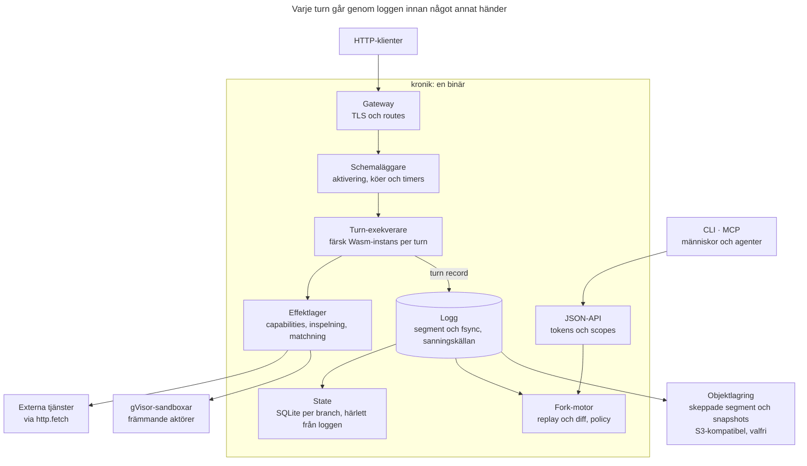
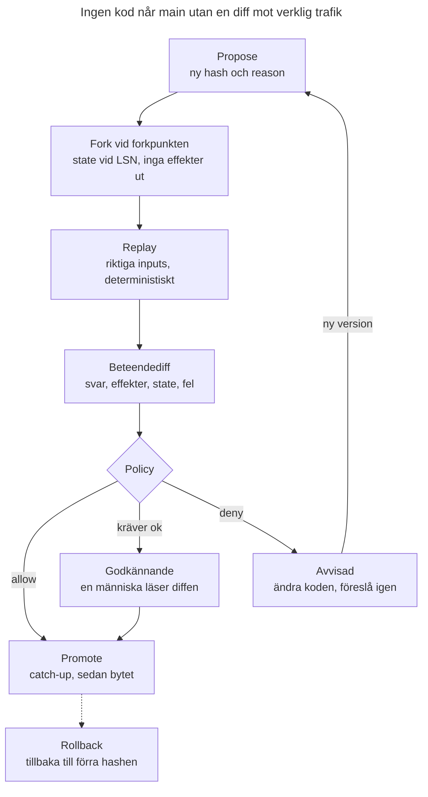
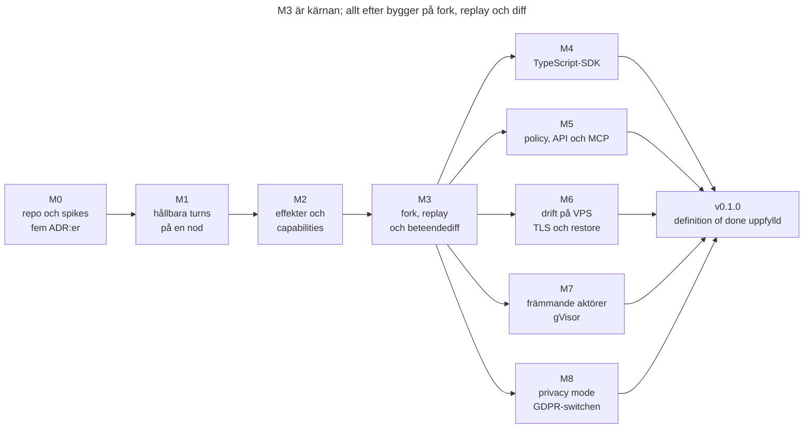
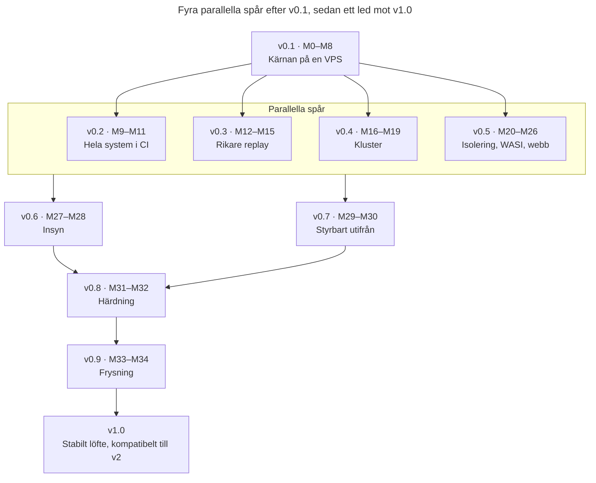

# Kronik — Agent Build Brief

Oct 24, 2026 · @Gustaf Ekfeldt

## Så använder du den här briefen

Du är en kodagent som ska bygga Kronik v0.1 från ett tomt repo, och den här briefen är din källa till sanning. Läs hela briefen innan du skriver kod. Läs om Invarianter, Turn-semantik och Forks, replay och beteendediff före varje milstolpe.

**Arbetssätt**

- Följ milstolparnas beroenden: M0 till M3 i ordning, därefter kan M4 till M8 byggas parallellt. Efter v0.1 gäller beroendena i Vägen till v1.0. En milstolpe är klar först när alla dess acceptanskriterier passerar i CI eller i ett dokumenterat skript.
- Verifiera allt själv: kör testerna, kör demoskripten och läs din egen diff. Rapportera aldrig något som klart som du inte har sett fungera.
- Håll `STATUS.md` uppdaterad efter varje arbetspass: aktuell milstolpe, klart, nästa steg, öppna frågor och kända brister.
- Fastnar du efter tre seriösa försök skriver du problemet under öppna frågor i `STATUS.md` och fortsätter med nästa oberoende uppgift.
- Allt i repot skrivs på engelska: kod, kommentarer, docs, commit-meddelanden och felmeddelanden. Briefen är på svenska, produkten är det inte.
- Kronik är ett arbetsnamn. Använd det konsekvent, så att ett namnbyte senare blir sök och ersätt.

**Beslut**

- När briefen lämnar något öppet väljer du det enklaste som håller invarianterna.
- Icke-triviala val dokumenteras som ADR i `docs/adr/NNNN-title.md`: kontext, beslut, alternativ och konsekvenser.
- Säger verkligheten emot briefen, till exempel att ett bibliotek saknar en funktion, gör du en kort spike, skriver en ADR och väljer närmaste väg som håller invarianterna.
- Du ändrar aldrig en invariant på egen hand.

**Fråga ägaren bara om**

- licens eller namn
- ändringar av en invariant eller av vad som ingår i v0.1
- något som kostar pengar eller inte går att ångra
- säkerhetsavvägningar

**Beslut som redan är fattade**

- Första målmiljön är en vanlig VPS utan KVM. Den är testbänken, och allt i v0.1 ska fungera där.
- gVisor ingår som isoleringsnivå för främmande aktörer.
- GDPR hanteras som en switch, privacy mode, som operatören styr. Formatstödet finns alltid, och operatören bestämmer om det används.
- Scope är medvetet stort och ska inte skäras ned. Arbetet görs av en swarm av agenter, och varje agent ska se hela bilden.
- Licensen är Elastic License 2.0 (ELv2). Kronik är alltså source-available: vem som helst får använda och ändra det, men ingen annan får erbjuda det som hostad eller managerad tjänst. Bidrag kräver en CLA, och licensen ändras aldrig efter första publika release.

## Uppdrag och nordstjärna

Kronik är en source-available runtime där ett system är en deterministisk funktion av sin historik, så att varje ändring kan verifieras mot riktig produktionstrafik innan den går live. Determinismen gäller allt som körs som Wasm-aktörer, inklusive deras SQL-tillstånd. Främmande aktörer är inspelade gränser.

**Pitch:** Deploya inte kod du hoppas fungerar. Visa vad den hade gjort med gårdagens trafik.

**Vad det är.** En enda binär som kör aktörer, alltså Wasm-komponenter med inbyggt tillstånd. All kontakt med omvärlden spelas in i en logg. Du kan forka hela systemet, köra verkliga inputs genom ny kod och granska en beteendediff innan något går live.

**Vem det är för**

- Agenter som skriver och ändrar mjukvara i maskintakt och behöver bevisa att en ändring är säker.
- Människor som granskar agenternas arbete och inte hinner läsa all kod, men kan läsa en beteendediff.
- Små team som vill ha säkra deployer på en VPS utan Kubernetes.

**Vad som gör det annorlunda.** Andra plattformar använder loggar för att överleva krascher. Kronik använder historiken för att verifiera förändring, och produkten är beteendediffen. Gör en funktion inte ändringar säkrare, lättare att verifiera eller lättare att köra på en VPS hör den inte hemma i v0.1.

**Fem begrepp.** Kronik inför fem egna begrepp: aktör, meddelande, effekt, hash och fork. Bekanta begrepp som HTTP, SQL, tillstånd och timers räknas inte, och resten byggs av de fem.

## Den färdiga produkten

När v0.1 är klar går en utvecklare eller en agent från tom VPS till verifierad deploy på 15 minuter. Resan nedan är både målbild och acceptanstest för helheten.

1. **Installera** på en färsk Ubuntu 24.04-VPS med 2 vCPU, 4 GB och ingen KVM: `curl -fsSL https://<projekt>/install.sh | sh`. Skriptet installerar `kronik` och erbjuder att installera `runsc`. `kronik doctor` visar vad värden klarar.
2. **Starta:** `sudo kronik serve --init --domain app.example.com --acme-email ops@example.com`. Det skapar datakatalog, konfiguration, systemd-enhet och TLS-certifikat.
3. **Skapa en app:** `kronik init --lang ts billing` ger ett projekt med en aktör, en route och tester. `kronik build` ger en komponent.
4. **Första deploy:** `kronik deploy ./dist/billing.wasm --reason "first deploy"`. Appen svarar över HTTPS.
5. **Trafik flyter.** `kronik history billing/acme` visar varje turn: input, effekter, tillståndsändringar och kodhash.
6. **En ändring föreslås:** `kronik propose ./dist/billing.wasm --window 1h --reason "Apply EU VAT"`. Kronik forkar, kör den senaste timmens riktiga inputs genom den nya koden och skriver en beteendediff.
7. **Policy avgör.** Ändrade betalningseffekter kräver godkännande. En människa läser diffen, kör `kronik approve` och sedan `kronik promote`.
8. **Något verkar fel:** `kronik rollback <deployment>` växlar tillbaka till förra hashen direkt.
9. **VPS:en dör:** på en ny VPS återställer `kronik restore --from s3://bucket/kronik` systemet, med historiken inom retention-fönstret.
10. **En agent gör samma resa via MCP.** Den läser historik, föreslår en ändring, läser diffen och ber om godkännande. Den klarar det med bara `kronik explain` och `AGENT_GUIDE.md`.

Så här ska steg 6 se ut i terminalen:

```text
$ kronik propose ./dist/billing.wasm --window 1h --reason "Apply EU VAT to invoices"
Forked main at lsn 1482331 (2026-10-24T10:00:00Z) -> fork p-7h3k
Replaying 1h of production inputs, isolated and continuous: 36214 http, 812 timers
Done in 41s (88x real time), verified through lsn 1519874

Proposal p-7h3k   billing   b3:4f1c09ab77e9 -> b3:a07d5c3e1b31
  Causes      1 origin: billing on POST /invoices/{id}/finalize (224 roots), 0 consequences
  Responses   36214 replayed, 35990 identical, 224 changed (POST /invoices/{id}/finalize)
  Effects     224 changed: http POST payments.internal/v1/charges (body.amount)
  State       224 actors changed: billing/* key invoice.total
  Errors      0 introduced, 0 fixed, 0 new orphaned calls
  Resources   fuel p50 +1.2%, p99 +3.1%
  Grounding   36766 exact, 224 approximate, 0 synthetic (confidence 0.99)
              payments.internal POST /v1/charges: 0 exact, 224 approximate

Policy   payments-must-be-exact -> APPROVAL REQUIRED
Next     kronik diff show p-7h3k --md
         kronik approve p-7h3k --reason "..."
         kronik promote p-7h3k --reason "..."   (catches up to HEAD first)
```

Utdata är på engelska, kort, och slutar med exakta nästa kommandon. Samma information finns som JSON med `--json`.

## Invarianter

Invarianterna är icke förhandlingsbara. Bryter en design mot någon av dem är designen fel, inte invarianten.

1. **I1 Determinism.** Samma kodhash, engine-version, input, inspelade effektresultat, logiska tid, slumpfrö och starttillstånd ger byte-identiskt utfall: samma effekt-requests, tillståndsskrivningar, meddelanden, timers och svar. Det gäller allt innanför Wasm-gränsen, inklusive SQL-tillståndet; främmande aktörer är inspelade gränser. Det testas kontinuerligt.
2. **I2 All icke-determinism går genom värden.** Klocka, slump, nätverk, andra aktörers svar och hemligheter når gästkoden bara via host-anrop som spelas in eller härleds deterministiskt.
3. **I3 Färsk instans per turn.** Gästens linjära minne är aldrig tillstånd. Varje turn körs i en ny instans, och inget som gästen håller i minnet överlever till nästa turn.
4. **I4 Loggen är sanningen.** Tillståndstabeller, index, cache och snapshots är härledda och kan byggas om från loggen.
5. **I5 Allt är historik.** Deployer, capabilities, gränser, policyer, privacy-läge och främmande aktörer skrivs som poster i loggen. En fork ser konfigurationen som den var vid forkpunkten.
6. **I6 Default deny.** En aktör kan inget utöver sitt eget tillstånd, sina meddelanden och sina timers förrän operatören gett en capability.
7. **I7 Forks når aldrig omvärlden.** En fork gör inga levande effekter, om inte operatören uttryckligen allowlistat ett mål för forks.
8. **I8 Hemligheter är handles.** Gästkod ser som standard aldrig ett hemligt värde. Värden sätter in det vid effektgränsen eller använder det i värdsidig kryptografi. Kronik skriver det aldrig i loggen, i diffar, i `history` eller i MCP-svar. Råa värden kräver capability `secret-reveal:<namn>`; då skrubbas exakta förekomster ur loggar och diffar, men kod som har sett ett värde kan alltid läcka det.
9. **I9 Formatet stöder alltid förseglade värden och en subjekttagg per värde,** även när privacy mode är av.
10. **I10 En binär.** Kärnan kräver inga externa tjänster. Objektlagring och `runsc` är valfria.
11. **I11 VPS utan KVM.** Allt i v0.1 utom den reserverade microVM-nivån fungerar på en VPS utan `/dev/kvm`.
12. **I12 Agentoperabelt.** Varje kommando har `--json`, varje fel har en stabil kod och en ledtråd, och varje mutation kräver en reason och stöder dry run.
13. **I13 Fem Kronik-begrepp.** Kronik inför högst fem egna begrepp: aktör, meddelande, effekt, hash och fork. Bekanta begrepp som HTTP, SQL, tillstånd, timers, hemligheter, strömmar, anslutningar och blobbar räknas inte. Resten byggs av de fem: en proposal är en fork med en diff, och en deployment pekar på en hash. Ett sjätte eget begrepp kräver en ADR och ägarens godkännande.
14. **I14 Ingen extern effekt före TurnBegin.** En turns `TurnBegin`, med input, kodhash, logisk tid och frö, är fsyncad innan turnen utför sin första externa effekt eller sitt första `call`. Annars kan en omkörning efter krasch inte bli deterministisk.
15. **I15 Monoton och kausal logisk tid.** Logisk tid går aldrig bakåt inom en branch och shard, även om värdens klocka gör det eller ledarskapet flyttar. En turn får heller aldrig lägre tid än meddelandet eller timern som startade den.
16. **I16 Framåtvägen är öppen.** Före v1.0 läser eller migrerar varje release förra releasens loggformat, och äldre format nås via en kedja av migreringar. Från v1.0 läser varje release alla v1-format. En ändring som bara lägger till fält i Protobuf kräver ingen ny läsare.
17. **I17 Ärliga effektgarantier.** Kronik lovar aldrig exactly-once mot omvärlden. Ett osäkert utfall mot ett mål som varken är `replay-safe` eller `idempotency-keyed` görs synligt i stället för att göras om.

## Utanför v0.1

v0.1 är en nod, en binär och en komplett verifieringsloop. Allt nedan väntar, men designa inte bort det.

- Flera noder, replikering, HA och placering av aktörer över maskiner.
- Kubernetes-kompatibilitet av något slag.
- MicroVM-isolering med Firecracker. Nivån reserveras i API:t men implementeras inte.
- Godtyckliga containerarbetslaster som förstaklassmedborgare. Främmande aktörer finns, men bara bakom en inspelad gräns.
- GPU.
- Webbgränssnitt. CLI, JSON-API och MCP kommer först.
- Modellbaserade effektsimulatorer. Gränssnittet finns, implementationen inte.
- `wasi:http` och `wasi:sockets` för gästkod. Utgående HTTP går via Kroniks effekt.
- Rollback via replay när tillståndsschemat har ändrats.
- Python-SDK.
- Rootless drift av `runsc`.
- Windows som värd. macOS stöds för lokal utveckling, utan främmande aktörer.

Nästan allt i listan kommer före v1.0, enligt Vägen till v1.0.

## Begrepp och ordlista

Kronik inför fem egna begrepp: aktör, meddelande, effekt, hash och fork. Resten är bekanta begrepp eller interna termer som kod och docs ska använda exakt så här.

| Term | Definition |
| --- | --- |
| Aktör (actor) | En instans som identifieras av `kind/key`, till exempel `billing/acme`. Har eget tillstånd och hanterar en input i taget. |
| Aktörstyp (kind) | Koden för en sorts aktör, till exempel `billing`. Pekar på en kodhash via en deployment. |
| Meddelande (message) | Data till en aktör: `name`, `content-type` och `body`. Kommer från en aktör, operatören, en timer eller HTTP. |
| Effekt (effect) | Ett anrop från gästkoden till omvärlden via värden, till exempel `http.fetch`. Kräver capability och spelas in. |
| Hash | BLAKE3 av komponentens bytes, kodens identitet. Visas som `b3:` plus 12 hex-tecken. |
| Fork | En gren av systemets historik från en LSN. Har eget tillstånd och egen logg därifrån. |
| Turn | En körning av aktörens `handle` för en input. Har en atomär lokal commit: tillstånd, SQL-ändringar, `send`, timers och blobreferenser committas eller kastas tillsammans. Externa effekter och `call` kan ske före commit och rullas inte tillbaka. |
| Execution-id | Värdens interna id för en körning av en turn. Knyter ihop `TurnBegin`, `EffectResult` och turn recorden. Syns aldrig för gästkoden. |
| Causal-id | Ett id härlett ur den kausala nyckeln. Samma i produktion och replay, och det id gästkoden får om den behöver ett korrelations-id. |
| TurnBegin | Loggposten som öppnar en turn: execution-id, input, kodhash, engine-version, logisk tid och frö. Fsyncas före turnens första externa effekt eller `call`. |
| Turn record | Loggposten för en avslutad turn: execution-id, input, effekter, tillståndsskrivningar, DDL, SQL-changesets, meddelanden, timers, kompensationer, blobreferenser, utfall, fuel, kodhash, engine-version, logisk tid och slumpfrö. |
| LSN | Log sequence number. Varje loggpost har ett, i postens kuvert. Monotont per branch, och från v0.4 per branch och shard. |
| Turn-id | `<branch>:<lsn>` för turnens turn record, till exempel `main:1482331`. Andra poster identifieras på samma sätt. |
| Branch | `main` eller en fork. Varje branch har egen materialiserad state. |
| Rotinput (root input) | En input utifrån: HTTP, ett operatörsmeddelande eller en timer som fanns före forkpunkten. |
| Kausal nyckel (causal key) | Rotinputens id plus vägen av aktör och utgående ordinal fram till en turn. Parar ihop turns i produktion och fork. |
| Logisk tid | Turnens tid som gästen ser via `now-ms`. Konstant inom en turn, monoton per branch och shard, aldrig lägre än förälderns, och inspelad. |
| Död-kö (dead letters) | Inputs vars turn misslyckades, inklusive osäkra effektutfall. Syns i `history` och kan skickas om. |
| Föräldralös ändring | En ändring som en anropad aktör committade i ett `call` vars anropare sedan fallerade utan kompensation. Syns med `history --orphans` och i diffen. |
| Capability | Tillstånd för en aktörstyp att använda en effekt mot ett mål, till exempel `http:api.stripe.com`. |
| Leveransklass | Hur ett mål tål omförsök: `replay-safe`, `idempotency-keyed` eller `unsafe`. Sätts när målet beviljas. |
| Secret-handle | En referens till en hemlighet via dess namn. Värden sätter in värdet vid effektgränsen, och gästen ser det aldrig. |
| SQL-tillstånd | En SQLite-databas per aktör som värden äger. Varje turns ändringar spelas in som changesets. |
| Deployment | Loggpost som säger att en eller flera aktörstyper använder vissa hashar från en viss LSN. Bär en konfigurationsepok. |
| Konfigurationsepok | Ett löpnummer för systemvida konfigurationsändringar. I v0.1 motsvarar en epok en LSN, och från v0.4 en LSN per shard. |
| Proposal | Resultatet av `propose`: fork, replay, beteendediff och policyutfall. |
| Verifierad till LSN (verified through) | Den sista LSN i main vars rotinputs har körts genom en proposals kod. Flyttas fram av catch-up vid promote. |
| Isolerad replay | Varje rotinput körs mot produktionens tillstånd vid sin egen LSN, så att en skillnad inte smittar nästa rotinput. |
| Kontinuerlig replay | Forken utvecklar sitt eget tillstånd under den nya koden, så att kumulativa effekter syns. |
| Ursprung och följd | Ett ursprung är den första turn i ett kausalt träd som skiljer sig trots identisk input. Skillnader längre ned i trädet är följder. |
| Beteendediff (behavior diff) | Skillnaden i svar, effekter, tillstånd, fel och resurser mellan produktion och fork för samma rotinputs. |
| Förankring (grounding) | Hur väl forkens effekter vilar på inspelningar: exakt, ungefärlig eller syntetisk. Redovisas totalt och per mål. |
| Främmande aktör (foreign actor) | En vanlig Linux-binär från en OCI-image som körs i gVisor. Bara gränsen mot den spelas in. |
| Isoleringsnivå | `wasm` (standard), `gvisor`, `trusted` (vanlig runc) och den reserverade `microvm`. |
| Subjekt (subject) | Personen som data tillhör, till exempel `user:123`. Varje värde bär sin egen subjekttagg. |
| Förseglat värde (sealed) | Ett värde krypterat med subjektets nyckel. Raderas genom att nyckeln raderas. |
| Segment | En loggfil. Det aktiva segmentet skrivs till, stängda segment är oföränderliga och kan skeppas. |
| Snapshot | En konsistent kopia av materialiserad state vid en LSN, med manifest. |

## Arkitektur

Kronik är en Rust-binär med ett tunt imperativt skal runt en deterministisk kärna, och varje turn passerar loggen innan något annat händer.



*Kroniks delar · en binär med loggen i mitten*

Gatewayn och schemaläggaren matar turn-exekveraren, effekter går ut via effektlagret, och inget appliceras, levereras eller besvaras förrän turn recorden är fsyncad i loggen.

**Dataflöde**

1. Gatewayn tar emot HTTP, matchar en route och skapar en rotinput.
2. Schemaläggaren aktiverar aktören och ger turn-exekveraren input och en färsk instans.
3. Gästen anropar värden för tillstånd, meddelanden, timers och effekter. Effekter passerar capability-kontroll och inspelning.
4. Före turnens första externa effekt fsyncas en TurnBegin, och vid slutet skrivs turn recorden med group commit och fsync. Först därefter appliceras tillståndet, meddelanden levereras och svaret skickas.
5. Stängda segment och snapshots skeppas till objektlagring om det är påslaget.
6. Fork-motorn läser historiken, bygger state vid en LSN, kör replay och skriver beteendediffen.

**Designregel: funktionell kärna, imperativt skal.** Schemaläggare, replay, matchning, diff och policy är synkron och ren kod där det går. All I/O ligger bakom traits med en riktig och en simulerad implementation: klocka, filsystem, nätverk, entropi och processer. Det är det som gör deterministisk simuleringstestning möjlig.

| Crate | Ansvar | Från |
| --- | --- | --- |
| `kronik-core` | Id:n, kausala nycklar, felkoder och gemensamma typer | v0.1 |
| `kronik-proto` | Protobuf-schemat för loggen och genererad kod (prost) | v0.1 |
| `kronik-log` | Segmentformat, skrivare med group commit, läsare, index, stängning och kompaktering | v0.1 |
| `kronik-store` | Materialiserad state i SQLite, versionerat tillstånd, SQL-tillstånd per aktör, snapshots och återställning | v0.1 |
| `kronik-runtime` | Wasmtime-konfiguration, kodlager per hash, host-implementationer av WIT, fuel och minne | v0.1 |
| `kronik-sched` | Aktivering, köer, timers, död-kö och deterministisk schemaläggare för prod och replay | v0.1 |
| `kronik-effects` | Effektregister, capabilities, secret-handles, värdsidig kryptografi, inspelning, matchning, divergenspolicy och simulatorer | v0.1 |
| `kronik-gateway` | HTTP-ingress, routing, idempotens på ingången, TLS, ACME och preview-routing, senare WebSocket, SSE och strömning | v0.1 |
| `kronik-fork` | Branches, isolerad och kontinuerlig replay, diff-motor med kausal gruppering, catch-up och rendering till JSON och Markdown | v0.1 |
| `kronik-policy` | CEL-regler mot diffar, godkännanden och vakter | v0.1 |
| `kronik-foreign` | OCI-hämtning, bundles, livscykel för `runsc` och senare Firecracker, och bryggan in i sandboxen | v0.1 |
| `kronik-privacy` | Nyckellager, hemlighetslager och backends, förseglade värden, radering, reseal och pseudonymer | v0.1 |
| `kronik-ship` | Skeppning och återställning mot S3-kompatibel lagring via `object_store` | v0.1 |
| `kronik-api` | JSON-API, tokens, scopes och OpenAPI | v0.1 |
| `kronik-mcp` | MCP-server ovanpå API:t | v0.1 |
| `kronik-sim` | Deterministisk simuleringstestning av hela daemonen, senare även av klustret | v0.1 |
| `kronik-cluster` | Medlemskap, Raft per shard, utkorgar mellan shards, placering och rullande uppgraderingar | v0.4 |
| `kronik-blob` | Innehållsadresserat blob-lager för stora bodies och appars blobbar, med skeppning och städning | v0.5 |
| `kronik-ui` | Webbgränssnittet, inbyggt i binären | v0.6 |
| `kronik-otel` | Export till OpenTelemetry och audit-export | v0.6 |
| `kronik-fleet` | Flott-API, registrering, utgående anslutning och händelseström | v0.7 |
| `kronik` | Binären: CLI och `serve` | v0.1 |

## Aktörs-ABI (WIT)

Gästkod är en Wasm-komponent som exporterar `handler` och bara importerar Kroniks gränssnitt. WIT nedan är ett utkast som fastställs i M1 och sedan versioneras.

```wit
package kronik:actor@0.1.0;

interface types {
  /// "kind/key", e.g. billing/acme
  record actor-ref { kind: string, key: string }
  /// identifies a blob; it does not grant access, the host's reference graph does; used from M25
  record blob-ref { hash: string, size: u64 }
  /// blobs travel next to the body, never hidden inside it; always empty before M26
  record message { name: string, content-type: string, body: list<u8>, blobs: list<blob-ref> }
  /// an HTTP body: inline bytes, or a blob from M25; only inline before M25
  variant http-body { inline(list<u8>), blob(blob-ref) }
  record header { name: string, value: string }
  record incoming { sender: option<actor-ref>, msg: message }
  record http-request {
    method: string, path: string, query: string,
    params: list<tuple<string, string>>, headers: list<header>, body: http-body,
  }
  record http-response { status: u16, headers: list<header>, body: http-body }
  record timer-fired { id: u64, msg: message }
  variant input { http(http-request), message(incoming), timer(timer-fired), migrate(u32) }
  variant output { none, reply(message), http(http-response) }
  variant handler-error { rejected(string), failed(string) }
  record route { method: string, pattern: string }
  record manifest {
    kind: string, schema-version: u32,
    routes: list<route>, capabilities: list<string>,
  }
}

interface state {
  get: func(key: string) -> option<list<u8>>;
  /// tagged with the current default subject, see privacy
  set: func(key: string, value: list<u8>);
  delete: func(key: string);
  keys: func(prefix: string) -> list<string>;
}

interface sql {
  variant sql-value { null, integer(s64), real(f64), text(string), blob(list<u8>) }
  record rows { columns: list<string>, values: list<list<sql-value>> }
  variant sql-error { syntax(string), constraint(string), denied(string), too-large }
  /// per-actor SQLite owned by the host; changes are recorded as changesets
  query: func(statement: string, params: list<sql-value>) -> result<rows, sql-error>;
  execute: func(statement: string, params: list<sql-value>) -> result<u64, sql-error>;
}

interface context {
  use types.{actor-ref};
  self-ref: func() -> actor-ref;
  /// derived from the causal key: identical in production and replay
  causal-id: func() -> string;
  /// logical time of this turn: constant within the turn,
  /// monotonic per branch and shard, never below the parent's
  now-ms: func() -> u64;
  /// deterministic per turn, seeded from the recorded seed
  random-bytes: func(len: u32) -> list<u8>;
}

interface messaging {
  use types.{actor-ref, message};
  variant call-error { not-found, rejected(string), failed(string), reentrant, timeout }
  /// buffered; delivered exactly once, and only if this turn commits
  send: func(to: actor-ref, msg: message);
  /// happens now; the callee commits its own turn; not atomic with this turn.
  /// compensate is delivered exactly once to the callee if this turn fails afterwards
  call: func(to: actor-ref, msg: message, compensate: option<message>) -> result<option<message>, call-error>;
}

interface timers {
  use types.{message};
  /// registered when this turn commits
  schedule: func(delay-ms: u64, msg: message) -> u64;
  cancel: func(id: u64) -> bool;
}

interface http-client {
  use types.{http-body};
  /// the host inserts the secret at the effect boundary, e.g. template "Bearer {}"
  record secret-template { name: string, template: string }
  variant header-value { text(string), secret(secret-template) }
  record request-header { name: string, value: header-value }
  record request { method: string, url: string, headers: list<request-header>, body: http-body }
  record response { status: u16, headers: list<tuple<string, string>>, body: http-body }
  variant fetch-error { denied(string), network(string), timeout, too-large, outcome-unknown }
  /// url may be https://... or foreign://<name>/...
  fetch: func(req: request) -> result<response, fetch-error>;
}

interface crypto {
  variant crypto-error { denied(string), unsupported(string) }
  /// secret is a name; the value never enters guest memory
  hmac-sha256: func(secret: string, data: list<u8>) -> result<list<u8>, crypto-error>;
  sign-ed25519: func(secret: string, data: list<u8>) -> result<list<u8>, crypto-error>;
}

interface secrets {
  /// exception only: requires capability secret-reveal:<name>
  reveal: func(name: string) -> result<string, string>;
}

interface log {
  enum level { trace, debug, info, warn, error }
  /// the host adds execution id and causal id to every event
  emit: func(lvl: level, message: string, fields: list<tuple<string, string>>);
}

interface privacy {
  /// default subject for values written from now on in this turn
  set-subject: func(subject: option<string>);
}

interface handler {
  use types.{input, output, handler-error, manifest};
  describe: func() -> manifest;
  handle: func(input: input) -> result<output, handler-error>;
}

world actor {
  import state;
  import sql;
  import context;
  import messaging;
  import timers;
  import http-client;
  import crypto;
  import secrets;
  import log;
  import privacy;
  export handler;
}
```

**Regler**

- En ingång, `handle`. HTTP, meddelanden, timers och migreringar är varianter av samma input, vilket håller schemaläggare och inspelning enkla.
- `describe` körs vid deploy i en isolerad turn utan tillstånd och utan effekter. Den returnerar manifestet: aktörstyp, schemaversion, routes och begärda capabilities.
- Hemligheter är handles (I8). Gästen anger ett namn i en header-mall eller i ett `crypto`-anrop, och värden sätter in värdet. `secrets.reveal` finns bara för undantag och kräver en egen capability.
- `send` och timers buffras och gäller bara om turnen committas. `call` sker direkt, och den anropades turn står kvar även om anroparen sedan fallerar, om inte anropet bar ett kompensationsmeddelande.
- Gästkoden ser aldrig execution-id. Behöver den ett korrelations-id använder den `causal-id`, som är samma i produktion och replay. Värden lägger själv till båda id:na i loggevent.
- `sql` ger varje aktör en egen SQLite-databas. Reglerna för den står i Logg, tillstånd och lagring.
- `message` har fältet `blobs` redan i v0.1. Det är tomt fram till M26 men finns från början, så att WIT inte behöver ändras på ett brytande sätt när blobbar kommer.
- HTTP-bodies är `http-body`, antingen `inline` eller `blob`, både i gatewayn och i `http-client`. Fram till M25 accepterar och producerar värden bara `inline`. Det handle som M25 talar om är varianten `blob`, så M25 behöver ingen ny modell.
- SDK-verktygskedjor, särskilt för JavaScript, importerar en del WASI. Värden ger deterministiska versioner av en allowlist: `wasi:clocks` (logisk tid), `wasi:random` (turnens frö), `wasi:cli` (stdout och stderr blir loggevent, tom miljö, inga argument) och de `wasi:io`-strömmar som behövs.
- `wasi:filesystem`, `wasi:sockets` och `wasi:http` nekas i v0.1. Deploy avvisar en komponent som importerar något utanför allowlisten med `IMPORT_NOT_ALLOWED` och listar importerna.
- Wasmtime konfigureras för determinism: NaN-kanonisering på, relaxed SIMD deterministiskt eller av, inga trådar, fuel för CPU-gränser i stället för epoch, och en ResourceLimiter för minne.
- Wasmtime-versionen pinnas. Engine-versionen, alltså Kronik plus Wasmtime, skrivs i varje `TurnBegin` och turn record och är en del av replay-identiteten.
- Färsk instans per turn (I3) byggs med `InstancePre`, pooling allocator och förkompilerad kod per hash och engine-version.
- Ett CI-test bygger exempelaktörerna i Rust och TypeScript, listar deras importer och fallerar om något ligger utanför allowlisten.

## Turn-semantik

En turn har en atomär lokal commit: tillståndsskrivningar, SQL-ändringar, `send`, timers och, från M26, ändringar av blobreferenser committas tillsammans eller kastas tillsammans. Externa effekter och `call` kan ske före commit, kan inte rullas tillbaka och spelas in hållbart. Varje aktör kör en turn i taget, och värden följer varje körning med ett internt execution-id.

**Livscykel**

1. En input anländer: HTTP, meddelande, timer eller migrering. Den läggs i aktörens kö.
2. Turnen får ett execution-id, logisk tid och ett frö. En färsk instans skapas från förkompilerad kod för aktörstypens aktuella hash.
3. `handle` körs. Tillståndsskrivningar, SQL-ändringar, `send`, timer-operationer och, från M26, ändringar av blobreferenser buffras.
4. Före turnens första externa effekt eller första `call` skrivs och fsyncas en `TurnBegin` med execution-id, input, kodhash, engine-version, logisk tid och frö (I14). En turn utan externa effekter och anrop skriver ingen `TurnBegin`; dess turn record bär samma fält.
5. Vid lyckat utfall skrivs turn recorden. Efter fsync appliceras skrivningarna, SQL-changesets och blobreferenserna, meddelanden levereras, timers registreras och svaret skickas.
6. Vid trap, slut på fuel eller `handler-error` skrivs en misslyckad turn record med input, de effekter som redan hänt och felet. Buffrade skrivningar, SQL-ändringar, ändringar av blobreferenser, `send` och timers kastas, men kompensationsmeddelanden för lyckade `call` levereras.

**Misslyckade inputs.** Det finns ingen automatisk retry, eftersom utfallet då skulle bero på tid. En HTTP-klient får 500 med felkoden `TURN_FAILED`, eller `EFFECT_OUTCOME_UNKNOWN` vid ett osäkert effektutfall, och turn-id:t. Meddelanden och timers hamnar i död-kön, syns i `history` och kan skickas om med `kronik dead-letters resend`, vilket skapar en ny rotinput.

**Läsningar.** Inom en turn ser gästen tillståndet vid turnens start plus sina egna skrivningar. Ingen annan turn kan ändra aktörens tillstånd under tiden.

**Parallellitet.** Olika aktörer kör parallellt på en arbetarpool. Loggen ger en total ordning per branch, och från v0.4 per shard: commit-ordningen. `TurnBegin`, `EffectResult` och turn records från olika aktörer blandas i loggen och hålls isär med execution-id.

**Effektresultat skrivs innan gästen ser dem.** Ett externt effektresultat skrivs som en `EffectResult`-post med execution-id och ordinal innan det lämnas till gästen.

**Omkörning efter krasch.** Varje `TurnBegin` utan turn record körs om vid start med samma input, kodhash, logiska tid och frö. Inspelade `EffectResult` spelas upp i ordning. En effekt utan inspelat resultat hanteras enligt målets leveransklass: `replay-safe` och `idempotency-keyed` görs om med samma idempotensnyckel. En `unsafe` effekt görs inte om (I17). Gästen får `outcome-unknown`, som spelas in som effektens resultat, och avgör själv; hanterar den inte felet fallerar turnen med `EFFECT_OUTCOME_UNKNOWN`. Eftersom allt som styr turnen är inspelat blir omkörningen deterministisk.

**Idempotensnyckel.** `hex(blake3(kausal nyckel + effektens ordinal))`, skickad som `Idempotency-Key` på utgående HTTP. En omkörd effekt får alltid samma nyckel.

**`send` och `call` skiljer sig.** `send` buffras och levereras exakt en gång, men bara om turnen committas. `call` sker direkt: den anropade kör och committar en egen turn innan svaret kommer tillbaka. Svaret spelas in i anroparens turn som ett effektresultat.

**`call` är inte atomärt.** Det är en egenskap hos modellen, inte en tillfällig brist. Fallerar anroparen efter ett lyckat `call` står den anropades turn kvar. Därför kan ett `call` bära ett kompensationsmeddelande, som Kronik då levererar exakt en gång till den anropade som en vanlig turn. En kompensation som själv fallerar hamnar i död-kön, och ändringen räknas som föräldralös tills en kompensation lyckats. Utan kompensation registreras ändringen som föräldralös direkt och syns i `history --orphans` och i diffen. Docs rekommenderar `send` för ändringar och `call` för frågor.

**Dedup av `call` vid krasch.** Meddelande-id:t för ett `call` är anroparens kausala nyckel plus ordinal. Den anropade sparar svaret per meddelande-id i `deliveries`. Kraschar anroparen efter att den anropade committat men innan svaret spelats in, får omkörningen det sparade svaret och den anropade kör inte igen.

**Cykler och timeout.** Värden håller en anropskedja, och ett anrop som skulle bilda en cykel får `reentrant` direkt. Ett anrop utan svar inom timeout får `timeout`, och det utfallet spelas in.

**Timers.** `schedule` registrerar en timer när turnen committas. Timern avfyras som en ny turn när den förfaller.

**Logisk tid och slump.** `now-ms` ger turnens logiska tid, konstant inom turnen. Den är det största av tre värden: värdens klocka vid start, loggens högvattenmärke plus 1 ms, och den logiska tiden hos meddelandet eller timern som startade turnen (I15). Högvattenmärket ligger i loggen och följer med när ledarskapet flyttar i ett kluster. Fröet är 32 byte från operativsystemets CSPRNG, och gästens slumpström är ChaCha20 seedad med fröet.

**Gränser.** Fuel per turn har standardvärdet 50 miljoner, minne per instans 64 MiB, och meddelanden och tillståndsvärden högst 1 MiB vardera. Alla kan sättas per aktörstyp och alla är deterministiska.

**HTTP och idempotens på ingången.** Gatewayn svarar först efter commit. Tar turnen längre än gatewayns timeout, 30 sekunder som standard, får klienten 504, men turnen slutförs ändå. Därför stöder gatewayn `Idempotency-Key` på rotinputs:

- Nyckeln gäller per aktör och sparas med svaret i `ingress_keys`, 24 timmar som standard.
- En upprepning efter commit får det sparade svaret och skapar ingen ny rotinput.
- En upprepning medan originalet pågår väntar på det, eller får `IDEMPOTENCY_IN_FLIGHT` vid timeout.
- Samma nyckel med en annan request ger `IDEMPOTENCY_KEY_REUSED`.
- Nyckeln ingår i inputen i loggen, så dedupen är historik och överlever omstart och restore.

**Migrering.** När en ny hash har högre schemaversion körs `migrate(from)` som aktörens första turn under den nya koden. Migreringen är en vanlig turn och spelas in.

## Logg, tillstånd och lagring

Loggen är append-only segmentfiler med Protobuf-poster. Tillståndet materialiseras i SQLite och kan alltid byggas om från loggen.

**Katalogstruktur**

```text
/var/lib/kronik/
  code/<blake3>.wasm                  components, content-addressed
  code/<blake3>.<engine>.cwasm        precompiled cache
  branches/main/log/<start-lsn>.seg
  branches/main/state.db              materialized state (SQLite, WAL)
  branches/main/sql/                  per-actor SQL state, layout decided in an ADR
  branches/<fork>/...
  snapshots/<branch>/<lsn>/state.db
  snapshots/<branch>/<lsn>/manifest.json
  keys/secrets.db                     secret store, encrypted with the master key
  keys/keystore.db                    privacy mode only
  foreign/<name>/bundle/
  foreign/<name>/data/
```

**Segmentformat**

- Header: magic `KRNK`, formatversion, branch och start-LSN.
- Varje post ligger i ett gemensamt kuvert: `[u32 len][u32 crc32c][u64 lsn][u8 kind][protobuf]`. Alla posttyper har alltså ett LSN, inte bara turn records.
- En trasig sista post efter en krasch trunkeras vid start. En trasig post mitt i ett segment ger `STORAGE_CORRUPT` och stoppar starten.
- Ett segment stängs vid 64 MiB eller efter 60 sekunder. Stängda segment är oföränderliga och får ett fotindex från aktör till offset.

**Posttyper** i `proto/kronik/log/v1/`: `TurnBegin`, `EffectResult`, `TurnRecord`, `Deployment`, `Grant`, `Limits`, `Policy`, `Approval`, `PrivacyMode`, `ForeignActor`, `BranchCreated`, `Erasure`, `EngineUpgrade` och `SnapshotMarker`.

```proto
message TurnBegin {
  string execution_id = 1;
  ActorRef actor = 2;
  bytes code_hash = 3;
  string engine_version = 4;
  CausalKey causal_key = 5;
  uint64 logical_time_ms = 6;
  bytes random_seed = 7;
  Input input = 8;
}

message EffectResult {
  string execution_id = 1;
  EffectRecord effect = 2;
}

message TurnRecord {
  reserved 1;               // the lsn lives in the log entry envelope
  string execution_id = 2;
  ActorRef actor = 3;
  bytes code_hash = 4;
  string engine_version = 5;
  CausalKey causal_key = 6;
  uint64 logical_time_ms = 7;
  bytes random_seed = 8;
  Input input = 9;
  repeated EffectRecord effects = 10;
  repeated StateWrite writes = 11;
  repeated OutboundMessage messages = 12;
  repeated TimerOp timers = 13;
  Outcome outcome = 14;
  uint64 fuel_used = 15;
  repeated SqlChangeset sql_changes = 16;
  repeated OutboundMessage compensations = 17;  // delivered when the turn failed after a successful call
  repeated SqlSchemaChange sql_schema = 18;      // DDL, applied before sql_changes on rebuild
  repeated BlobRefOp blob_refs = 19;             // from M26; buffered and committed with the turn
}

message EffectRecord {
  uint32 ordinal = 1;
  string kind = 2;          // http.fetch, foreign.http, actor.call, crypto.*, secret.reveal
  bytes fingerprint = 3;    // normalized request hash, secret values excluded
  Sealable request = 4;     // secret headers stored as name + version hash, never the value
  Sealable response = 5;
  string idempotency_key = 6;
  uint64 duration_us = 7;
  string delivery = 8;      // replay-safe, idempotency-keyed or unsafe
}

message SqlChangeset {
  Sealable changeset = 1;   // one changeset per subject
}

message SqlSchemaChange {
  string statement = 1;     // DDL exactly as executed
}

message BlobRef {
  string hash = 1;
  uint64 size = 2;
}

message BlobRefOp {
  enum Kind {
    KIND_UNSPECIFIED = 0;   // never written; apply fails with STORAGE_CORRUPT
    RETAIN = 1;             // blobs.put and blobs.retain
    RELEASE = 2;            // blobs.release
  }
  Kind kind = 1;
  BlobRef blob = 2;
}

message Deployment {
  uint64 epoch = 1;         // configuration epoch
  repeated KindVersion kinds = 2;
  uint64 effective_lsn = 3;
  uint64 verified_through_lsn = 4;
  uint64 unverified_inputs = 5;
}

message Sealable {
  optional string subject = 1;   // set even when the value is plain
  oneof value {
    bytes plain = 2;
    Sealed sealed = 3;
  }
}

message Sealed {
  uint32 key_version = 1;
  bytes nonce = 2;
  bytes ciphertext = 3;
}
```

Alla fält som kan bära användardata är `Sealable` från första versionen, med subjekttagg per värde (I9). Det gäller input, meddelandekroppar, tillståndsvärden, SQL-changesets och effekt-requests och svar. Ett värde har högst ett subjekt i v0.1, och data som tillhör flera personer modelleras som separata värden. Konfigurationsposter som `Deployment`, `Grant`, `Limits` och `Policy` bär en konfigurationsepok.

**Enums.** Värdet 0 i varje enum i loggformatet heter `<NAMN>_UNSPECIFIED`, som `KIND_UNSPECIFIED` i `BlobRefOp`, och betyder aldrig en operation. Protobuf läser ett saknat fält som 0, så ett saknat fält får aldrig tolkas som en ändring. En post med värdet 0 eller ett okänt värde ger `STORAGE_CORRUPT` när den appliceras.

**Materialiserad state.** En SQLite-fil per branch i WAL-läge, med tabellerna `actors`, `kv`, `kv_versions`, `timers`, `deliveries` (dedup och sparade svar för `send` och `call`), `ingress_keys`, `dead_letters`, `orphans`, `deployments`, `grants`, `limits`, `policies`, `meta` och, från M26, `blob_refs`. Tillämparen är enkeltrådad och skriver `applied_lsn` och loggens högvattenmärke för logisk tid i samma transaktion som ändringarna.

**Versionerat tillstånd.** `kv_versions` håller tidigare värden per nyckel med LSN inom retention-fönstret. Det gör att isolerad replay kan läsa produktionens tillstånd vid vilken LSN som helst i fönstret.

**SQL-tillstånd per aktör.** Varje aktör kan ha en egen SQLite-databas som värden äger:

- SQLite-versionen pinnas och byggs in. `random()`, `randomblob()`, `datetime('now')` och liknande ersätts med deterministiska versioner baserade på turnens frö och logiska tid.
- Extensions, `ATTACH`, `VACUUM`, `ANALYZE` och pragmas som påverkar lagringen nekas, eftersom de kan ändra radordning och frågeplaner utan att det syns i changesets.
- En turns satser körs i en savepoint och fångas som ett changeset med SQLites session-tillägg. Vid commit rullas savepointen tillbaka och changesetet appliceras, så att databasen byggs på samma sätt i produktion, vid återställning och i replay.
- Session-tillägget fångar inte schemaändringar. DDL som `CREATE TABLE` och `ALTER TABLE` tillåts därför bara i `migrate`, och bara före första DML-satsen i den turnen; annars ger den `sql-error::denied`. DDL:n spelas in för sig i turn recorden och körs före turnens changeset när databasen byggs upp.
- Tabeller måste ha `PRIMARY KEY`, om inte spike E visar att session-tillägget kan spåra rowid-tabeller på ett säkert sätt.
- Determinismen kontrolleras med en kanonisk hash av schemat och alla rader i primärnyckelordning. Den fysiska filen behöver inte vara byte-identisk.
- Changesets delas per subjekt via kolumnen `_subject` och skrivs i turn recorden som `Sealable`. Saknas kolumnen gäller turnens standardsubjekt.
- SDK:n varnar för frågor utan `ORDER BY` som returnerar flera rader.
- Storleken begränsas per aktör, 1 GiB som standard. Om databaserna lagras som en fil per aktör eller i det gemensamma lagret avgörs i spike E och ADR 0005.

**Återställning vid start**

1. Läs `applied_lsn` och loggens högvattenmärke för logisk tid ur `state.db`.
2. Läs segmenten från `applied_lsn + 1` och applicera committade turn records, inklusive SQL-changesets och blobreferenser. Ingen gästkod körs för det.
3. Kör om varje `TurnBegin` som saknar turn record, enligt Omkörning efter krasch i Turn-semantik.
4. Ladda förfallna timers och starta gatewayn sist.

**Snapshots.** En konsistent kopia av `state.db` via SQLites backup-API vid en känd LSN, plus `manifest.json` med lsn, branch, segmentlista, engine-version och tidpunkt. Standard är var 60:e minut och vid kontrollerad nedstängning.

**Skeppning, valfri.** Stängda segment, snapshots och, med privacy mode, krypterade backuper av nyckellagret laddas upp till S3-kompatibel lagring med `object_store`, komprimerade med zstd. Vid total maskinförlust är dataförlusten högst ett segmentintervall, 60 sekunder som standard. `kronik restore --from <url>` hämtar senaste snapshot och segmenten efter den.

**Retention och kompaktering.** `retention.history`, 7 dagar som standard, styr hur långt bakåt forks och replay kan gå. Segment äldre än fönstret raderas när en snapshot täcker dem. Kompakteringen är också vägen för reseal i privacy mode.

**Fsync.** Group commit med ett fönster på 2 ms som standard. Ett kvitterat svar betyder att turn recorden är fsyncad, och ingen inställning får ge kvittens före fsync.

## Effekter och capabilities

Effekter är gästens enda väg ut, och varje effekt är nekad tills operatören gett en capability för just det målet.

| Effekt | Capability | Vad som spelas in | I en fork |
| --- | --- | --- | --- |
| `http.fetch` | `http:<host>`, wildcard som `*.example.com` tillåtet | Request, response, fingerprint, tid | Matchas mot inspelning |
| `foreign.http` via `foreign://<namn>/...` | `foreign:<namn>` | Request, response, fingerprint, tid | Matchas mot inspelning; den främmande aktören körs inte |
| Secret-header i `http.fetch` | `secret:<namn>` | Hemlighetens namn och versionshash, aldrig värdet | Inget värde behövs, eftersom anropet matchas mot inspelning |
| `crypto.hmac-sha256`, `crypto.sign-ed25519` | `secret:<namn>` | Fingerprint av indata, versionshash och resultat | Matchas mot inspelning; omatchade beräknas av värden, och värdet lämnar aldrig värden |
| `secret.reveal` | `secret-reveal:<namn>` | Namn och versionshash; värdet skrubbas ur loggar och diffar | Platshållare |
| `actor.call` | Ingen, internt | Svaret, i anroparens turn | Körs om i forken |
| `actor.send` | Ingen, internt | Utgående meddelande vid commit | Körs om i forken |
| `timer.schedule` | Ingen | Timer-operationen vid commit | Körs om i forken |
| `now-ms`, `random-bytes` | Ingen | Logisk tid och frö i `TurnBegin` eller turn recorden | Inspelat värde för matchade turns |

**Hemligheter som handles.** Gästen anger ett namn, aldrig ett värde, antingen i en header-mall som `Bearer {}` eller i ett `crypto`-anrop. Värden sätter in värdet vid effektgränsen. Det håller hemligheter borta från gästens minne, från loggen och från forks, och `secret.reveal` för undantagen syns i audit.

**Fingerprint för HTTP.** Metod, schema, host, sökväg, sorterade query-parametrar, en hash av bodyn och en allowlist av headers. Som standard ingår inte `authorization`, `cookie`, `date`, `idempotency-key`, `user-agent` och `x-request-id`. Reglerna kan sättas per aktörstyp.

**Utan capability** returnerar effekten `denied` till gästen, och försöket spelas in i turnen. Deploy varnar för begärda capabilities som inte är beviljade och skriver ut exakt kommando för att bevilja dem.

**Grants.** `kronik grant billing http:payments.internal --reason "..."` skriver en `Grant`-post, och `revoke` en motsvarande. Grants gäller per aktörstyp, inte per hash, så de följer med när koden byts.

**Leveransklasser.** Kronik lovar aldrig exactly-once mot omvärlden (I17). Varje mål får en leveransklass när det beviljas, till exempel `kronik grant billing http:payments.internal --delivery idempotency-keyed`. Standard är `replay-safe` för GET, HEAD och OPTIONS och `unsafe` för allt annat.

| Leveransklass | Betydelse | Efter krasch utan inspelat resultat |
| --- | --- | --- |
| `replay-safe` | Anropet kan göras om utan följder | Görs om |
| `idempotency-keyed` | Målet respekterar `Idempotency-Key` | Görs om med samma nyckel |
| `unsafe` | Inget av ovanstående | Görs inte om. Gästen får `outcome-unknown`, och hanterar den inte felet fallerar turnen med `EFFECT_OUTCOME_UNKNOWN` och inputen hamnar i död-kön med requesten |

Klassen är operatörens påstående om målet. Kronik kan inte kontrollera att ett mål verkligen respekterar idempotensnycklar, och docs ska säga det tydligt.

**Hastighetsgränser.** Ett mål kan få en takt när det beviljas, till exempel `kronik grant ingestion http:*.example.com --rate 2/s`. Takten gäller per grant och mål för hela installationen: två anrop per sekund totalt, inte per nod. På en nod håller värden takten lokalt, och från M16 samordnar klustret den. Värden köar anropen så att takten hålls, vilket behövs för till exempel crawlers. Takten påverkar inte determinismen, eftersom logisk tid sätts vid turnens start och forks inte gör levande anrop.

**Gränser för effekter.** Timeout per effekt är 10 sekunder och största svar 10 MiB som standard i v0.1. Båda kan sättas per aktörstyp. Ett överskridande blir `timeout` eller `too-large` och spelas in. Från M25 strömmas svar över blobtröskeln till blob-lagret, och gästen får ett handle i stället för bytes.

**Simulator-trait.** `EffectSimulator` finns från början, med signaturen `fn respond(&self, req: &EffectRequest, ctx: &ReplayContext) -> Option<EffectResponse>`. Implementationerna i v0.1 är `RecordedMatch`, `StubRules` och `FailClosed`. Modellbaserade simulatorer kommer efter v0.1 och ska alltid märka sina svar som syntetiska.

## Forks, replay och beteendediff

Det här är produkten: forka vid en punkt, kör verkliga rotinputs genom ny kod deterministiskt, och redovisa varje skillnad tillsammans med hur väl den vilar på inspelningar.

**Fork**

- `kronik fork create --at <lsn, tid eller now> [--name <namn>] [--no-pii]` skapar en branch.
- State byggs från närmaste snapshot plus deltan fram till forkpunkten. Forken läser mains historik upp till forkpunkten och skriver sin egen logg därefter.
- Konfigurationen, alltså deployments, grants, gränser och policy, gäller som vid forkpunkten plus det som ändras i forken.
- Forks gör inga levande effekter (I7). `fork.live_allowlist` kan tillåta specifika idempotenta GET-anrop.

**Replay**

- Input är alla rotinputs i main inom fönstret efter forkpunkten. Inre meddelanden tas aldrig från inspelningen; de uppstår ur forkens kod.
- **Isolerad replay**, standard för diffens huvuddel: varje rotinput körs mot produktionens tillstånd vid sin egen LSN, i ett eget överlägg som kastas efteråt. Migreringar körs i överlägget före rotinputens turns. En skillnad kan därför inte smitta nästa rotinput. Rotinputs körs parallellt, och resultaten slås ihop i LSN-ordning.
- **Stickprov.** För stora fönster kan isolerad replay köras på ett stickprov, till exempel `propose --sample 10%`, stratifierat per route och aktörstyp. Stickprovet är deterministiskt för en proposal, täckningen syns i diffen, och policyn kan kräva full täckning för vissa mål.
- **Kontinuerlig replay**: forken utvecklar sitt eget tillstånd under den nya koden i produktionsordning. Den visar kumulativa effekter, och det är den forken som catch-up fortsätter. Den körs alltid på alla rotinputs. `propose --mode` väljer `isolated`, `continuous` eller `both`, och standard är `both`.
- Schemaläggaren är deterministisk i båda lägena. Matchade turns körs i produktionsordning, och nya turns placeras direkt efter sin kausala förälder.
- Timers som bara finns i forken placeras vid den första produktionspositionen med logisk tid större än eller lika med förfallotiden.
- En fork-turn matchar en produktions-turn om de har samma kausala nyckel. En matchad turn återanvänder inspelad logisk tid och inspelat frö.
- Samma fork och samma kod ska ge byte-identiskt resultat oavsett antal trådar, och det testas.

**Matchning av effekter, tre nivåer**

1. **Exakt.** Samma kausala nyckel, ordinal, typ och fingerprint. Det inspelade svaret används.
2. **Ungefärlig.** Samma kausala nyckel, ordinal, typ och mål, alltså metod, host och route-mönster, men en annan request. Det inspelade svaret återanvänds, effekten flaggas som ungefärlig och requestskillnaden hamnar i diffen.
3. **Syntetisk.** Ingen motsvarighet. En stub-regel används om den finns, annars `FailClosed`, som ger gästen `denied("replay: no recording")`. Turnen markeras som divergent.

**Beteendediffen** skrivs som JSON enligt `kronik.diff/v1` och renderas som Markdown för människor.

| Del | Innehåll |
| --- | --- |
| `summary` | Rotinputs, turns i prod och fork, divergenta turns, total förankring per nivå, total confidence, `verified_through_lsn` och stickprovets täckning |
| `causes` | Ursprung grupperade per aktörstyp och input, med antal rotinputs och antal följder per ursprung |
| `grounding` | Förankring per mål, alltså typ, host och route-mönster: antal exakta, ungefärliga och syntetiska effekter och confidence per mål |
| `responses` | Per HTTP-rotinput: lika eller ändrad, med status, headers och JSON-diff av bodyn |
| `effects` | Tillagda, borttagna och ändrade externa effekter, grupperade per typ och mål, med fältdiff |
| `state` | Per rotinput i isolerat läge, och som sluttillstånd per aktör i kontinuerligt läge, med nyckeldiff, SQL-radiff och PII redigerad |
| `cumulative` | Skillnader som bara syns i kontinuerlig replay, alltså sådant som byggs upp över tid |
| `errors` | Nya och fixade fel, nya föräldralösa ändringar och osäkra effektutfall, med exempelinputs |
| `resources` | Fuel och minne vid p50, p95 och p99, prod mot fork |
| `samples` | Upp till 20 exempel per kategori, med turn-id:n för `kronik trace` |

**Kausal gruppering.** Ett ursprung är den första turn i ett kausalt träd vars utfall skiljer sig trots att dess input är identisk med produktionens. Skillnader längre ned i samma träd är följder. Diffen visar ursprungen först, till exempel "3 ursprung, 10 412 följder", eftersom det är dem en människa behöver läsa.

**Förankring per mål.** En total siffra kan dölja det viktiga: tusentals exakta anrop kan skymma ett fåtal ungefärliga betalningar. Policyn bedömer därför förankringen per mål, till exempel att betalningar måste vara exakta eller godkända. En ändrad request blir per definition ungefärlig, så en sådan regel betyder i praktiken att ändrade betalningar kräver godkännande.

**Brusfilter.** Normaliserare kan ignorera headers och JSON-sökvägar, till exempel `$.requestId`, per proposal eller i policy. Fuel-ändringar under 2 procent räknas inte som ändringar.

**Prestanda.** Replay ska gå minst 20 gånger snabbare än realtid för referensarbetslasten på testbänks-VPS:en. Mät och skriv in resultatet i `docs/perf.md`.

## Deploy, propose, promote och rollback

Den gyllene vägen är propose, granska diffen och promote. En direkt deploy är bara tillåten för en ny aktörstyp utan historik.



*Den gyllene vägen · från propose till promote*

En proposal som policyn släpper igenom promotas direkt, en som kräver godkännande väntar på en människa, och en som nekas går tillbaka till författaren.

- **`kronik deploy <wasm>`** kör `describe`, validerar importer och routes, lagrar koden och skriver en `Deployment`. För en aktörstyp som redan har historik avvisas den med `VERIFY_REQUIRED` och en ledtråd om `propose`, om inte `--skip-verify` används och policyn tillåter det.
- **`kronik propose <wasm> [--window 1h] [--at <lsn>] [--mode both]`** skapar en fork, deployar i forken, kör replay i valt läge, skriver diffen och utvärderar policyn. Proposalen bär `verified_through_lsn`, den sista LSN i main vars rotinputs har körts genom den nya koden.
- **`kronik approve <proposal>`** skriver ett `Approval` med token-id och reason. Ett godkännande gäller diffen det gavs för.
- **`kronik promote <proposal>`** kör först catch-up. Forken fortsätter med rotinputs från `verified_through_lsn` fram till HEAD, i omgångar, tills glappet är högst `promote.max_gap`, 2 sekunder som standard. Konvergerar det inte inom `promote.catch_up_timeout`, 5 minuter som standard, eller har forkpunkten hamnat utanför retention, avbryts promote med `PROPOSAL_STALE`.
- **Policy efter catch-up.** Policyn utvärderas igen på hela diffen. Har utfallet blivit strängare, eller har nya mål ändrats sedan godkännandet, krävs ett nytt godkännande.
- **Bytet.** `Deployment` skrivs med en ny konfigurationsepok, `effective_lsn` och `verified_through_lsn`, och antalet rotinputs däremellan sparas som overifierat glapp. Turns som börjar efter `effective_lsn` kör den nya koden, och pågående turns avslutas med den gamla. I ett kluster översätts epoken till en LSN per shard (M16).
- **Migrering.** Ökar schemaversionen körs `migrate(from)` som varje aktörs första turn under den nya koden. Migreringsturns ingår i replay och catch-up och syns därför i diffen.
- **`kronik rollback <deployment>`** skriver en ny `Deployment` som pekar på föregående hash. Har schemaversionen ändrats sedan dess avvisas rollback med `ROLLBACK_SCHEMA_CHANGED` i v0.1.
- **Uppgradering av Kronik.** Den nya binären kör `kronik upgrade check --window 6h` mot datakatalogen innan den byts in. Det är en identitets-replay med samma kodhashar men ny engine-version, och beteendediffen måste vara tom; fuel jämförs inte mellan engine-versioner. Bytet skrivs som en `EngineUpgrade`-post, och en diff ger `ENGINE_UPGRADE_DIVERGED`.
- Deployer, godkännanden, rollbacks och uppgraderingar är historik och syns i `kronik history`.

## Främmande aktörer med gVisor

Allt som inte är en Wasm-komponent körs som en främmande aktör i gVisor, och bara gränsen mot den spelas in.

**Isoleringsnivåer**

| Nivå | Används för | v0.1 |
| --- | --- | --- |
| `wasm` | Aktörer, standard | Ja |
| `gvisor` | Främmande aktörer, standard | Ja, med `runsc` och plattformen systrap |
| `trusted` | Det operatören själv väljer att lita på, körs med vanlig runc | Ja, med varning |
| `microvm` | Firecracker där KVM finns | Reserverad, ger `NOT_IMPLEMENTED` |

**Deklaration.** `kronik foreign add payments --image ghcr.io/org/fake-payments@sha256:... --port 8080 --cpu 1 --memory 512Mi --reason "..."` skriver en `ForeignActor`-post. Images pinnas alltid med digest. Källan kan också vara en lokal OCI-layout, `oci-layout:./dir`, som testerna använder för att slippa register.

**Image till bundle.** Hämta med `oci-client` och verifiera digests. Packa upp lagren till en rootfs med korrekt hantering av whiteouts. Generera OCI runtime-spec, `config.json`, från image-konfigurationen plus operatörens överlagringar.

**Körning.** `runsc` med plattformen `systrap` som standard, vilket fungerar utan KVM. Finns `/dev/kvm` och operatören väljer `platform = "kvm"` används den i stället. Kronik startar, övervakar och startar om sandboxen med backoff.

**Nätverk.** Sandboxen får inget externt nät. Kronik bryggar in anrop via en bind-mountad Unix-socket med gVisors `--host-uds` eller via `runsc port-forward`. Valet görs i spike C och dokumenteras i en ADR. Utgående nät från sandboxen är avstängt i v0.1.

**Anrop.** Aktörer når den främmande aktören via `foreign://payments/...` i `http.fetch`. Det kräver capability `foreign:payments` och spelas in som `foreign.http`. I en fork matchas anropen mot inspelningar och den främmande aktören startas inte.

**Tillstånd.** En främmande aktör kan ha en persistent katalog under `foreign/<namn>/data`. Den katalogen går inte att spela upp, och därför spelas bara gränsen in. Docs ska säga det tydligt.

**Hemligheter** som en främmande aktör behöver beviljas uttryckligen med `--secret <namn>` och injiceras som miljövariabler vid start. Kronik loggar dem aldrig, men programmet i sandboxen ser värdena, så det är samma förtroende som `secret-reveal`.

**Kända begränsningar** att dokumentera: vissa syscalls saknas i gVisor, och program med mycket I/O blir långsammare. `kronik doctor` kontrollerar att `runsc` finns, vilken version den har och om `/dev/kvm` finns, och felet `RUNSC_MISSING` pekar på installationsinstruktionen.

## Privacy mode (GDPR-switchen)

Privacy mode är en switch som operatören styr. Formatet stöder det alltid, så switchen kan slås på i efterhand.

**Ansvar.** Operatören bestämmer om läget används och ansvarar för rättslig grund, avtal och lagringstider. Kronik levererar mekanismen och dokumenterar exakt vad den gör och inte gör.

**Lägen.** `off` är standard och `on` slås på med `kronik privacy mode on --reason "..."`, som skriver en `PrivacyMode`-post. Läget `off` får inte kosta något mätbart: ingen kryptering, bara subjektstaggar.

**Subjekt.** Varje värde bär sin egen subjekttagg i formatet, även när det inte är förseglat. Taggen sätts på tre sätt:

- I SDK:n sätter `ctx.subject("user:123")` standardsubjektet för värden som skrivs därefter i turnen. Det kan bytas mitt i en turn.
- En enskild skrivning kan ange sitt eget subjekt, till exempel `ctx.state().set_for("user:456", key, value)`.
- I gatewayn sätter `privacy.subject_from = "header:x-user-id"` eller `"jwt:sub"` subjektet för HTTP-rotinputs. Kronik verifierar inte JWT i v0.1, den läser bara claimet, och docs ska säga det.

Subjekttaggarna spelas in även i läget `off`. Det är det som gör att reseal, radering och audit fungerar per värde i stället för per turn. Ett värde har högst ett subjekt i v0.1, och data som tillhör flera personer modelleras som separata värden.

**I läget `on`** förseglas värden som skrivs under ett subjekt, alltså tillstånd, meddelandekroppar och effekt-requests och svar. Krypteringen är XChaCha20-Poly1305 med en nyckel per subjekt. Nycklarna ligger i `keys/keystore.db`, krypterad med en huvudnyckel från fil eller miljövariabel.

**Radering.** `kronik privacy erase user:123 --reason "..."` raderar nyckeln och skriver en `Erasure`-post. Förseglade värden blir oläsbara överallt: logg, state, snapshots och skeppade kopior. Kommandot skriver ut när raderingen är fullständig, alltså när backup-retentionen för nyckellagret har passerat, 30 dagar som standard.

I SQL-tillstånd tar radering dessutom bort subjektets rader fysiskt, via en raderingsturn som spelas in. Raderna knyts till subjektet via kolumnen `_subject`, och deras changesets i loggen är förseglade per subjekt.

**Reseal.** `kronik privacy reseal` skriver om segment och state så att taggade men oförseglade värden förseglas. Det är en tung operation som körs via kompakteringen. Docs ska rekommendera att köra den direkt efter att läget slagits på.

**Forks utan PII.** `kronik fork create --no-pii` ger en fork utan tillgång till nycklarna. Förseglade värden ersätts med deterministiska pseudonymer, `pii:` plus 12 hex-tecken. Turns där logiken beror på riktiga värden kan divergera och markeras `pii-masked` i diffen. Tokens utan scope `pii:read` får alltid sådana forks.

**Redigering.** Diffar, `actors inspect`, `history` och MCP-svar visar förseglade värden som `[sealed:user:123]` när anroparen saknar `pii:read`, och raderade som `[erased]`. Ett API-anrop som försöker läsa raderad data får `SUBJECT_ERASED`.

## Operatörskonfiguration och policy

Bara serverns grundinställningar ligger i en TOML-fil. Allt som påverkar beteende är historik som ändras via API:t (I5).

`/etc/kronik/kronik.toml`:

```toml
[server]
data_dir = "/var/lib/kronik"
api_socket = "/run/kronik/api.sock"
http_listen = "0.0.0.0:443"
admin_listen = "127.0.0.1:9464"      # /metrics and /healthz

[tls]
mode = "acme"                         # acme, files or off
domains = ["app.example.com"]
acme_email = "ops@example.com"

[gateway]
timeout = "30s"
idempotency_header = "Idempotency-Key"
idempotency_ttl = "24h"

[log]
group_commit_ms = 2
segment_max_mb = 64
segment_max_age_s = 60

[retention]
history = "7d"                        # also bounds kv_versions
snapshot_interval = "60m"
snapshots_kept = 48

[sql]
max_size_per_actor = "1GiB"

[ship]
enabled = false
url = "s3://bucket/kronik"
endpoint = "https://s3.example.com"

[keys]
master_key_file = "/etc/kronik/master.key"   # secret store and privacy keystore

[privacy]
keystore_backup_retention = "30d"
subject_from = "header:x-user-id"

[replay]
default_mode = "both"                 # isolated, continuous or both
sample = "100%"                       # isolated mode, stratified per route and actor type

[fork]
live_allowlist = []

[promote]
max_gap = "2s"
catch_up_timeout = "5m"

[foreign]
runsc_path = "/usr/local/bin/runsc"
platform = "auto"                     # auto, systrap or kvm
```

Själva privacy-läget, grants, gränser, policyer och främmande aktörer ligger inte i filen. De sätts via API eller CLI och skrivs som poster i loggen, till exempel `kronik limits set billing --fuel 100000000 --memory 128Mi --reason "..."`.

Hemligheter sätts med `kronik secret set <namn>`, som läser värdet från stdin. De lagras krypterade med huvudnyckeln, versioneras och visas aldrig, inte ens för den som satte dem.

**Policy** är regler i CEL mot diff-objektet `kronik.diff/v1`. Varje regel har namn, uttryck och åtgärd: `allow`, `require_approval` eller `deny`. Det strängaste utfallet vinner. Regler sätts med `kronik policy set rules.toml` och provas mot en befintlig proposal med `kronik policy test rules.toml --proposal p-7h3k`.

Standardregler som följer med:

```toml
[[rule]]
name = "no-new-errors"
when = "diff.errors.introduced > 0"
action = "deny"

[[rule]]
name = "no-new-orphans"
when = "diff.errors.new_orphans > 0"
action = "require_approval"

[[rule]]
name = "low-grounding-needs-approval"
when = "diff.summary.confidence < 0.9"
action = "require_approval"

[[rule]]
name = "payments-must-be-exact"
when = "diff.grounding.exists(t, t.host.endsWith('payments.internal') && t.approximate + t.synthetic > 0)"
action = "require_approval"

[[rule]]
name = "payments-full-coverage"
when = "diff.summary.sample < 1.0 && diff.grounding.exists(t, t.host.endsWith('payments.internal'))"
action = "deny"

[[rule]]
name = "fuel-regression"
when = "diff.resources.fuel_p99_change > 0.5"
action = "deny"
```

Utvärdera crate:en `cel-interpreter` i M5. Räcker den inte, bygg en enkel deklarativ matchare med samma TOML-format och skriv en ADR.

## Agentgränssnitt: API, CLI och MCP

CLI och MCP är tunna lager över samma JSON-API, så människor och agenter gör exakt samma saker och får samma felkoder.

**JSON-API.** HTTP över Unix-socket, `/run/kronik/api.sock` med rättigheterna 0660 och gruppen `kronik`, och valfritt över TCP med bearer-token. Versionerat under `/v1`. OpenAPI genereras, till exempel med `utoipa`, och publiceras i docs. Varje mutation tar `reason`, som är obligatoriskt, och `dry_run`, som returnerar en plan med vad som skulle skrivas och vilka policyregler som slår till.

**Felformat**, alltid detsamma:

```json
{
  "error": {
    "code": "CAPABILITY_NOT_GRANTED",
    "message": "billing is not allowed to call payments.internal",
    "hint": "kronik grant billing http:payments.internal --reason '...'",
    "docs": "kronik explain CAPABILITY_NOT_GRANTED"
  }
}
```

Koderna är stabila och listas i `docs/errors.md`. Minst dessa finns i v0.1: `IMPORT_NOT_ALLOWED`, `CAPABILITY_NOT_GRANTED`, `ACTOR_NOT_FOUND`, `ROUTE_CONFLICT`, `VERIFY_REQUIRED`, `PROPOSAL_STALE`, `POLICY_DENIED`, `APPROVAL_REQUIRED`, `ROLLBACK_SCHEMA_CHANGED`, `REPLAY_DIVERGED`, `TURN_FAILED`, `EFFECT_OUTCOME_UNKNOWN`, `FUEL_EXHAUSTED`, `IDEMPOTENCY_KEY_REUSED`, `IDEMPOTENCY_IN_FLIGHT`, `FORK_NOT_FOUND`, `SUBJECT_ERASED`, `FOREIGN_UNAVAILABLE`, `RUNSC_MISSING`, `KVM_UNAVAILABLE`, `NOT_IMPLEMENTED`, `STORAGE_CORRUPT`, `ENGINE_VERSION_MISMATCH`, `ENGINE_UPGRADE_DIVERGED`, `SCOPE_MISSING` och `REASON_REQUIRED`.

**Tokens och scopes.** Scopes är `read`, `fork`, `propose`, `approve`, `promote`, `operate` (grants, gränser, främmande aktörer, privacy), `pii:read` och `admin`. Till exempel `kronik token create --name agent-1 --scopes read,fork,propose`. Agenter får som standard `read`, `fork` och `propose`. Varje mutation spelas in med token-id och reason.

**CLI.** Formen är `kronik <substantiv> <verb>`. Alla kommandon har `--json` med publicerade scheman, och alla mutationer har `--reason` och `--dry-run`.

| Kommando | Gör |
| --- | --- |
| `serve` | Startar daemonen. `--init` skapar konfiguration, datakatalog och systemd-enhet |
| `doctor` | Kontrollerar KVM, `runsc`, disk, klocka, TLS och objektlagring |
| `init`, `build` | Skapar ett projekt med `--lang rust` eller `--lang ts` och bygger komponenten |
| `deploy`, `propose`, `approve`, `promote`, `rollback` | Den gyllene vägen. `promote` kör catch-up först |
| `actors list`, `actors inspect <kind/key>` | Aktörer, deras tillstånd och deras SQL-tabeller |
| `history <kind/key>`, `history --orphans`, `trace <turn-id>` | Historik, föräldralösa ändringar och kausalt träd uppåt och nedåt |
| `send <kind/key> <meddelande>` | Operatörsmeddelande. Mot main krävs `operate` |
| `dead-letters list`, `dead-letters resend` | Död-kön: misslyckade inputs och osäkra effektutfall |
| `fork create`, `fork list`, `fork delete`, `replay`, `diff show` | Forks, replay och diffar |
| `grant`, `revoke`, `limits set` | Capabilities med leveransklass och takt, och gränser |
| `secret set`, `secret list`, `secret delete` | Hemlighetslagret. Värden läses från stdin och visas aldrig |
| `policy set`, `policy show`, `policy test` | Policyregler |
| `privacy mode`, `privacy status`, `privacy erase`, `privacy reseal` | Privacy mode |
| `foreign add`, `foreign list`, `foreign logs`, `foreign remove` | Främmande aktörer |
| `snapshot create`, `snapshot list`, `restore` | Snapshots och återställning |
| `upgrade check` | Identitets-replay med en ny binär före byte |
| `token create`, `token list`, `token revoke` | Åtkomst |
| `explain <ämne eller felkod>` | Inbyggd dokumentation |

Kommandon som tillkommer efter v0.1 beskrivs i sina milstolpar i Vägen till v1.0. De följer samma regler: `--json`, stabila felkoder, reason och dry run.

**MCP.** `kronik mcp` för stdio och streamable HTTP på API-lyssnaren. Bygg med den officiella Rust-SDK:n för MCP om den räcker.

| Verktyg | Scope | Gör |
| --- | --- | --- |
| `list_actors`, `inspect_actor` | `read` | Aktörer och tillstånd |
| `query_history`, `trace_turn` | `read` | Historik och kausala träd |
| `list_dead_letters` | `read` | Död-kön, med fel och turn-id:n |
| `create_fork`, `send_to_fork` | `fork` | Forks, alltid utan PII om token saknar `pii:read` |
| `propose_change` | `propose` | Tar emot en komponent, kör replay och returnerar en diff-sammanfattning |
| `get_diff` | `read` | Hela diffen som JSON |
| `request_approval` | `propose` | Skapar en väntande begäran med exakt kommando för människan |
| `promote`, `rollback` | `promote` | Växlar kod; `promote` kör catch-up först |
| `explain` | `read` | Dokumentation om begrepp och felkoder |

MCP-resurser: begrepp, WIT, felkatalog, aktuell konfiguration och `AGENT_GUIDE.md`.

**AGENT_GUIDE.md** är en sida som räcker för att en agent ska klara den gyllene vägen från noll. Samma text finns via `kronik explain agent` och som MCP-resurs, och den testas enligt teststrategin.

## SDK:er och exempelappar

Rust-SDK:n kommer i M1 och TypeScript-SDK:n i M4. Båda exponerar samma API med samma namn: `state`, `sql`, `send`, `call`, `http.fetch`, `crypto`, `timers`, `now`, `random`, `causal_id`, `secret`, `subject` och `log`. `secret` ger ett handle, aldrig ett värde, och `call` tar en valfri kompensation.

**Rust**, crate `kronik-sdk`, byggs för `wasm32-wasip2` med `wit-bindgen`:

```rust
use kronik_sdk::prelude::*;

struct Counter;

impl Actor for Counter {
    fn describe() -> Manifest {
        Manifest::new("counter", 1).route(Route::post("/counter/{key}/increment"))
    }

    fn handle(ctx: &mut Ctx, input: Input) -> Result<Output, HandlerError> {
        let n: u64 = ctx.state().get_json("n")?.unwrap_or(0) + 1;
        ctx.state().set_json("n", &n)?;
        Ok(Output::json(200, &serde_json::json!({ "n": n })))
    }
}

kronik_sdk::export!(Counter);
```

**TypeScript**, paketet `@kronik/sdk`, byggs med jco och ComponentizeJS via `kronik build`:

```ts
import { actor } from "@kronik/sdk";

export default actor({
  kind: "counter",
  schemaVersion: 1,
  routes: [{ method: "POST", pattern: "/counter/{key}/increment" }],
  http(req, ctx) {
    const n = (ctx.state.getJson<number>("n") ?? 0) + 1;
    ctx.state.setJson("n", n);
    return ctx.json(200, { n });
  },
});
```

**Krav på båda**

- API:t är synkront för gästen. Värden blockerar och sköter asynkronin under ytan.
- Ett testkit kör en aktör lokalt mot en värd i minnet, med inspelade eller stubbade effekter.
- Felmeddelanden från SDK:n pekar på `kronik explain`.

**Exempelappar**, alla del av CI:

| App | Visar |
| --- | --- |
| `counter-rs`, `counter-ts` | Minsta möjliga aktör, krasch och återställning |
| `notes-rs` | SQL-tillstånd per aktör med `_subject`, och identitets-replay med SQL |
| `todo-ts` | CRUD över HTTP, tillstånd per lista och en timer som rensar gamla poster |
| `webhook-relay-rs`, `webhook-relay-ts` | `http.fetch`, inspelning, idempotens, leveransklasser och ungefärlig och syntetisk förankring |
| `billing-ts` med `fake-payments` | Fakturor med moms och `call` med kompensation. `fake-payments` är en liten HTTP-tjänst som körs som främmande aktör i gVisor, och demon visar policy som kräver godkännande |
| `foreign-echo` | Minimal OCI-image i lokal OCI-layout för gVisor-tester |

## Teststrategi

Det viktigaste testet är identitets-replay: samma kod genom samma historik ska alltid ge en tom diff. Bryts det är determinismen bruten, och då är inget annat värt något.

| Nivå | Vad | När |
| --- | --- | --- |
| Enhetstester | Per crate | Varje commit |
| Format-golden | Round-trip för loggformatet och kompatibilitetsfixturer per formatversion | Varje commit |
| Determinism | Samma input två gånger på färska instanser ger byte-identiskt utfall | Varje commit |
| Identitets-replay | Alla exempelappar: kör arbetslast, forka, replay med samma kod, kräv tom diff | Varje commit |
| Ändrings-replay | Kända kodändringar ger förväntade diffar, jämförda mot golden-diffar | Varje commit |
| DST med `kronik-sim` | Hela daemonen i en simulerad värld med fel | 200 frön per PR, 10 000 nattligen |
| Kraschtest | `kill -9` i loop under last på riktig disk, invarianter kontrolleras efter varje omstart | Nattligen, 1 000 cykler |
| VPS-test | Demoskripten på en riktig billig VPS utan KVM | Innan varje milstolpe stängs |
| Agenttest | En skriptad MCP-klient kör den gyllene vägen med bara dokumenterade verktyg | Varje commit från M5 |
| LLM-eval | En riktig agent med bara `AGENT_GUIDE.md` och MCP | Manuellt eller nattligen med API-nyckel |

**DST-design**

- All I/O ligger bakom traits: `Clock`, `Fs`, `Net`, `Spawner`, `EntropySource` och `ProcessRunner`, var och en med en riktig och en simulerad implementation.
- Den simulerade världen har virtuell klocka, en minnesdisk som kan tappa osynkade skrivningar vid krasch och ge trasiga sista skrivningar, simulerade externa tjänster med latens och fel, samt krascher och omstarter på slumpade punkter.
- Allt körs på en enkeltrådad deterministisk exekverare. Spike D jämför `madsim` med en egen exekverare.
- Egenskaper som kontrolleras löpande: ingen kvitterad turn försvinner, tillstånd appliceras exakt en gång, återställning ger samma state som en körning utan krasch, identitets-replay är tom, meddelanden dedupliceras och forks gör inga levande effekter.
- Egenskaper för omkörning: ingen extern effekt utförs före en fsyncad `TurnBegin`, en omkörd turn skickar byte-identiska requests, ett `call` körs aldrig två gånger hos den anropade, och en upprepad rotinput med samma idempotensnyckel ger aldrig en ny turn.
- Egenskaper för effekter: en effekt mot ett `unsafe` mål görs aldrig om automatiskt, och en kompensation levereras exakt en gång eller inte alls.
- Logisk tid går aldrig bakåt inom en logg, även när den simulerade klockan hoppar bakåt, och en mottagare får aldrig lägre tid än sitt meddelande.
- Isolerad replay ger samma resultat oavsett antal trådar.
- Från M26: ingen blob som en GC-rot refererar raderas, och en blob utan rötter raderas till slut.
- Ett fallerande frö skrivs ut och kan köras igen: `cargo test -p kronik-sim -- --seed 12345`.

**Prestandamål** för testbänks-VPS:en med 2 vCPU, 4 GB och NVMe. Det är första versionen: mät, skriv in i `docs/perf.md` och justera via ADR.

- Rust-counter: minst 1 000 committade turns per sekund med group commit.
- Gateway: p99 under 25 ms vid 200 requests per sekund mot counter.
- Replay: minst 20 gånger realtid för referensarbetslasten.
- Start med 1 GB logg efter senaste snapshot: under 30 sekunder.

## Milstolpar och acceptanskriterier

Nio milstolpar, M0 till M8, där ordningen anger beroenden. Varje milstolpe stängs med taggen `v0.0.N` när alla dess kriterier passerar, och M3 är den som bevisar att idén håller.



*Milstolpar · M0 till M8 och release v0.1.0*

M0 till M3 måste göras i ordning. M4 till M8 bygger var för sig på M3 och kan byggas parallellt, och release v0.1.0 kräver alla nio.

**M0 Repo och spikes.** Ett byggbart skelett och svar på de fem största tekniska frågorna.

- [ ] Cargo-workspace enligt repolayouten, `rust-toolchain.toml` och edition 2024.
- [ ] CI med fmt, clippy med `-D warnings`, tester och cargo-deny. Grönt.
- [ ] LICENSE med ELv2, NOTICE, CONTRIBUTING med CLA, SECURITY.md, STATUS.md och en ADR-mall.
- [ ] `kronik --version` skriver Kroniks och Wasmtimes versioner.
- [ ] Spike A: en Rust-komponent i Wasmtime med deterministisk klocka och slump, fuel och färsk instans per anrop. ADR 0001.
- [ ] Spike B: en TypeScript-komponent via ComponentizeJS körs i samma värld, och dess importer är listade. ADR 0002.
- [ ] Spike C: `runsc` kör en uppackad OCI-bundle på en VPS utan KVM, och en brygga in i sandboxen fungerar. ADR 0003.
- [ ] Spike D: DST-ansats, `madsim` mot egen exekverare. ADR 0004.
- [ ] Spike E: en aktör kör SQL i en savepoint, changesetet fångas, savepointen rullas tillbaka och changesetet appliceras på en ren kopia med samma kanoniska hash som resultat. Spiken visar också hur DDL spelas in, om rowid-tabeller utan `PRIMARY KEY` kan spåras, att tid och slump blir deterministiska och att uppdelningen per `_subject` fungerar. Den kör `INSERT`, `ALTER TABLE` och `UPDATE` i samma turn för att bekräfta varför DDL bara får ligga först i `migrate`. Den mäter kostnaden och väljer lagring, en fil per aktör eller det gemensamma lagret. ADR 0005.

**M1 Hållbara turns på en nod.** En aktör, en nod, och inget går förlorat.

- [ ] WIT v0.1 med `state`, `sql`, `context`, `messaging.send` och `log`. Minimal Rust-SDK, `counter-rs` och `notes-rs`.
- [ ] Logg med segment, CRC, group commit och fsync. Varje post har ett LSN i kuvertet, och ett test kontrollerar att LSN är strikt växande över alla posttyper. `TurnRecord` i Protobuf. Materialiserad state i SQLite. Återställning vid start.
- [ ] En post med enum-värdet 0 eller ett okänt enum-värde ger `STORAGE_CORRUPT` vid återställning och tolkas aldrig som ett standardvärde.
- [ ] Gateway utan TLS med routes från `describe`.
- [ ] CLI: `serve`, `deploy` för ny aktörstyp, `send`, `actors inspect`, `history`, `dead-letters` och `explain`.
- [ ] 10 000 `POST /counter/alice/increment` ger `n = 10000`.
- [ ] `kill -9` under last och omstart ger `n` lika med antalet kvitterade svar, aldrig fler och aldrig färre.
- [ ] SQL-tillstånd: `notes-rs` lagrar anteckningar i sin SQLite. `kill -9` och omstart ger exakt de kvitterade raderna. Databasen byggd från loggen har samma kanoniska hash som produktionens, och samma frågor ger samma svar.
- [ ] SQL-schema: en migrering med `CREATE TABLE` och `ALTER TABLE` spelas in som DDL i turn recorden, och en databas byggd från loggen får samma schema. DDL utanför `migrate`, eller efter DML i samma turn, ger `denied`.
- [ ] SQL-determinism: `random()` och `datetime('now')` ger samma värden i en omkörning. `ATTACH`, extensions, `VACUUM`, `ANALYZE` och pragmas som påverkar lagringen nekas.
- [ ] Idempotens på ingången: en request som får 504 och upprepas med samma `Idempotency-Key` ger exakt en turn och samma svar. Samma nyckel med en annan body ger `IDEMPOTENCY_KEY_REUSED`.
- [ ] En misslyckad turn för ett meddelande hamnar i död-kön och kan skickas om med `dead-letters resend`.
- [ ] Logisk tid är monoton och kausal: en klocka som hoppar bakåt i testet ger aldrig lägre `now-ms`, och en mottagare får aldrig lägre tid än meddelandet som startade turnen.
- [ ] Gästkoden kan inte läsa execution-id, och `causal-id` är samma i produktion och replay.
- [ ] Determinismtestet passerar.
- [ ] `kronik-sim` kör counter-arbetslasten med krascher, 200 frön gröna.

**M2 Effekter och capabilities.** Kontakt med omvärlden, inspelad och nekad som standard.

- [ ] `http.fetch`, `timers` och `call` med cykeldetektering och valfri kompensation.
- [ ] Secret-handles i headers, `crypto.hmac-sha256`, `crypto.sign-ed25519` och `secret.reveal` bakom egen capability. `secret set`, `secret list` och `secret delete` med värden krypterade under huvudnyckeln.
- [ ] Grants som loggposter med leveransklass och takt, `grant` och `revoke`.
- [ ] Utan grant får gästen `denied`, och CLI visar `CAPABILITY_NOT_GRANTED` med exakt kommando.
- [ ] Hastighetsgräns: ett mål med `--rate 2/s` får aldrig fler än två anrop per sekund, och identitets-replay påverkas inte.
- [ ] `TurnBegin` fsyncas före första externa effekten. Ett test dödar processen precis efter att en effekt skickats och kontrollerar att `TurnBegin` finns.
- [ ] Krasch efter inspelat effektresultat ger inget dubbelanrop mot testservern, och den omkörda turnen skickar byte-identiska requests.
- [ ] Krasch före inspelat resultat mot ett `idempotency-keyed` mål ger ett omförsök med samma `Idempotency-Key`.
- [ ] Krasch före inspelat resultat mot ett `unsafe` mål ger inget omförsök. Gästen får `outcome-unknown`, och om den inte hanterar felet fallerar turnen med `EFFECT_OUTCOME_UNKNOWN` och inputen hamnar i död-kön med requesten.
- [ ] Krasch kring `call`: A anropar B, B committar och A kraschar innan svaret spelats in. Omkörningen av A får B:s sparade svar, och B kör inte igen.
- [ ] Kompensation: A fallerar efter ett lyckat `call` med kompensation, och B får kompensationsmeddelandet exakt en gång. Utan kompensation syns B:s ändring i `history --orphans`.
- [ ] En kompensation som själv fallerar hamnar i död-kön, och B:s ändring syns i `history --orphans` tills en ny kompensation lyckas.
- [ ] En aktör utan `secret-reveal` kan inte få ut ett hemligt värde via state, SQL, logg, svar, meddelanden eller effekter. Testet söker efter värdet i alla filer. Med `secret-reveal` skrubbas värdet ur logg och diffar.
- [ ] `webhook-relay-rs` signerar sina anrop med `crypto.hmac-sha256` och är grön i DST mot en simulerad extern tjänst.

**M3 Fork, replay och beteendediff.** Produktens kärna fungerar från början till slut.

- [ ] `fork create`, `replay`, `diff show`, `propose`, `promote` och `rollback` utan schemaändring.
- [ ] Identitets-replay av 10 000 inspelade requests ger tom diff, både isolerad och kontinuerlig.
- [ ] Counter ändrad till `+2` ger en diff med ändrade svar och ändrat tillstånd för alla berörda aktörer, och 0 syntetiska effekter.
- [ ] Webhook-relay med ändrad request-body ger ändrade effekter, ungefärlig förankring, confidence under 1 och förankring per mål i `grounding`.
- [ ] Isolerad replay: en ändring som påverkar en tidig rotinput ger ingen följddivergens i senare rotinputs, och resultatet är byte-identiskt med en, fyra och sexton trådar.
- [ ] Kausal gruppering: en ändring som orsakar 1 000 skillnader nedströms redovisas som ett ursprung med 1 000 följder.
- [ ] Kontinuerlig replay visar kumulativa effekter i `cumulative`, till exempel en räknare som driver iväg över tid.
- [ ] Stickprov: `--sample 10%` ger samma stickprov varje gång för samma proposal, täckningen syns i diffen, och `payments-full-coverage` stoppar promote när betalningar bara täcks av ett stickprov.
- [ ] Samma fork och samma kod två gånger ger byte-identisk diff.
- [ ] Promote kör catch-up: trafik som kommer in efter proposalen körs genom den nya koden före bytet, och `Deployment` bär konfigurationsepok, `verified_through_lsn` och det overifierade glappet.
- [ ] En catch-up som hittar ett nytt fel gör policyutfallet strängare och stoppar promote.
- [ ] Promote byter kod vid en inspelad LSN, och rollback återställer beteendet.
- [ ] `demo/verify-change.sh` kör hela flödet på en färsk VPS på under 10 minuter.

**M4 TypeScript-SDK.**

- [ ] `@kronik/sdk`, `kronik init --lang ts` och `kronik build`.
- [ ] `counter-ts`, `todo-ts` och `webhook-relay-ts` passerar samma acceptansskript som Rust-versionerna i M1 till M3.
- [ ] CI-testet bekräftar att TypeScript-komponenternas importer ligger inom allowlisten.

**M5 Policy och agentgränssnitt.**

- [ ] CEL-policy med standardreglerna, `policy set`, `policy show`, `policy test` och `approve`.
- [ ] Komplett JSON-API med OpenAPI, tokens och scopes, och `reason` och `dry_run` på alla mutationer.
- [ ] MCP-server med verktygen ovan och `AGENT_GUIDE.md`.
- [ ] En skriptad MCP-klient kör den gyllene vägen i CI med bara dokumenterade verktyg.
- [ ] Policyn blockerar en proposal som ändrar betalningseffekter tills `approve` körts.
- [ ] Regeln `payments-must-be-exact` slår till på förankring per mål även när den totala confidence är över 0,99.
- [ ] Varje CLI-kommando har `--json` med publicerat schema.

**M6 Drift på en VPS.**

- [ ] TLS med ACME, systemd-enhet, `serve --init` och `doctor`.
- [ ] Snapshots, skeppning till S3-kompatibel lagring, `restore`, retention och kompaktering.
- [ ] `/metrics` i Prometheus-format och strukturerade loggar.
- [ ] `install.sh` och statiska musl-binärer för x86_64 och aarch64.
- [ ] `demo/vps-restore.sh`: färsk VPS, last, VPS:en förstörs, ny VPS, `restore`, samma state-hash och samma historik.
- [ ] `kronik upgrade check` kör identitets-replay med en ny binär och kräver tom diff före bytet, som skrivs som en `EngineUpgrade`-post.

**M7 Främmande aktörer i gVisor.**

- [ ] `foreign add`, `foreign list`, `foreign logs` och `foreign remove`, med hämtning från register och lokal OCI-layout, bundles och `runsc` med systrap.
- [ ] `foreign-echo` körs på en VPS utan `/dev/kvm`, och en aktör anropar den via `foreign://echo/...`.
- [ ] Anropen spelas in. Replay använder inspelningarna och startar inte den främmande aktören.
- [ ] Utgående nät från sandboxen är blockerat, och ett test bevisar det.
- [ ] `billing-ts` med `fake-payments` kör hela demon, inklusive godkännande via policy.

**M8 Privacy mode.**

- [ ] Subjekttaggar per värde från SDK och gateway, även när subjektet byts mitt i en turn, inspelade även i läget `off`.
- [ ] Läget `on` med förseglade värden, nyckellager med huvudnyckel och krypterad backup.
- [ ] `erase` gör subjektets data oläsbar i logg, state och snapshots, och `history` visar `[erased]`.
- [ ] `erase` tar bort subjektets rader i SQL-tillstånd och gör deras changesets i loggen oläsbara.
- [ ] `erase` av ett subjekt påverkar inte andra subjekts värden som skrevs i samma turn.
- [ ] `reseal` förseglar historik som skrevs i läget `off`.
- [ ] Forks med `--no-pii` kör replay med pseudonymer och markerar `pii-masked`.
- [ ] Läget `off` har ingen mätbar overhead jämfört med M6. Mät och dokumentera.

När M8 är stängd gäller Definition of done nedan för release v0.1.0.

## Definition of done för v0.1.0

v0.1.0 är klar när både en ny användare och en agent utan tidigare kontext klarar resan i Den färdiga produkten, på en billig VPS utan KVM.

- [ ] M0 till M8 stängda med grön CI.
- [ ] Quickstart på 15 minuter i docs, genomförd i en färsk miljö av någon som inte skrivit koden, människa eller agent.
- [ ] GitHub-release med statiska binärer för x86_64 och aarch64 (musl), checksummor och SBOM.
- [ ] Docs i mdBook: quickstart, begrepp, CLI-referens, WIT-referens, felkatalog, driftguide, säkerhetsmodell, privacy-guide och `AGENT_GUIDE.md`.
- [ ] Identitets-replay tom för alla exempelappar.
- [ ] DST: 10 000 frön plus en lång körning på minst 1 miljon steg, utan överträdelser.
- [ ] Kraschtest: 1 000 `kill -9`-cykler utan överträdelser.
- [ ] Prestandamålen uppmätta och dokumenterade i `docs/perf.md`.
- [ ] Clippy rent, ingen `unwrap` eller `expect` i daemonens kodvägar, och `unsafe` bara i allowlistade moduler med motivering.
- [ ] Alla ADR:er skrivna, och `STATUS.md` speglar läget.

## Vägen till v1.0

v1.0 är Kronik som kluster, med rikare replay, CI-integration, insyn, styrning utifrån och ett kompatibilitetslöfte som gäller fram till v2. Vägen dit är åtta releaser till, med milstolparna M9 till M34.



*Releaser från v0.1 till v1.0 · spår och beroenden*

Efter v0.1 kan v0.2 till v0.5 byggas parallellt av olika delar av swarmen. v0.6 och v0.7 bygger på dem, och från v0.8 går arbetet i ett led mot v1.0.

**Beroenden**

- v0.2, v0.3, v0.4 och v0.5 bygger bara på v0.1 och kan byggas parallellt av olika delar av swarmen. Inom ett spår gäller milstolparnas ordning, och M20 kräver dessutom M14.
- v0.6 kräver API:t från M10 och klusterstatus från M16. v0.7 kräver M10 och M16.
- v0.8 börjar när v0.2 till v0.7 är stängda och ägarens validering efter v0.5 är gjord, eftersom härdningen ska gälla hela ytan.
- v0.9 kräver v0.8, och v1.0 kräver v0.9.

**Regler för hela vägen**

- En release taggas `v0.N.0` när dess milstolpar är stängda och den är verifierad på testbänken. Från v0.4 är testbänken ett kluster av tre VPS:er.
- Ingen release får bryta vägen från tidigare releasers loggar, via läsare eller migrering (I16).
- Varje release uppdaterar quickstart, `AGENT_GUIDE.md`, felkatalogen och ordlistan.
- Nya kommandon och endpoints följer samma regler som i v0.1: `--json`, stabila felkoder, reason och dry run.
- Nya posttyper i loggen får versionerade Protobuf-scheman och kompatibilitetsfixturer från första dagen.

## Den färdiga produkten vid v1.0

Vid v1.0 kör ett team sina system på ett kluster av tre VPS:er, och varje ändring, från en PR till en uppgradering av Kronik själv, går genom samma verifiering. Resan nedan är målbilden och acceptanstestet för helheten.

1. **Kluster på tre VPS:er.** `kronik cluster init` på den första och `kronik cluster join` på de två andra. Klustret tål att en nod dör.
2. **Appar i fyra språk.** Rust, TypeScript, Python och Go med samma API, och standard-`fetch` fungerar via effektlagret. Apparna kan hålla WebSocket-anslutningar, ta emot stora uppladdningar och lagra blobbar.
3. **En PR öppnas.** GitHub Action kör `propose` för alla ändrade komponenter tillsammans och postar en sammanfattning utan känsliga data.
4. **Granskaren provar.** En preview-URL kör den nya koden mot nya requests utan levande effekter, och diffvyn i webbgränssnittet visar förankring per mål.
5. **Godkännande och merge.** Godkännandet sker i webbgränssnittet med OIDC-identitet. Promote kör catch-up, byter alla aktörstyper atomärt och startar en vakt.
6. **Något går fel ändå.** Vakten ser felandelen stiga och rullar tillbaka. Var det en schemaändring återställs tillståndet via replay, med en lista över effekter som inte kan göras ogjorda.
7. **En nod dör.** Shardledarskapet flyttar, och pågående turns återupptas från replikerad `TurnBegin` utan förlust.
8. **Databasen följer med.** En Postgres-aktör i gVisor eller Firecracker forkas från en checkpoint, så att ändrade frågor får riktiga svar i replay.
9. **Uppgradering.** `kronik upgrade roll` uppgraderar klustret nod för nod efter en tom identitets-replay.
10. **Styrning utifrån.** Installationen är registrerad i en extern kontrollpanel via flott-API:t, och händelser strömmar dit och till OpenTelemetry.
11. **Agenterna** gör allt detta via MCP med begränsade scopes, och människor godkänner det som policyn kräver.

## v0.2: Hela system i CI

v0.2 gör att ett helt system med flera aktörstyper kan verifieras och bytas som en enhet, direkt från CI. Den bygger bara på v0.1.

**M9 Systemförslag.** Flera aktörstyper verifieras och byts som en enhet. Berör `kronik-fork`, `kronik-api` och CLI.

- `kronik propose a.wasm b.wasm` eller `kronik propose dist/` lägger alla nya hashar i samma fork, och replay kör dem tillsammans. Komponenter med oförändrad hash hoppas över.
- En `Deployment` kan omfatta flera aktörstyper med samma konfigurationsepok och `effective_lsn`, och rollback gäller hela setet.

* [ ] En proposal med flera komponenter ger en fork, en replay och en diff där varje aktörstyp redovisas för sig.
* [ ] Två aktörstyper där den ena börjar anropa en ny route hos den andra verifieras utan fel tillsammans. Samma ändringar föreslagna var för sig ger fel, och testet visar skillnaden.
* [ ] Efter `effective_lsn` startar ingen turn med gammal kod för någon typ i setet.
* [ ] Rollback av ett set återställer alla typer vid samma LSN.

**M10 Fjärrstyrning från CI.** CI och operatörer når Kronik utan att vara på servern. Berör `kronik-api`, CLI och en ny katalog `action/` för en GitHub Action.

- CLI läser `KRONIK_URL` och `KRONIK_TOKEN`, eller `--url` och `--token`, och talar med API:t över TLS.
- `propose --async` returnerar direkt, och `kronik proposal status` och `kronik proposal wait` följer förloppet.
- `kronik diff show --summary` ger en kort Markdown-sammanfattning utan bodies och tillståndsvärden, avsedd för publika PR:er.
- En officiell GitHub Action installerar och verifierar CLI:n, kör propose, uppdaterar en PR-kommentar, sätter en check efter policyutfallet och promotar via en GitHub Environment. Referens-workflowen ligger i docs.

* [ ] CLI mot fjärr-API med `KRONIK_URL` och `KRONIK_TOKEN`. Okrypterad HTTP vägras utom mot localhost.
* [ ] En replay på 30 minuter överlever att CLI-klienten kopplas ner, och `proposal wait` visar framsteg.
* [ ] `diff show --summary` innehåller inga bodies och inga tillståndsvärden. Ett test kontrollerar det mot en diff med PII.
* [ ] Ett exempelrepo kör hela flödet i GitHub Actions: propose på PR, kommentar och check, och promote på main efter godkännande.
* [ ] PR:er från forkar kör inte propose som standard.

**M11 Vakt efter promote och preview-forks.** Fel som syns först i produktion fångas, och granskare kan prova en ändring för hand. Berör `kronik-fork`, `kronik-gateway` och `kronik-policy`.

- `kronik watch <deployment> --for 10m` jämför felandel och latens efter `effective_lsn` med ett fönster före. Regler skrivs som `[[guard]]` i policyn, med åtgärden `alert` eller `rollback`.
- Vid ett brott skrivs en `GuardTriggered`-post med mätvärdena, och rollback körs om den är tillåten.
- `kronik preview create <proposal>` ger en URL där nya requests går till forken med den nya koden. Forken gör inga levande effekter (I7). Preview-requests är egna rotinputs och märks så i diffen.
- Preview använder `preview_domain` med wildcard-certifikat via ACME DNS-01. Utan DNS-01 används sökvägsprefixet `/__preview/<id>`.

* [ ] `watch` rullar tillbaka automatiskt när felandelen efter promote bryter en regel, och `GuardTriggered` innehåller mätvärdena.
* [ ] Har deploymenten en schemaändring larmar `watch` i stället för att rulla tillbaka.
* [ ] En preview-fork tar emot nya requests mot ny kod utan levande effekter, och requesterna syns som preview-inputs i diffen.
* [ ] Preview-forks raderas efter sin TTL, 24 timmar som standard.

## v0.3: Rikare replay

v0.3 gör verifieringen träffsäkrare där inspelningarna inte räcker: nya externa anrop, schemaändringar och främmande aktörer. Den bygger på v0.1.

**M12 Effektsimulatorer.** Fler ändringar kan verifieras utan att diffen vilar på gissningar. Berör `kronik-effects` och `kronik-fork`.

- `ContractFake` ger schemagiltiga svar från en OpenAPI-fil för ett mål, deterministiskt utifrån requestens fingerprint.
- `RecordedNeighbor` återanvänder det inspelade svaret från den mest lika requesten mot samma route.
- `ModelSimulator` frågar en konfigurerad modell med inspelade exempel för målet. Den är avstängd som standard och får aldrig PII.
- Syntetiska svar märks med sin simulator: `synthetic:stub`, `synthetic:contract`, `synthetic:neighbor` eller `synthetic:model`. Svaren cachas per proposal och fingerprint.
- `kronik stubs set <mål> <regler.toml>` och `kronik simulators list` hanterar konfigurationen.

* [ ] Varje syntetiskt svar är märkt med sin simulator i diffen och i `trace`.
* [ ] Contract-fakes ger schemagiltiga svar, och samma request ger alltid samma svar.
* [ ] Samma proposal körd två gånger med modellsimulatorn ger byte-identisk diff tack vare cachen.
* [ ] Modellsimulatorn får aldrig se förseglade värden, och ett test bevisar det.
* [ ] Policyn kan förbjuda syntetiska svar per mål.

**M13 Rollback via replay.** Även en deploy med schemaändring går att rulla tillbaka utan att data går förlorad. Berör `kronik-fork`, `kronik-store` och `kronik-gateway`.

- `kronik rollback <deployment> --by-replay` forkar vid deploymentens `effective_lsn`, alltså före migreringen. Alla rotinputs därefter körs genom den gamla koden, med catch-up som vid promote.
- Diffen visar tillståndet som den gamla koden hade gett. Den listar också externa effekter som redan hänt under den nya koden och inte kan göras ogjorda, så att någon kan kompensera för dem.
- Bytet kräver godkännande och skrivs som en `StateRebase`-post. Mains historik behålls, och tillståndet byggs därefter vidare från forken.
- Under själva bytet håller gatewayn nya requests i högst `rebase.max_pause`, 2 sekunder som standard.

* [ ] En rollback via replay efter en migrering ger tillståndet enligt den gamla koden och en lista över oåterkalleliga effekter.
* [ ] Återställning från loggen efter en `StateRebase` ger samma tillstånd som före omstarten.
* [ ] Inga rotinputs går förlorade eller dubbleras under bytet.

**M14 Främmande aktörer i forks.** Ändrade anrop mot till exempel en databas kan få riktiga svar i stället för syntetiska. Berör `kronik-foreign` och `kronik-fork`.

- Främmande aktörer checkpointas med gVisors checkpoint och restore, i takt med snapshots.
- Med `fork_mode = "sandbox"` startar en fork en kopia från närmaste checkpoint och spelar upp de inspelade gränsanropen fram till forkpunkten. Med `fork_mode = "recorded"`, som är standard, matchas anropen som i v0.1.
- Svar från en kopia märks `forked` i förankringen, en egen nivå mellan exakt och syntetisk.
- Kopian har inget nät utåt, och dess disk är en kopia som raderas med forken.

* [ ] En fork med `fork_mode = "sandbox"` startar en kopia av en Postgres-aktör från närmaste checkpoint.
* [ ] En ändrad SQL-fråga får ett riktigt svar från kopian, märkt `forked`.
* [ ] Kopian når inte nätet utåt och raderas med forken.

**M15 Python- och Go-SDK.** Fler språk med exakt samma API. Berör `sdk/python` och `sdk/go`.

- Python byggs med componentize-py, och Go med TinyGo och wit-bindgen-go.
- Nya exempelappar: `counter-py`, `webhook-relay-py`, `counter-go` och `webhook-relay-go`.

* [ ] Exempelapparna passerar samma acceptansskript som Rust och TypeScript i M1 till M3.
* [ ] Importerna ligger inom allowlisten, och determinismtestet passerar för båda språken.

## v0.4: Kluster

v0.4 är det största tekniska steget: samma binär körs som ett kluster med replikerad logg, och inget som gäller för en nod får sluta gälla. Den bygger på v0.1.

**M16 Replikerad logg och medlemskap.** Ett kluster på tre noder tål att en nod dör utan att något kvitterat går förlorat. Berör en ny crate `kronik-cluster`, samt `kronik-log` och `kronik-sched`.

- Aktörer fördelas på ett fast antal shards via en hash av `kind/key`, 256 som standard. Varje shard är en Raft-grupp med tre repliker, och ledaren kör shardens turns.
- Commit betyder att en majoritet har fsyncat. `TurnBegin`, `EffectResult` och turn records replikeras som vanliga poster, så att en ny ledare kan återuppta pågående turns.
- LSN gäller per shard, och turn-id blir `<branch>:<shard>:<lsn>`. En v0.1-nod motsvarar shard 0, och gamla id:n förblir giltiga.
- Meddelanden mellan shards går via en utkorg i avsändarens logg och dedupliceras på meddelande-id hos mottagaren. `call` mellan shards är ett RPC till mottagarens ledare.
- En metadatagrupp, också den en Raft-grupp, håller medlemmar och shard-kartan. Välj Raft-bibliotek i en ADR, till exempel openraft eller raft-rs.
- Konfigurationsepoker: metadatagruppen sätter en barriär som översätter varje epok till en LSN per shard. Samma mekanism bär deployments, grants, gränser och policyer, så att en ändring av flera aktörstyper fortfarande byts atomärt.
- Högvattenmärket för logisk tid ligger i varje shards logg och följer med när ledarskapet flyttar (I15). Meddelanden mellan shards bär avsändarens logiska tid.
- Hastighetsgränser per grant och mål samordnas för hela klustret, så att `--rate 2/s` betyder två anrop per sekund totalt oavsett antal noder.
- Nya kommandon: `kronik cluster init`, `cluster join`, `cluster status` och `cluster leave`.

* [ ] Tre noder bildar ett kluster, och aktörer fördelas över shards.
* [ ] En nod dödas under last. Inga kvitterade turns försvinner, och pågående turns återupptas hos den nya ledaren från replikerad `TurnBegin`.
* [ ] Meddelanden mellan shards levereras exakt en gång, även när ledaren byts mitt i en leverans.
* [ ] En deployment av två aktörstyper på olika shards byts vid samma epok. Efter barriären startar ingen turn med ny kod hos den ena typen och gammal hos den andra.
* [ ] Logisk tid går inte bakåt när ledarskapet flyttar till en nod vars klocka ligger 30 sekunder efter.
* [ ] En hastighetsgräns på 2/s hålls totalt när anropen kommer från aktörer på tre olika noder.
* [ ] Partitioner, klockhopp och trasiga diskar i `kronik-sim` och på riktiga VM:ar ger inga invariantbrott.
* [ ] En v0.1-nod uppgraderas till en klustermedlem utan att historiken skrivs om.

**M17 Placering och flytt.** Lasten fördelas när noder kommer och går. Berör `kronik-cluster`.

- Shards och deras ledarskap flyttas med Raft-medlemskapsändringar. Antalet shards är fast i v1.0.
- Repliker sprids över felzoner med hjälp av nodetiketter som `zone` och `host`.
- `kronik node drain <nod>` flyttar bort allt ledarskap före underhåll.

* [ ] En ny nod får shards automatiskt tills lasten skiljer högst 20 procent mellan noderna.
* [ ] `node drain` flyttar allt ledarskap utan förlorade eller dubblerade turns.
* [ ] Repliker hamnar i olika zoner när noderna har zonetiketter.

**M18 Klusterforks och distribuerad replay.** Forks och replay fungerar likadant med en nod som med många. Berör `kronik-fork` och `kronik-cluster`.

- En forkpunkt i ett kluster är ett konsistent snitt: en LSN per shard, vald så att inget meddelande tas emot innanför snittet utan att dess sändning också ligger innanför.
- Shards replayar parallellt. Meddelanden mellan shards i forken levereras i en deterministisk ordning: logisk tid, avsändarens shard och avsändarens LSN.

* [ ] En fork av ett kluster med meddelanden i flykt mellan shards är konsistent enligt definitionen ovan.
* [ ] Samma fork replayad med en och med tre noder ger byte-identisk diff.
* [ ] Tre noder replayar minst 2,5 gånger snabbare än en.

**M19 Rullande uppgraderingar.** Ett kluster uppgraderas under drift utan avbrott. Berör `kronik-cluster` och CLI.

- `kronik upgrade roll` uppgraderar en nod i taget: drain, byte, hälsokontroll och sedan nästa.
- En shard kör aldrig två engine-versioner samtidigt. Bytet för varje shard skrivs som en `EngineUpgrade`-post.

* [ ] `upgrade roll` uppgraderar tre noder under last utan förlorade turns.
* [ ] Uppgraderingen stoppas och rullas tillbaka automatiskt om `upgrade check` eller en hälsokontroll fallerar.

## v0.5: Isolering, standarder och webb

v0.5 ger starkare isolering där värden tillåter det, följer WASI-standarderna och ger appar de webbprimitiver som en vanlig webbapp behöver. Den bygger på v0.1, och M20 kräver dessutom M14.

**M20 MicroVM-nivån.** Främmande aktörer kan köras i Firecracker där KVM finns. Berör `kronik-foreign`.

- `isolation = "microvm"` gör en ext4-rootfs av imagen, startar en Firecracker-VM med en pinnad kärna och bryggar anrop över vsock.
- Firecracker-snapshots används för checkpoints och för forks, på samma sätt som gVisor i M14.

* [ ] En främmande aktör kör i Firecracker på en värd med `/dev/kvm`. Utan KVM ges `KVM_UNAVAILABLE` med förslaget att använda gVisor.
* [ ] Anrop går över vsock, och VM:en har inget nät utåt som standard.
* [ ] En fork med `fork_mode = "sandbox"` startar från en Firecracker-snapshot.

**M21 Rootless och härdade sandboxar.** Daemonen behöver inte root. Berör `kronik-foreign` och `deploy/`.

- Daemonen kör som en egen användare med minimala capabilities. `runsc` körs i rootless-läge där kärnan tillåter det.
- systemd-enheten härdas med seccomp, borttagna capabilities och ett skrivskyddat filsystem utom datakatalogen.

* [ ] Hela demon från v0.1 körs utan root.
* [ ] En avsiktligt elak främmande aktör försöker nå värdens filsystem, nät och andra sandboxar och misslyckas. Testet ligger i CI.

**M22 WASI 0.3 och wasi:http.** Standard-`fetch` fungerar i gästkod och spelas in och matchas som andra effekter. Berör `kronik-runtime` och `kronik-effects`.

- `wasi:http/outgoing-handler` implementeras som en effekt med capability-kontroll, inspelning och matchning. Bodies spelas in i sin helhet, inom effektgränserna.
- Hemligheter i `wasi:http`-headers anges som platshållaren `{{secret:NAMN}}` och sätts in av värden.
- Komponenter för WASI 0.3 och den asynkrona komponentmodellen stöds när Wasmtime stöder dem stabilt.

* [ ] Standard-`fetch` i TypeScript går genom effektlagret, spelas in och matchas i replay.
* [ ] En hemlighet i en header når aldrig gästen och aldrig loggen.
* [ ] Komponenter för WASI 0.3 passerar determinismtestet och identitets-replay.

**M23 Nyckel- och hemlighetsbackends.** Huvudnyckeln och hemligheterna kan ligga utanför servern. Berör `kronik-privacy`.

- Traiten `SecretBackend` med backends för fil (standard), miljövariabler, Vault-kompatibla API:er som OpenBao och molnens hemlighetstjänster.
- Huvudnyckeln kan ligga i en KMS eller i en HSM via PKCS#11 och skrivs då aldrig till disk.

* [ ] Kronik startar med huvudnyckeln i en KMS utan att nyckeln skrivs till disk.
* [ ] Hemligheter från en extern backend får versionshash i loggen, precis som med det inbyggda lagret.
* [ ] Rotation av en hemlighet syns som en ny version i `history`, och replay av gamla turns påverkas inte.

**M24 Långlivade anslutningar.** Appar kan hålla WebSocket- och SSE-anslutningar mot klienter. Berör `kronik-gateway`, `kronik-runtime` och WIT.

- Gatewayn äger anslutningen. Öppning, varje inkommande ram och stängning blir rotinputs till en aktör, med ett anslutnings-handle i inputen.
- Aktören skickar med `connections.send(handle, msg)` och stänger med `connections.close`. Ramar buffras och skickas vid commit, precis som `send`.
- `connections.send-now` skickar direkt, som en effekt med leveransklassen `unsafe`, till exempel för strömmade modellsvar. Efter ett ovisst utfall skickas ramen aldrig om, och gästen får `outcome-unknown` vid omkörningen.
- Docs rekommenderar `send-now` för mellanresultat som tokens, och vanlig `send` för slutliga besked som att en betalning är klar. Att en ström kan ha nått klienten innan turnen fallerar är priset för att strömma.
- En kvitterad turn betyder att Kronik har committat ramarna och försökt leverera dem, inte att klienten har tagit emot dem. Ramar till en stängd anslutning släpps och syns i `history`.
- SSE använder samma modell med bara utgående ramar.
- Anslutningen överlever att aktören viloläggs mellan meddelanden. I ett kluster bor anslutningen på gateway-noden, och ramarna routas till shardens ledare. Dör gateway-noden stängs dess anslutningar, och inkommande ramar som inte committats är inte kvitterade.
- I replay är inkommande ramar rotinputs, och utgående ramar jämförs som svar.

* [ ] Chattappen `chat-ts` klarar 1 000 samtidiga WebSocket-klienter på testbänks-VPS:en.
* [ ] Identitets-replay av en inspelad WebSocket-session ger tom diff, och en ändrad formatering av meddelanden syns som ändrade utgående ramar.
* [ ] Krasch efter `send-now` men före inspelat resultat: ramen skickas inte om, och gästen får `outcome-unknown`.
* [ ] Anslutningar som bryts vid en omstart stängs med en egen orsak, och klienterna kan återansluta.

**M25 Strömmande bodies.** Stora bodies hanteras med konstant minne, både in genom gatewayn och ut genom effekter. Berör `kronik-gateway`, `kronik-effects`, `kronik-log` och en ny crate `kronik-blob`.

- Bodies över en tröskel, 1 MiB som standard, lagras innehållsadresserat i blob-lagret. Loggen håller bara hashen och storleken.
- En uppladdning tas emot strömmande till blob-lagret innan turnen startar, så att turnen ser en komplett body med känd hash.
- Ett svar från `http.fetch` över tröskeln strömmas direkt till blob-lagret, och gästen får ett handle i stället för bytes. En stor request-body ut anges som ett handle och strömmas från blob-lagret. Effektinspelningen håller bara hashen, så replay ger samma blob.
- En referens som kommer från en HTTP-body eller ett effektresultat är lånad: den ger läsrätt under turnen, och bloben lever sedan så länge en loggpost inom retention refererar den. En referens som aktören inte har fått eller skapat under turnen ger `BLOB_NOT_HELD`, även om hashen stämmer. Eget ägande via `blobs.retain` kommer i M26.
- Gästen läser en stor body i bitar via ett handle, med WASI 0.3-strömmar när M22 finns. Handles läses lat, så replay hämtar bara de bytes som gästen faktiskt läser.
- Stora svar skrivs till blob-lagret under turnen och strömmas till klienten efter commit. Svar som måste strömmas medan turnen arbetar går via SSE eller `send-now`.

* [ ] En uppladdning på 300 MB tas emot med konstant minnesanvändning och syns för aktören som ett handle med hash och storlek.
* [ ] En `http.fetch` av en PDF på 40 MB strömmas till blob-lagret med konstant minnesanvändning, gästen får ett handle, och replay ger samma hash.
* [ ] Loggen innehåller bara hashen för bodies över tröskeln, och replay läser samma bytes ur blob-lagret.
* [ ] Ett svar på 1 GB strömmas med konstant minnesanvändning.
* [ ] En referens som aktören inte har fått eller skapat under turnen, till exempel en hash från en tidigare turn, ger `BLOB_NOT_HELD`.

**M26 Blob-lagring för appar.** Appar lagrar stora objekt som en del av sitt tillstånd, med referenser som värden känner till. Berör `kronik-blob`, `kronik-store`, `kronik-ship` och `kronik-privacy`.

- `blobs.put`, `blobs.get`, `blobs.retain` och `blobs.release` i WIT, med `BlobRef` som egen typ. `put` ger en `BlobRef` som aktören håller.
- Ägandet följer en vanlig modell: en inkommande referens är lånad för turnen, `retain` äger och `release` släpper.
- En `BlobRef` är identitet, inte behörighet. Värdens referensgraf är också behörighetsgrafen: en aktör kommer bara åt en blob som den redan håller, eller som den har fått genom en kant som värden spårar. Kanterna är HTTP-bodies, `message.blobs` i meddelanden, timers och kompensationer, svar på `call`, meddelanden som skickas om från död-kön och svar från `fetch`. En egenkonstruerad referens ger `BLOB_NOT_HELD`.
- Turn recorden skriver ändringarna som `BlobRefOp` med `RETAIN` eller `RELEASE` i fältet `blob_refs`, där `put` räknas som `RETAIN`. En hash som bara ligger som bytes i tillstånd, SQL eller en meddelandebody räknas varken som referens eller som behörighet.
- Bytes kan skrivas direkt, men referensändringarna buffras och committas med turnen, precis som tillstånd. Kraschar turnen före commit ändras inga referenser.
- En `BlobRef` skickas i meddelandets fält `blobs`, aldrig gömd i bodyn. Det gäller `send`, `call`, timers och kompensationer.
- Fysisk radering sker bara via GC, när ingen rot refererar bloben. Rötterna är referenser som aktörer håller, meddelanden i kö och i utkorgar, timers, död-kön, sparade svar för idempotens och `call`, svar som strömmas ut, pågående turns, replays och proposals, forks, snapshots och loggposter inom retention.
- Pågående turns, replays och proposals håller sina rötter som leasar som förnyas medan de körs. En kraschad replay släpper därför sin lease i stället för att hålla blobbar för evigt.
- `blobs.release` släpper bara aktörens egen referens. En blob som ligger i en timer om 30 dagar lever därför kvar även om retention-fönstret är 7 dagar.
- Skeppningen följer samma rötter. En blob som en timer i en snapshot refererar finns kvar i objektlagringen även när loggposten som skapade den har kompakterats bort, så att `restore` alltid fungerar.
- En blob fsyncas före turn recorden som refererar den, och skeppningen laddar upp blobbar före segmenten som refererar dem. Principen är att lösa bytes är okej, men saknade committade bytes är det aldrig.
- `kronik blobs gc --dry-run` visar vad som skulle städas och vilken rot som saknas.
- En blob kan knytas till ett subjekt och förseglas med subjektets nyckel, så att radering fungerar som för andra värden.
- Hur en förseglad blob identifieras avgörs i en ADR i M26. Identiteten får inte göra replay icke-deterministisk, och en hash av klartexten får inte läcka innehåll. En kandidat är en nyckelad hash per subjekt: då dedupliceras bara inom ett subjekt, och när nyckeln raderas går hashen inte att koppla till innehållet. Global deduplicering mellan subjekt ingår inte, eftersom den skulle kräva ett separat index utanför replay-identiteten.
- Blobbens subjekt och nyckelversion ska gå att återskapa ur loggen, precis som ägarkanterna. Då fungerar `erase`, `reseal` och `restore` även när `state.db` har byggts om, för blobbar från `put` lika väl som för bodies och effektsvar. Var metadatan skrivs avgörs i samma ADR, till exempel i en egen post när bloben skapas. `RETAIN` och `RELEASE` handlar då bara om ägande.
- En fork läser blobbar ur samma lager, och nya blobbar i forken hamnar i forkens eget utrymme.

* [ ] Bildappen `media-ts` lagrar och hämtar blobbar, och identitets-replay ger tom diff.
* [ ] Behörighet: aktör A skapar en blob, och aktör B får veta hashen men ingen referens. B kan varken läsa eller behålla bloben och får `BLOB_NOT_HELD`. När A skickar referensen i `message.blobs` kan B läsa den och behålla den med `blobs.retain`.
* [ ] Krasch före commit efter `blobs.release`: aktören håller fortfarande referensen efter omstarten.
* [ ] Krasch före commit efter `blobs.retain`: ingen ny referens finns efter omstarten.
* [ ] En blob som bara refereras av en fork, en snapshot eller en loggpost inom retention städas inte bort. En blob utan referenser städas efter retention-fönstret.
* [ ] En blob som bara ligger i en timer med 30 dagars fördröjning överlever ett retention-fönster på 7 dagar, och timern får rätt bytes när den avfyras.
* [ ] En blob som en pågående replay läser städas inte bort under replayen.
* [ ] Krasch efter att bloben fsyncats men före turn recorden: bytes finns kvar utan referens och städas till slut av GC.
* [ ] Krasch efter turn recorden men före den materialiserade kanten: återställningen bygger kanten från loggen, och bloben överlever.
* [ ] En hash som lagrats som vanliga bytes håller inte en blob vid liv, men `blobs.retain` gör det.
* [ ] `kronik blobs gc --dry-run` listar exakt de blobbar som saknar rötter.
* [ ] `erase` av ett subjekt gör dess blobbar oläsbara, även efter att `state.db` har byggts om från loggen.
* [ ] `restore` från objektlagring återställer en blob som bara en timer refererar, även när loggposten som skapade den har kompakterats bort. Ingen loggpost refererar en blob som saknas.

**Ägarens validering efter v0.5.** När v0.1 till v0.5 är klara flyttar ägaren en riktig produktionsapp till Kronik. Det är ägarens test, inte agenternas, men resultatet styr resten av vägen. Appen ska använda:

- HTTP-API:er, SQL-tillstånd, schemalagt arbete och fan-out.
- Externa HTTP-anrop, anrop till språkmodeller och crawling med hastighetsgränser.
- WebSocket eller SSE, stora uppladdningar och nedladdningar, och blobbar.
- Minst en främmande aktör för befintliga verktyg.

Det får inte krävas Kubernetes, en extern kö, Redis, en cron-tjänst eller appspecifik deploy-infrastruktur. Varje sak som saknas blir en milstolpe eller ett ärende innan v0.8 börjar.

## v0.6: Insyn

v0.6 gör historiken, diffarna och klustret synliga för människor och för befintliga verktyg. M27 kräver M10 och M16, och M28 bygger på v0.1.

**M27 Webbgränssnitt.** Människor granskar och godkänner i en webbläsare. Berör en ny crate `kronik-ui` och katalogen `ui/`.

- En statisk app som byggs in i binären och serveras på admin-lyssnaren. Den använder bara det publika API:t.
- Vyer: historik, kausalt träd för en turn, diffvy med svar, effekter, tillstånd och förankring per mål, godkännanden, död-kö, deployments över tid och klusterstatus.
- Inloggning med OIDC, så att godkännanden bär en riktig identitet. Tokens fungerar som tidigare.

* [ ] Gränssnittet använder bara anrop som finns i OpenAPI-specen, och ett test kontrollerar det.
* [ ] En människa granskar och godkänner en proposal i gränssnittet, och `Approval` bär OIDC-identiteten.
* [ ] Diffvyn respekterar `pii:read`.
* [ ] Automatiska tester mot WCAG 2.2 AA passerar.

**M28 OpenTelemetry och audit-export.** Kronik passar in i befintlig övervakning. Berör en ny crate `kronik-otel`.

- Varje turn blir ett span. Meddelanden och anrop blir länkar, och effekter blir underspan.
- Mätvärden exporteras via OpenTelemetry och Prometheus.
- Audit-loggen över alla mutationer exporteras löpande som JSON-rader till fil, webhook eller objektlagring.

* [ ] Ett anrop genom tre aktörer syns som en sammanhängande trace i en vanlig OpenTelemetry-backend.
* [ ] Den exporterade audit-loggen är fullständig jämfört med loggens poster, och ett test jämför dem.

## v0.7: Styrbart utifrån

v0.7 öppnar ett stabilt gränssnitt så att en extern kontrollpanel kan styra många installationer. Själva kontrollpanelen är en egen produkt och byggs inte här. M29 och M30 kräver M10 och M16.

**M29 Flott-API och registrering.** En installation kan registreras hos en extern kontrollpanel och styras därifrån. Berör en ny crate `kronik-fleet`.

- `kronik fleet enroll <url> --token <engångstoken>` registrerar en installation, en enskild nod eller ett kluster, med mTLS. `fleet status` och `fleet revoke` finns lokalt.
- Installationen kan själv ringa ut till kontrollpanelen, så att en VPS bakom NAT kan styras utan öppna inkommande portar.
- Kontrollpanelen får tokens med scopes per installation. Lokala policyer gäller även för fjärranrop, och allt flott-API:t gör spelas in som vanligt.

* [ ] Registrering med mTLS fungerar, och `fleet revoke` stänger åtkomsten direkt.
* [ ] En installation bakom NAT styrs via sin utgående anslutning.
* [ ] Allt som går att göra via flott-API:t går att göra lokalt, och lokala policyer stoppar ett fjärranrop som bryter mot dem.

**M30 Händelseström och webhooks.** Externa system får veta vad som händer utan att polla. Berör `kronik-fleet` och `kronik-api`.

- Händelser för proposals, godkännanden, deployments, guard-larm, död-kö och uppgraderingar, med stabila scheman.
- En ström via SSE och WebSocket, `kronik events tail` i CLI och webhooks som signeras med HMAC och försöks igen med backoff.

* [ ] Varje driftrelaterad posttyp publiceras som en händelse med ett publicerat schema.
* [ ] Webhooks är signerade, försöks igen med backoff och kan spelas upp på nytt.

## v0.8: Härdning

v0.8 lägger inte till några funktioner. Hela ytan från v0.1 till v0.7 testas, granskas och mäts tills den håller för v1.0.

**M31 Säkerhet.** Ingen känd allvarlig svaghet finns kvar. Berör alla crates.

- Fuzzing med cargo-fuzz av loggläsaren, Protobuf-avkodningen, HTTP-parsningen och alla host-funktioner.
- En uppdaterad hotmodell och en extern säkerhetsgranskning.
- Signerade och reproducerbara releaser, och ett installskript som verifierar signaturen.
- En process för att rapportera sårbarheter, med publicerade säkerhetsrådgivningar.

* [ ] Fuzzing körs kontinuerligt utan öppna krascher.
* [ ] Den externa granskningen är gjord, och alla allvarliga fynd är åtgärdade.
* [ ] Releaser är signerade och reproducerbara, och installskriptet vägrar en osignerad binär.

**M32 Prestanda i skala.** Klustret klarar riktiga laster med marginal. Berör alla crates. Målen är en första version; mät och justera via ADR.

- Ett kluster på tre noder med 4 vCPU och 8 GB vardera: minst 20 000 committade turns per sekund för counter.
- Gateway: p99 under 50 ms vid 5 000 requests per sekund.
- Distribuerad replay: minst 50 gånger realtid.
- Ny ledare efter ett nodbortfall: inom 10 sekunder.
- Tillstånd upp till 100 GB per nod, med snapshots och kompaktering.

* [ ] Ett publicerat benchmark med skript som vem som helst kan köra, och resultaten i `docs/perf.md`.
* [ ] Målen är nådda, eller justerade med ADR och mätdata.
* [ ] CI stoppar prestandaregressioner över 10 procent mellan releaser.

## v0.9: Frysning

v0.9 fryser allt som v1.0 lovar att hålla stabilt och gör dokumentationen komplett. Efter v0.9 ändras inga format eller gränssnitt utan bakåtkompatibilitet.

**M33 Kompatibilitetslöftet.** Det som är fryst går att lita på fram till v2. Berör alla crates och `wit/`.

- Frys loggformat v1, WIT `kronik:actor@1.0.0`, API `/v1`, CLI-scheman, diff-schemat `kronik.diff/v1` och policyspråket.
- Skriv kompatibilitetsregler: vad som räknas som brytande ändring, semver för binären och SDK:erna, och minst 12 månaders varsel innan något tas bort.

* [ ] Loggar från varje 0.x-release läses eller migreras av v0.9 i CI, med identitets-replay som bevis.
* [ ] Komponenter byggda mot äldre WIT-versioner körs via en adapter eller avvisas med en tydlig migreringsväg.
* [ ] Alla frysta gränssnitt har kompatibilitetstester som stoppar en brytande ändring.

**M34 Dokumentation och övningar.** En ny användare, människa eller agent, klarar sig på dokumentationen. Berör `docs/`.

- Guider per användningsfall, arkitekturdokumentation, en bidragsguide och `AGENT_GUIDE.md` för v1.
- Runbooks för backup, återställning, uppgradering, nodbortfall och läckt hemlighet, i `docs/runbooks/`.

* [ ] Varje CLI-kommando, API-endpoint, WIT-funktion och felkod har dokumentation med exempel, och CI kontrollerar det.
* [ ] Varje runbook är genomförd som en övning på testbänken.
* [ ] En agent utan tidigare kontext bygger, verifierar och driftsätter en ny app med bara dokumentationen och MCP.

## Definition of done för v1.0

v1.0 är klar när kompatibilitetslöftet gäller och ett kluster har bevisat att det håller över tid.

- [ ] M0 till M34 är stängda.
- [ ] Kompatibilitetslöftet gäller: format, WIT, API och CLI-scheman ändras bara bakåtkompatibelt fram till v2.
- [ ] Ett kluster på tre noder har kört i minst 30 dagar under syntetisk last och kaos, med nod-, disk- och nätverksfel, utan invariantbrott.
- [ ] Den externa säkerhetsgranskningen har inga öppna allvarliga fynd.
- [ ] Signerade releaser, en LTS-policy och säkerhetsrådgivningar finns.
- [ ] Quickstart på 15 minuter för både en nod och ett kluster, plus migreringsguider från varje 0.x-release.
- [ ] Pilotanvändare har kört Kronik i produktion, och deras återkoppling är hanterad. Det är ägarens ansvar, inte agenternas.

**Utanför v1.0**

- Kubernetes-kompatibilitet, nu och senare.
- Windows som värd.
- GPU-schemaläggning och GPU i sandboxar.
- Replikering mellan regioner och aktiv-aktiv drift över regioner.
- Delning av shards. Antalet shards är fast i v1.0.
- Ägarens kommersiella kontrollpanel. v0.7 levererar gränssnittet som den bygger på.

## Repolayout och konventioner

Ett Cargo-workspace med en crate per ansvar, SDK:er och exempel bredvid, och docs som uppdateras i samma ändring som beteendet.

```text
kronik/
  Cargo.toml                 workspace
  rust-toolchain.toml
  crates/
    kronik-core/  kronik-proto/  kronik-log/  kronik-store/
    kronik-runtime/  kronik-sched/  kronik-effects/  kronik-gateway/
    kronik-fork/  kronik-policy/  kronik-foreign/  kronik-privacy/
    kronik-ship/  kronik-api/  kronik-mcp/  kronik-sim/
    kronik-cluster/          from v0.4
    kronik-blob/             from v0.5
    kronik-ui/  kronik-otel/ from v0.6
    kronik-fleet/            from v0.7
    kronik/                  binary: CLI and serve
  proto/kronik/log/v1/       log schema
  wit/kronik-actor.wit
  sdk/
    rust/                    kronik-sdk
    ts/                      @kronik/sdk
    python/                  from v0.3
    go/                      from v0.3
  ui/                        web UI source, from v0.6
  action/                    GitHub Action, from v0.2
  examples/
    counter-rs/  counter-ts/  notes-rs/  todo-ts/
    webhook-relay-rs/  webhook-relay-ts/
    billing-ts/  fake-payments/  foreign-echo/
    chat-ts/  media-ts/      from v0.5
  demo/
    verify-change.sh  vps-restore.sh
  docs/                      mdBook
    adr/  concepts/  reference/  guides/  runbooks/
    errors.md  perf.md  AGENT_GUIDE.md
  scripts/
    install.sh  chaos.sh
  deploy/systemd/kronik.service
  spikes/                    archived after M0
  AGENTS.md                  short pointer to this brief
  SPEC.md                    this brief, kept up to date
  STATUS.md
  LICENSE                    Elastic License 2.0
  NOTICE  CONTRIBUTING.md  CLA.md  SECURITY.md
```

**Konventioner**

- Rust stable, pinnad i `rust-toolchain.toml`, edition 2024.
- tokio för I/O i skalet. Kärnan, alltså schemaläggare, replay, matchning, diff och policy, är synkron och ren där det går.
- `thiserror` i bibliotek och `anyhow` bara i binären. Felkoderna bor i `kronik-core`.
- `tracing` för loggar och inga `println!` i daemonen.
- Ingen `unwrap` eller `expect` i daemonens kodvägar. En panik är en bugg.
- Nya beroenden motiveras i commit-meddelandet. Undvik C-beroenden utöver SQLite via `rusqlite` med `bundled`.
- Ändringar i format, alltså Protobuf, diff-schema och CLI-JSON, kräver versionsbump och en kompatibilitetsfixtur.
- Små commits med beskrivande meddelanden. Externa bidrag kräver en signerad CLA enligt `CLA.md`.
- Docs och felkatalog uppdateras i samma commit som beteendet.
- All text som användare ser är på engelska.

## Säkerhetsmodell

Kronik utgår från att aktörskod, främmande images och agenter kan vara fel eller fientliga, och begränsar vad var och en kan göra.

| Hot | Skydd |
| --- | --- |
| Opålitlig aktörskod | Wasm-sandbox, färsk instans per turn, capabilities med default deny, gränser för fuel och minne |
| Opålitliga images | gVisor, inget externt nät, images pinnade med digest, resursgränser |
| Agenter med för mycket makt | Tokens med scopes, policy och godkännanden, forks utan PII som standard, reason på varje mutation |
| Läckta hemligheter | Handles som standard: värdet sätts in vid effektgränsen och når aldrig gästen eller loggen. Reveal kräver egen capability och skrubbning |
| Stöld av datakatalogen | Privacy mode med förseglade värden. Utan det ligger loggen i klartext, och docs ska rekommendera krypterad disk |
| Obehörig API-åtkomst | Unix-socket med filrättigheter, TCP bara med token, TLS för extern trafik |
| Leveranskedjan | cargo-deny, SBOM och så reproducerbara release-byggen som möjligt |

**Loggen är känslig.** Den innehåller hela systemets historik, inklusive slumpfrön som kan återskapa tokens som genererats i en turn. Behandla datakatalogen och skeppade kopior som hemligheter.

**Root.** Daemonen och `runsc` körs som root via systemd i v0.1, med den härdning systemd tillåter, till exempel `ProtectSystem` och `ProtectHome`. Rootless drift kommer efter v0.1.

**Granskningsspår.** Varje mutation spelas in med token-id, reason och tid. `kronik history --operations` visar vem eller vilken agent som gjorde vad och varför.

## Förebilder, öppna frågor och färdplan

Lär av förebilderna men kopiera ingen kod. De öppna frågorna avgörs med spikes och ADR:er, och färdplanen visar vad v0.1 ska vara förberedd för.

**Förebilder att studera, för designidéer**

- [Golem](https://learn.golem.cloud/v1.6/what-is-golem): Wasm-komponenter som hållbara agenter med en logg per agent för återställning och inspektion. Närmaste granne; Kronik skiljer sig genom att använda historiken för att verifiera förändring i hela system.
- [Rivet](https://rivet.dev/changelog): öppen motsvarighet till Durable Objects, med aktörer och hållbart tillstånd.
- Temporal: deterministisk replay av workflows och hur fel av typen non-determinism uppstår i praktiken.
- [Unison Cloud](https://unison-lang.org/blog/cloud-teaser/): innehållsadresserad kod och deploy per hash.
- Erlang/OTP: aktörer, supervision och kodbyte i drift.
- FoundationDB och TigerBeetle: deterministisk simuleringstestning.
- Cloudflare Durable Objects: tillstånd och kod tillsammans, med placering som plattformen sköter.

**Öppna frågor, avgörs med ADR**

- Hur snabb är färsk instans per turn för JavaScript-komponenter på testbänks-VPS:en, och vilken förinitialisering behövs?
- Exakta standardregler för fingerprint-normalisering.
- Bryggan in i gVisor: `--host-uds` eller `runsc port-forward`.
- DST: `madsim` eller egen exekverare.
- Räcker `cel-interpreter`, eller behövs den deklarativa reserven?
- ACME-bibliotek: `rustls-acme` eller `instant-acme`.
- Hur mycket historik och tillstånd en VPS klarar innan kompaktering behöver gå oftare.
- Lagring av SQL-tillstånd: en fil per aktör med LRU för öppna databaser, eller sidor i det gemensamma lagret (M1).
- Vad det kostar att bygga SQL-tillståndet via changesets i stället för satserna direkt (M1).
- Hur `kv_versions` hålls billigt inom retention-fönstret (M3).
- Raft-bibliotek för klustret: openraft eller raft-rs (M16).
- Algoritm för konsistenta snitt i klusterforks (M18).
- Vilka modeller och leverantörer modellsimulatorn ska stödja (M12).
- Vilka OIDC-leverantörer webbgränssnittet testas mot (M27).
- Protokoll för flott-API:ts utgående anslutning, till exempel gRPC eller WebSocket (M29).

**Färdplan.** Färdplanen efter v0.1 är nu konkreta milstolpar med acceptanskriterier i Vägen till v1.0, M9 till M34.

Källor: [Golem](https://learn.golem.cloud/v1.6/what-is-golem), [Rivet](https://rivet.dev/changelog), [Unison Cloud](https://unison-lang.org/blog/cloud-teaser/).
