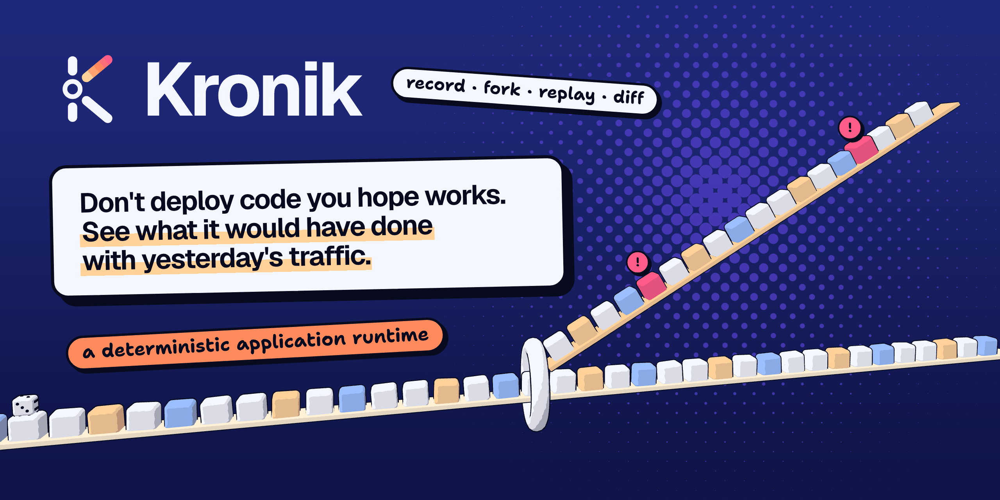
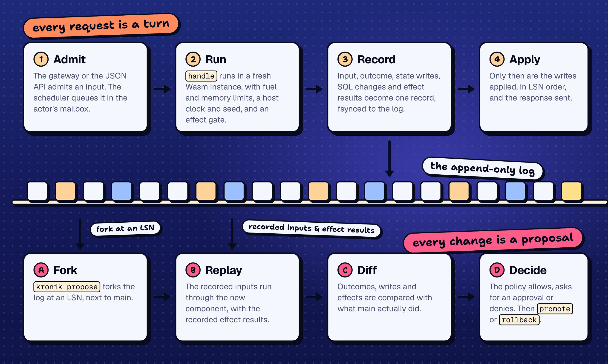
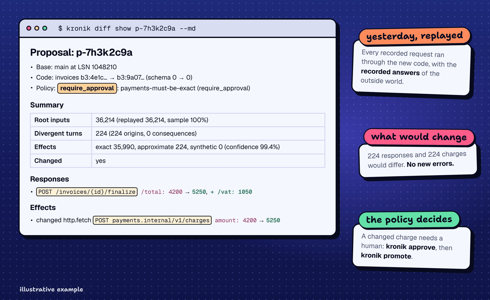

# Kronik



> Don't deploy code you hope works. See what it would have done with yesterday's
> traffic.

Kronik is a source-available runtime in which a system is a **deterministic
function of its history**. Every input, every effect result and every state
change is written to an append-only log before a turn is applied, delivered or
answered, so a change can be replayed against real production traffic and
reviewed as a **behavior diff** before it goes live.

The runtime is one `kronik` binary. It runs actors: Wasm components with
built-in key-value state and their own SQLite database, written in TypeScript,
Rust, Python or Go, or Linux programs from OCI images in gVisor. The CLI, the
JSON API and the MCP server are the primary interfaces; the embedded admin UI is
partial and unreleased.

[Website](https://www.kronik.se/) · [Quickstart](docs/guides/quickstart.md) ·
[Documentation](docs/introduction.md) ·
[Project status](https://github.com/G-man3207/Kronik/wiki/Project-status) ·
[Build brief](https://github.com/G-man3207/Kronik/wiki/Build-Brief)

> **Status: pre-alpha.** Kronik is not ready for production, and interfaces may
> change between releases. See [Status](#status).

## Why Kronik

Assistants and agents write code faster than anyone can read it. Tests pass and
staging is green, but neither shows what a change will do to the traffic a
system actually gets. Kronik records what a running system does — each request,
each outside answer, each state change — before it answers. A proposed change
can then run through yesterday's recorded traffic, with the outside world
answering as it did, and the result is a behavior diff: what would answer
differently, what would change, and what it would cost.

The idea in full, told from the beginning for readers who do not want to start
with the code, is at [demo.kronik.se](https://demo.kronik.se/). Kronik is for
the agents that write and change software at machine pace, the people who
review their work without time to read all the code, and small teams that want
safe deploys on a VPS without Kubernetes.

## How it works



Every request is a **turn**. It is admitted by the gateway or the JSON API, runs
`handle` in a fresh Wasm instance with fuel and memory limits, a host-provided
clock and seed, and a host-side effect gate. Before its first outside effect or
actor call, the turn's start (`TurnBegin`) is fsynced; each effect result is
recorded as it returns, so a crash can rerun the turn with the recorded answers.
The turn's record — input, outcome, state writes, SQL changes and effect
results — is then fsynced as one record and applied in LSN order; nothing is
delivered or answered before that.

Every change is a **proposal**. `kronik propose` forks the log at an LSN and
replays main's recorded root inputs through the new component, with the recorded
effect results. The outcome, writes and effects are compared with what main
actually did; a policy allows the change, asks for an approval, or denies it;
`promote` and `rollback` move code forward and back.

[Architecture](docs/concepts/architecture.md) and the
[concepts](docs/concepts/glossary.md) cover the model in detail.

## The behavior diff



`kronik diff show <proposal> --md` answers the review question: what changes?
It reports the responses, state and effects that differ, what the new code
costs to run, and how well each outside answer is grounded in the record.
A change that touches payments can require a human approval, with a reason, on
the record; `kronik promote` then moves it live, and `kronik rollback` can take
the state back too.

## Getting started

Install the latest release on Linux (x86_64 or aarch64):

```sh
curl -fsSL https://github.com/G-man3207/Kronik/releases/download/v0.5.0/install.sh | sh
kronik doctor
```

To build current `main` instead, from a trusted checkout with the prerequisites
in [CONTRIBUTING.md](CONTRIBUTING.md):

```sh
cargo build --locked --release -p kronik
export PATH="$PWD/target/release:$PATH"
kronik doctor
```

`kronik serve` runs in the foreground, so start it in its own terminal:

```sh
kronik serve \
  --data-dir /var/tmp/kronik \
  --http-listen 127.0.0.1:8080 \
  --api-socket /var/tmp/kronik/api.sock
```

In another terminal, point the CLI at that socket, deploy a first actor, change
it and propose the change:

```sh
export KRONIK_API_SOCKET=/var/tmp/kronik/api.sock

kronik init --lang ts billing
cd billing && npm install && npm test && kronik build
kronik deploy dist/billing.wasm --reason 'first deploy'
curl -s -X POST http://127.0.0.1:8080/billing/acme/increment

# change the counter to step by 2, rebuild, and propose it
sed -i 's/?? 0) + 1;/?? 0) + 2;/' src/actor.ts
kronik build
kronik propose dist/billing.wasm --window 1h --reason 'count in steps of 2'
kronik diff show <proposal> --md
```

The TypeScript template needs Node.js 22.20 or later; `--lang rust`, `python`
and `go` build the same counter in the other SDKs. The
[quickstart](docs/guides/quickstart.md) walks the full path from an empty
machine to a verified deploy, rollback and restore; [installing](docs/guides/install.md)
covers release contents and the SDK toolchains.

## What works today

- **Durable, deterministic turns.** State writes, SQL changes and outgoing
  messages commit together or not at all, and nothing is applied, delivered or
  answered until the turn's record is fsynced. Time, randomness and SQL
  functions such as `random()` come from values recorded with the turn, so a
  re-run gives the same outcome; a deterministic simulation of the daemon with
  injected crashes runs in CI, and a 1,000-cycle `kill -9` crash test runs in
  the manual nightly workflow.
- **Effects and capabilities.** Outgoing HTTP, actor-to-actor calls, timers and
  host-side cryptography with secret handles; every effect is denied until the
  operator grants a capability, and each result is recorded and returned on
  re-execution.
- **Fork, replay and diff.** `propose`, `approve`, `promote` and `rollback`,
  policy rules, effect simulators, `watch` (which rolls a promotion back when a
  guard breaks) and preview forks that take new requests on unproposed code.
- **Operations and observability.** TLS from files or ACME, a systemd unit,
  snapshots, shipping, `restore`, `upgrade check`, `doctor`, master-key
  wrapping (`keys`) and `/metrics`; turns become OpenTelemetry traces, metrics
  go to Prometheus and OTLP, and `kronik audit verify` checks the audit export
  against the log.
- **Long-lived connections and blobs.** WebSocket and server-sent events (SSE)
  routes whose frames are recorded with the turns that send them; uploads and
  `fetch` responses above a kind's threshold stream through a
  content-addressed blob store with constant memory, held by the actor and, in
  privacy mode, sealed with its subject's key.
- **Privacy mode.** Values with a subject can be sealed, erased and resealed;
  a fork requested by a token without `pii:read` replays personal text and blob
  values as pseudonyms. The [privacy guide](docs/guides/privacy.md) has the
  details and limits.
- **Foreign actors.** Linux programs from OCI images run in gVisor behind the
  same recorded boundary, and can be copied into a fork from a checkpoint; the
  microVM level is opt-in.
- **Agent interface.** The JSON API is described by OpenAPI, and `kronik mcp`
  serves the same operations as MCP tools with token scopes.

## Status

Kronik is pre-alpha and single-node: it is not ready for production, and
interfaces may change between releases.

The latest release is **v0.5.0** (15 November 2026,
[release notes](https://github.com/G-man3207/Kronik/releases/tag/v0.5.0)), the
"Isolation, standards and web" line (M20–M26): WebSocket and SSE connections,
streaming bodies and blob storage, external secret backends, and the opt-in
nonroot and microVM levels. Earlier attested releases are **v0.4.1** and
**v0.4.0**; the historical **v0.3.0** and **v0.1.0** remain unsigned, and
current consumers refuse their unsigned artifacts. `v0.5.0` ships static musl
binaries for x86_64 and aarch64 with `install.sh`, checksums, CycloneDX SBOMs
and two-build byte-equality evidence; `install.sh` verifies each archive's
Sigstore attestation.

`main` is the unreleased `0.6.0-dev` line; the [changelog](CHANGELOG.md) lists
what changed since `v0.5.0`. As of `v0.5.0`, 140 of the 196 criteria in the
[build brief](https://github.com/G-man3207/Kronik/wiki/Build-Brief) are
implemented; the
[compliance audit](https://github.com/G-man3207/Kronik/wiki/Compliance-audit)
maps each one to the tree, and the
[project status page](https://github.com/G-man3207/Kronik/wiki/Project-status)
tracks the milestones, the open questions and the known gaps.

Some claims were checked against pinned emulators and disposable hosted
runners, not production: ACME against Pebble rather than a public certificate
authority, the KMS and secret backends against emulators, blob shipping against
directory buckets and a local S3 server, and the nonroot and microVM levels on
GitHub-hosted Ubuntu 24.04 runners. There has been no independent external
security review, production pilot or three-node soak, and the cluster (M16–M19),
the WASI 0.3 remainder (M22), and the UI, fleet and hardening tracks (M27 and
M29–M34) are partial or absent.

## Repository and documentation

| Path | Contents |
| --- | --- |
| `crates/` | The daemon and its libraries: gateway, JSON API, scheduler, runtime, log, state, blob store, fork engine, MCP server, policy, privacy, shipping, admin UI, fleet API and OpenTelemetry/audit export |
| `sdk/`, `examples/` | The TypeScript, Rust, Python and Go SDKs, and example actors in all four languages, plus app examples and foreign Linux programs |
| `docs/` | The book: concepts, guides, reference, design notes and ADRs, indexed by [`docs/SUMMARY.md`](docs/SUMMARY.md) |
| `ui/`, `deploy/`, `action/` | The dependency-free admin UI source, the systemd unit and the GitHub Action |
| `scripts/`, `demo/` | CI, release, acceptance, simulation and chaos scripts, and end-to-end demos |

The [introduction](docs/introduction.md) explains the five concepts;
[writing actors](docs/guides/actors.md) covers `kronik init`, the SDKs and the
WIT interface; [operating Kronik](docs/guides/operations.md) and the
[security model](docs/guides/security.md) cover running it; the
[CLI reference](docs/reference/cli.md) and [error codes](docs/errors.md) cover
the interface; [Kronik for agents](docs/AGENT_GUIDE.md) is the same text as
`kronik explain agent`. The book is built from `docs/` with mdBook by
`scripts/ci.sh book`.

## Development

Kronik builds with the Rust toolchain pinned in `rust-toolchain.toml`:

```sh
git clone https://github.com/G-man3207/Kronik.git
cd Kronik
cargo build -p kronik
scripts/ci.sh
```

`scripts/ci.sh` runs the same 17 checks as CI; `scripts/ci.sh clippy test` runs
a subset. It needs rustup with the pinned toolchain, `cargo-deny`, Node.js 22.20
or later and the pinned Python test runtime from
[CONTRIBUTING.md](CONTRIBUTING.md), which also has the conventions.
[AGENTS.md](AGENTS.md) lists what each step needs and is the guide for automated
and human contributors. A missing prerequisite normally fails its step;
`foreign` without root and gVisor's `runsc`, and `s3` without Docker, skip with
a message instead.

CI, nightly, isolation and release workflows start only when someone runs them
(`workflow_dispatch`); only the GitHub Action demo runs on push and pull
request. The nightly adds the 1,000-crash test, deterministic simulation with
10,000 seeds and the release build.

## Security

Do not report vulnerabilities in public issues. See [`SECURITY.md`](SECURITY.md)
for the private reporting process and the security model.

## License

Kronik is licensed under the [Elastic License 2.0](LICENSE). It is
source-available, not open source. External contributions require a signed
[Contributor License Agreement](CLA.md).
