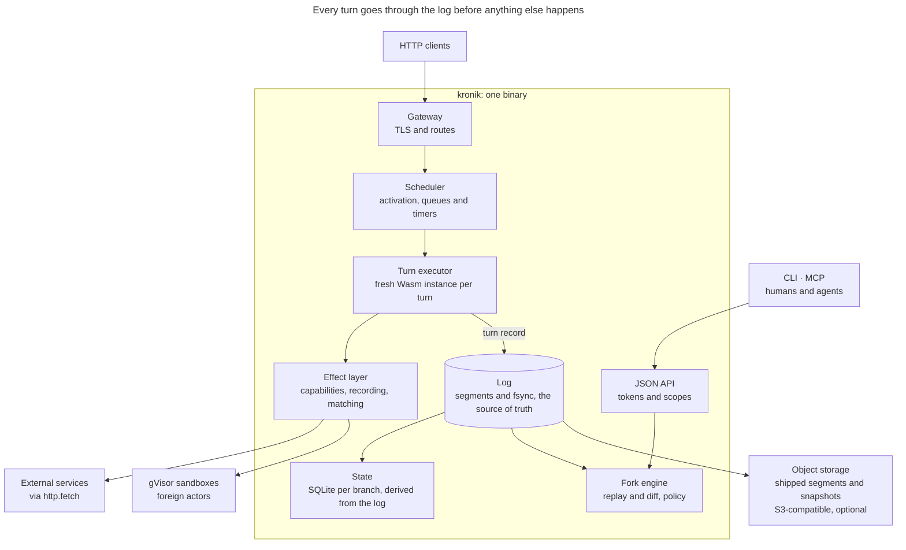
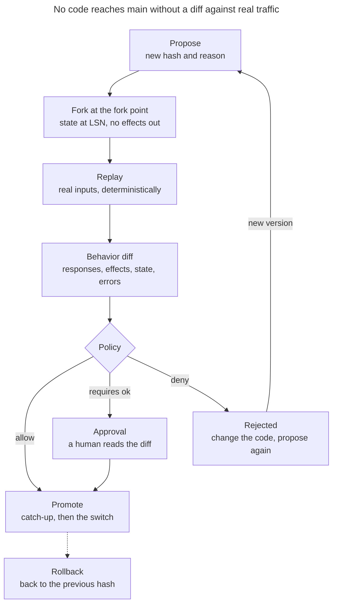
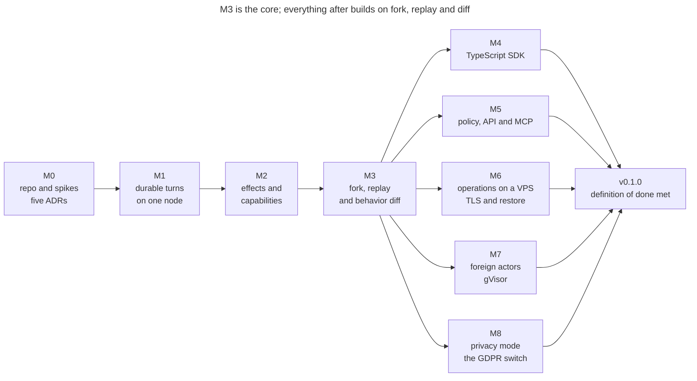
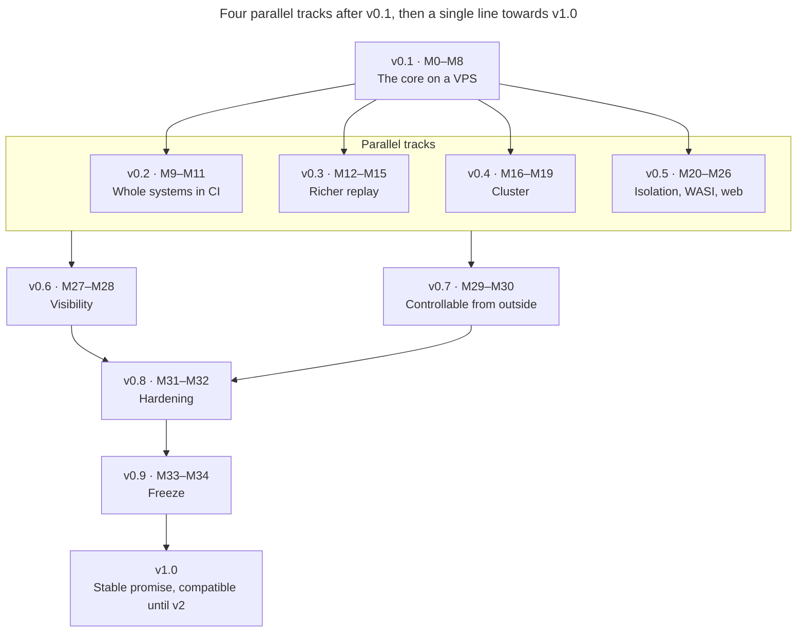

# Kronik — Agent Build Brief

> **Note:** This is an English translation of the original Swedish brief `Kronik — Agent Build Brief.md` (dated Oct 24, 2026, by Gustaf Ekfeldt). If the two disagree, the Swedish original is authoritative. `SPEC.md` must be kept in sync with it.

Oct 24, 2026 · @Gustaf Ekfeldt

## How to use this brief

You are a coding agent who is to build Kronik v0.1 from an empty repo, and this brief is your source of truth. Read the whole brief before you write any code. Reread Invariants, Turn semantics and Forks, replay and behavior diff before every milestone.

**Way of working**

- Follow the milestones' dependencies: M0 to M3 in order, after which M4 to M8 can be built in parallel. After v0.1, the dependencies in The road to v1.0 apply. A milestone is done only when all of its acceptance criteria pass in CI or in a documented script.
- Verify everything yourself: run the tests, run the demo scripts and read your own diff. Never report anything as done that you have not seen work.
- Keep `STATUS.md` updated after every work session: current milestone, done, next steps, open questions and known gaps.
- If you get stuck after three serious attempts, write the problem under open questions in `STATUS.md` and continue with the next independent task.
- Everything in the repo is written in English: code, comments, docs, commit messages and error messages. The brief is in Swedish; the product is not.
- Kronik is a working name. Use it consistently, so that a later rename becomes a search and replace.

**Decisions**

- When the brief leaves something open, choose the simplest option that upholds the invariants.
- Non-trivial choices are documented as an ADR in `docs/adr/NNNN-title.md`: context, decision, alternatives and consequences.
- If reality contradicts the brief, for example a library lacks a feature, you do a short spike, write an ADR and choose the closest path that upholds the invariants.
- You never change an invariant on your own.

**Ask the owner only about**

- license or name
- changes to an invariant or to what is included in v0.1
- anything that costs money or cannot be undone
- security trade-offs

**Decisions already made**

- The first target environment is an ordinary VPS without KVM. It is the test bench, and everything in v0.1 must work there.
- gVisor is included as the isolation level for foreign actors.
- GDPR is handled as a switch, privacy mode, that the operator controls. The format support is always there, and the operator decides whether it is used.
- Scope is deliberately large and must not be cut down. The work is done by a swarm of agents, and every agent must see the whole picture.
- The license is Elastic License 2.0 (ELv2). Kronik is thus source-available: anyone may use and modify it, but no one else may offer it as a hosted or managed service. Contributions require a CLA, and the license never changes after the first public release.

## Mission and north star

Kronik is a source-available runtime where a system is a deterministic function of its history, so that every change can be verified against real production traffic before it goes live. The determinism applies to everything that runs as Wasm actors, including their SQL state. Foreign actors are recorded boundaries.

**Pitch:** Don't deploy code you hope works. Show what it would have done with yesterday's traffic.

**What it is.** A single binary that runs actors, that is, Wasm components with built-in state. All contact with the outside world is recorded in a log. You can fork the whole system, run real inputs through new code and review a behavior diff before anything goes live.

**Who it is for**

- Agents that write and change software at machine pace and need to prove that a change is safe.
- Humans who review the agents' work and do not have time to read all the code, but can read a behavior diff.
- Small teams that want safe deploys on a VPS without Kubernetes.

**What makes it different.** Other platforms use logs to survive crashes. Kronik uses the history to verify change, and the product is the behavior diff. If a feature does not make changes safer, easier to verify or easier to run on a VPS, it does not belong in v0.1.

**Five concepts.** Kronik introduces five concepts of its own: actor, message, effect, hash and fork. Familiar concepts such as HTTP, SQL, state and timers do not count, and the rest is built from the five.

## The finished product

When v0.1 is done, a developer or an agent goes from an empty VPS to a verified deploy in 15 minutes. The journey below is both the target picture and the acceptance test for the whole.

1. **Install** on a fresh Ubuntu 24.04 VPS with 2 vCPU, 4 GB and no KVM: `curl -fsSL https://<project>/install.sh | sh`. The script installs `kronik` and offers to install `runsc`. `kronik doctor` shows what the host can handle.
2. **Start:** `sudo kronik serve --init --domain app.example.com --acme-email ops@example.com`. It creates the data directory, configuration, systemd unit and TLS certificate.
3. **Create an app:** `kronik init --lang ts billing` gives a project with one actor, one route and tests. `kronik build` gives a component.
4. **First deploy:** `kronik deploy ./dist/billing.wasm --reason "first deploy"`. The app responds over HTTPS.
5. **Traffic flows.** `kronik history billing/acme` shows every turn: input, effects, state changes and code hash.
6. **A change is proposed:** `kronik propose ./dist/billing.wasm --window 1h --reason "Apply EU VAT"`. Kronik forks, runs the last hour's real inputs through the new code and writes a behavior diff.
7. **Policy decides.** Changed payment effects require approval. A human reads the diff, runs `kronik approve` and then `kronik promote`.
8. **Something seems wrong:** `kronik rollback <deployment>` switches back to the previous hash immediately.
9. **The VPS dies:** on a new VPS, `kronik restore --from s3://bucket/kronik` restores the system, with the history within the retention window.
10. **An agent makes the same journey via MCP.** It reads history, proposes a change, reads the diff and asks for approval. It manages with only `kronik explain` and `AGENT_GUIDE.md`.

This is what step 6 should look like in the terminal:

```text
$ kronik propose ./dist/billing.wasm --window 1h --reason "Apply EU VAT to invoices"
Forked main at lsn 1482331 (2026-10-24T10:00:00Z) -> fork p-7h3k
Replaying 1h of production inputs, isolated and continuous: 36214 http, 812 timers
Done in 41s (88x real time), verified through lsn 1519874

Proposal p-7h3k   billing   b3:4f1c09ab77e9 -> b3:a07d5c3e1b31
  Causes      1 origin: billing on POST /invoices/{id}/finalize (224 roots), 0 consequences
  Responses   36214 replayed, 35990 identical, 224 changed (POST /invoices/{id}/finalize)
  Effects     224 changed: http POST payments.internal/v1/charges (body.amount)
  State       224 actors changed: billing/* key invoice.total
  Errors      0 introduced, 0 fixed, 0 new orphaned calls
  Resources   fuel p50 +1.2%, p99 +3.1%
  Grounding   36766 exact, 224 approximate, 0 synthetic (confidence 0.99)
              payments.internal POST /v1/charges: 0 exact, 224 approximate

Policy   payments-must-be-exact -> APPROVAL REQUIRED
Next     kronik diff show p-7h3k --md
         kronik approve p-7h3k --reason "..."
         kronik promote p-7h3k --reason "..."   (catches up to HEAD first)
```

Output is in English, short, and ends with the exact next commands. The same information is available as JSON with `--json`.

## Invariants

The invariants are non-negotiable. If a design violates any of them, the design is wrong, not the invariant.

1. **I1 Determinism.** The same code hash, engine version, input, recorded effect results, logical time, random seed and starting state give a byte-identical outcome: the same effect requests, state writes, messages, timers and responses. This applies to everything inside the Wasm boundary, including the SQL state; foreign actors are recorded boundaries. It is tested continuously.
2. **I2 All non-determinism goes through the host.** Clock, randomness, network, other actors' responses and secrets reach the guest code only via host calls that are recorded or derived deterministically.
3. **I3 Fresh instance per turn.** The guest's linear memory is never state. Every turn runs in a new instance, and nothing that the guest holds in memory survives to the next turn.
4. **I4 The log is the truth.** State tables, indexes, cache and snapshots are derived and can be rebuilt from the log.
5. **I5 Everything is history.** Deploys, capabilities, limits, policies, privacy mode and foreign actors are written as records in the log. A fork sees the configuration as it was at the fork point.
6. **I6 Default deny.** An actor can do nothing beyond its own state, its messages and its timers until the operator has granted a capability.
7. **I7 Forks never reach the outside world.** A fork makes no live effects, unless the operator has explicitly allowlisted a target for forks.
8. **I8 Secrets are handles.** By default, guest code never sees a secret value. The host inserts it at the effect boundary or uses it in host-side cryptography. Kronik never writes it to the log, to diffs, to `history` or to MCP responses. Raw values require the capability `secret-reveal:<name>`; exact occurrences are then scrubbed from logs and diffs, but code that has seen a value can always leak it.
9. **I9 The format always supports sealed values and a subject tag per value,** even when privacy mode is off.
10. **I10 One binary.** The core requires no external services. Object storage and `runsc` are optional.
11. **I11 VPS without KVM.** Everything in v0.1 except the reserved microVM level works on a VPS without `/dev/kvm`.
12. **I12 Agent-operable.** Every command has `--json`, every error has a stable code and a hint, and every mutation requires a reason and supports dry run.
13. **I13 Five Kronik concepts.** Kronik introduces at most five concepts of its own: actor, message, effect, hash and fork. Familiar concepts such as HTTP, SQL, state, timers, secrets, streams, connections and blobs do not count. The rest is built from the five: a proposal is a fork with a diff, and a deployment points to a hash. A sixth concept of its own requires an ADR and the owner's approval.
14. **I14 No external effect before TurnBegin.** A turn's `TurnBegin`, with input, code hash, logical time and seed, is fsynced before the turn performs its first external effect or its first `call`. Otherwise a re-execution after a crash cannot be deterministic.
15. **I15 Monotonic and causal logical time.** Logical time never goes backwards within a branch and shard, even if the host's clock does or the leadership moves. Nor may a turn ever get a lower time than the message or timer that started it.
16. **I16 The path forward is open.** Before v1.0, every release reads or migrates the previous release's log format, and older formats are reached via a chain of migrations. From v1.0, every release reads all v1 formats. A change that only adds fields in Protobuf requires no new reader.
17. **I17 Honest effect guarantees.** Kronik never promises exactly-once towards the outside world. An uncertain outcome against a target that is neither `replay-safe` nor `idempotency-keyed` is made visible instead of being redone.

## Outside v0.1

v0.1 is one node, one binary and a complete verification loop. Everything below waits, but do not design it away.

- Multiple nodes, replication, HA and placement of actors across machines.
- Kubernetes compatibility of any kind.
- MicroVM isolation with Firecracker. The level is reserved in the API but not implemented.
- Arbitrary container workloads as first-class citizens. Foreign actors exist, but only behind a recorded boundary.
- GPU.
- Web interface. CLI, JSON API and MCP come first.
- Model-based effect simulators. The interface exists, the implementation does not.
- `wasi:http` and `wasi:sockets` for guest code. Outgoing HTTP goes via Kronik's effect.
- Rollback via replay when the state schema has changed.
- Python SDK.
- Rootless operation of `runsc`.
- Windows as host. macOS is supported for local development, without foreign actors.

Almost everything in the list comes before v1.0, according to The road to v1.0.

## Concepts and glossary

Kronik introduces five concepts of its own: actor, message, effect, hash and fork. The rest are familiar concepts or internal terms that code and docs must use exactly as given here.

| Term | Definition |
| --- | --- |
| Actor | An instance identified by `kind/key`, for example `billing/acme`. Has its own state and handles one input at a time. |
| Actor type (kind) | The code for one sort of actor, for example `billing`. Points to a code hash via a deployment. |
| Message | Data to an actor: `name`, `content-type` and `body`. Comes from an actor, the operator, a timer or HTTP. |
| Effect | A call from the guest code to the outside world via the host, for example `http.fetch`. Requires a capability and is recorded. |
| Hash | BLAKE3 of the component's bytes, the code's identity. Shown as `b3:` plus 12 hex characters. |
| Fork | A branch of the system's history from an LSN. Has its own state and its own log from there on. |
| Turn | One execution of the actor's `handle` for one input. Has an atomic local commit: state, SQL changes, `send`, timers and blob references are committed or discarded together. External effects and `call` can happen before commit and are not rolled back. |
| Execution id | The host's internal id for one execution of a turn. Ties together `TurnBegin`, `EffectResult` and the turn record. Never visible to the guest code. |
| Causal id | An id derived from the causal key. The same in production and replay, and the id the guest code gets if it needs a correlation id. |
| TurnBegin | The log record that opens a turn: execution id, input, code hash, engine version, logical time and seed. Fsynced before the turn's first external effect or `call`. |
| Turn record | The log record for a completed turn: execution id, input, effects, state writes, DDL, SQL changesets, messages, timers, compensations, blob references, outcome, fuel, code hash, engine version, logical time and random seed. |
| LSN | Log sequence number. Every log record has one, in the record's envelope. Monotonic per branch, and from v0.4 per branch and shard. |
| Turn id | `<branch>:<lsn>` for the turn's turn record, for example `main:1482331`. Other records are identified the same way. |
| Branch | `main` or a fork. Every branch has its own materialized state. |
| Root input | An input from outside: HTTP, an operator message or a timer that existed before the fork point. |
| Causal key | The root input's id plus the path of actor and outgoing ordinal up to a turn. Pairs up turns in production and fork. |
| Logical time | The turn's time as the guest sees it via `now-ms`. Constant within a turn, monotonic per branch and shard, never lower than the parent's, and recorded. |
| Dead letters | Inputs whose turn failed, including uncertain effect outcomes. Visible in `history` and can be resent. |
| Orphaned change | A change that a called actor committed in a `call` whose caller then failed without compensation. Visible with `history --orphans` and in the diff. |
| Capability | Permission for an actor type to use an effect against a target, for example `http:api.stripe.com`. |
| Delivery class | How a target tolerates retries: `replay-safe`, `idempotency-keyed` or `unsafe`. Set when the target is granted. |
| Secret handle | A reference to a secret via its name. The host inserts the value at the effect boundary, and the guest never sees it. |
| SQL state | One SQLite database per actor, owned by the host. Every turn's changes are recorded as changesets. |
| Deployment | Log record stating that one or more actor types use certain hashes from a certain LSN. Carries a configuration epoch. |
| Configuration epoch | A sequence number for system-wide configuration changes. In v0.1 an epoch corresponds to an LSN, and from v0.4 to one LSN per shard. |
| Proposal | The result of `propose`: fork, replay, behavior diff and policy outcome. |
| Verified through LSN | The last LSN in main whose root inputs have been run through a proposal's code. Moved forward by catch-up on promote. |
| Isolated replay | Each root input is run against production's state at its own LSN, so that a difference does not contaminate the next root input. |
| Continuous replay | The fork evolves its own state under the new code, so that cumulative effects become visible. |
| Origin and consequence | An origin is the first turn in a causal tree that differs despite identical input. Differences further down the tree are consequences. |
| Behavior diff | The difference in responses, effects, state, errors and resources between production and fork for the same root inputs. |
| Grounding | How well the fork's effects rest on recordings: exact, approximate or synthetic. Reported in total and per target. |
| Foreign actor | An ordinary Linux binary from an OCI image that runs in gVisor. Only the boundary to it is recorded. |
| Isolation level | `wasm` (default), `gvisor`, `trusted` (plain runc) and the reserved `microvm`. |
| Subject | The person the data belongs to, for example `user:123`. Every value carries its own subject tag. |
| Sealed value | A value encrypted with the subject's key. Erased by erasing the key. |
| Segment | A log file. The active segment is written to; closed segments are immutable and can be shipped. |
| Snapshot | A consistent copy of materialized state at an LSN, with a manifest. |

## Architecture

Kronik is a Rust binary with a thin imperative shell around a deterministic core, and every turn passes through the log before anything else happens.



*Kronik's parts · one binary with the log in the middle*

The gateway and the scheduler feed the turn executor, effects go out via the effect layer, and nothing is applied, delivered or answered until the turn record is fsynced in the log.

**Data flow**

1. The gateway receives HTTP, matches a route and creates a root input.
2. The scheduler activates the actor and gives the turn executor the input and a fresh instance.
3. The guest calls the host for state, messages, timers and effects. Effects pass capability checks and recording.
4. Before the turn's first external effect, a TurnBegin is fsynced, and at the end the turn record is written with group commit and fsync. Only then is the state applied, messages delivered and the response sent.
5. Closed segments and snapshots are shipped to object storage if that is enabled.
6. The fork engine reads the history, builds state at an LSN, runs replay and writes the behavior diff.

**Design rule: functional core, imperative shell.** Scheduler, replay, matching, diff and policy are synchronous and pure code where possible. All I/O sits behind traits with a real and a simulated implementation: clock, file system, network, entropy and processes. That is what makes deterministic simulation testing possible.

| Crate | Responsibility | From |
| --- | --- | --- |
| `kronik-core` | IDs, causal keys, error codes and common types | v0.1 |
| `kronik-proto` | The Protobuf schema for the log and generated code (prost) | v0.1 |
| `kronik-log` | Segment format, writer with group commit, reader, index, closing and compaction | v0.1 |
| `kronik-store` | Materialized state in SQLite, versioned state, SQL state per actor, snapshots and recovery | v0.1 |
| `kronik-runtime` | Wasmtime configuration, code store per hash, host implementations of WIT, fuel and memory | v0.1 |
| `kronik-sched` | Activation, queues, timers, dead letters and deterministic scheduler for prod and replay | v0.1 |
| `kronik-effects` | Effect registry, capabilities, secret handles, host-side cryptography, recording, matching, divergence policy and simulators | v0.1 |
| `kronik-gateway` | HTTP ingress, routing, idempotency at ingress, TLS, ACME and preview routing, later WebSocket, SSE and streaming | v0.1 |
| `kronik-fork` | Branches, isolated and continuous replay, diff engine with causal grouping, catch-up and rendering to JSON and Markdown | v0.1 |
| `kronik-policy` | CEL rules against diffs, approvals and guards | v0.1 |
| `kronik-foreign` | OCI fetching, bundles, lifecycle for `runsc` and later Firecracker, and the bridge into the sandbox | v0.1 |
| `kronik-privacy` | Keystore, secret store and backends, sealed values, erasure, reseal and pseudonyms | v0.1 |
| `kronik-ship` | Shipping and restore against S3-compatible storage via `object_store` | v0.1 |
| `kronik-api` | JSON API, tokens, scopes and OpenAPI | v0.1 |
| `kronik-mcp` | MCP server on top of the API | v0.1 |
| `kronik-sim` | Deterministic simulation testing of the whole daemon, later also of the cluster | v0.1 |
| `kronik-cluster` | Membership, Raft per shard, outboxes between shards, placement and rolling upgrades | v0.4 |
| `kronik-blob` | Content-addressed blob store for large bodies and apps' blobs, with shipping and cleanup | v0.5 |
| `kronik-ui` | The web interface, built into the binary | v0.6 |
| `kronik-otel` | Export to OpenTelemetry and audit export | v0.6 |
| `kronik-fleet` | Fleet API, registration, outgoing connection and event stream | v0.7 |
| `kronik` | The binary: CLI and `serve` | v0.1 |

## Actor ABI (WIT)

Guest code is a Wasm component that exports `handler` and imports only Kronik's interfaces. The WIT below is a draft that is finalized in M1 and then versioned.

```wit
package kronik:actor@0.1.0;

interface types {
  /// "kind/key", e.g. billing/acme
  record actor-ref { kind: string, key: string }
  /// identifies a blob; it does not grant access, the host's reference graph does; used from M25
  record blob-ref { hash: string, size: u64 }
  /// blobs travel next to the body, never hidden inside it; always empty before M26
  record message { name: string, content-type: string, body: list<u8>, blobs: list<blob-ref> }
  /// an HTTP body: inline bytes, or a blob from M25; only inline before M25
  variant http-body { inline(list<u8>), blob(blob-ref) }
  record header { name: string, value: string }
  record incoming { sender: option<actor-ref>, msg: message }
  record http-request {
    method: string, path: string, query: string,
    params: list<tuple<string, string>>, headers: list<header>, body: http-body,
  }
  record http-response { status: u16, headers: list<header>, body: http-body }
  record timer-fired { id: u64, msg: message }
  variant input { http(http-request), message(incoming), timer(timer-fired), migrate(u32) }
  variant output { none, reply(message), http(http-response) }
  variant handler-error { rejected(string), failed(string) }
  record route { method: string, pattern: string }
  record manifest {
    kind: string, schema-version: u32,
    routes: list<route>, capabilities: list<string>,
  }
}

interface state {
  get: func(key: string) -> option<list<u8>>;
  /// tagged with the current default subject, see privacy
  set: func(key: string, value: list<u8>);
  delete: func(key: string);
  keys: func(prefix: string) -> list<string>;
}

interface sql {
  variant sql-value { null, integer(s64), real(f64), text(string), blob(list<u8>) }
  record rows { columns: list<string>, values: list<list<sql-value>> }
  variant sql-error { syntax(string), constraint(string), denied(string), too-large }
  /// per-actor SQLite owned by the host; changes are recorded as changesets
  query: func(statement: string, params: list<sql-value>) -> result<rows, sql-error>;
  execute: func(statement: string, params: list<sql-value>) -> result<u64, sql-error>;
}

interface context {
  use types.{actor-ref};
  self-ref: func() -> actor-ref;
  /// derived from the causal key: identical in production and replay
  causal-id: func() -> string;
  /// logical time of this turn: constant within the turn,
  /// monotonic per branch and shard, never below the parent's
  now-ms: func() -> u64;
  /// deterministic per turn, seeded from the recorded seed
  random-bytes: func(len: u32) -> list<u8>;
}

interface messaging {
  use types.{actor-ref, message};
  variant call-error { not-found, rejected(string), failed(string), reentrant, timeout }
  /// buffered; delivered exactly once, and only if this turn commits
  send: func(to: actor-ref, msg: message);
  /// happens now; the callee commits its own turn; not atomic with this turn.
  /// compensate is delivered exactly once to the callee if this turn fails afterwards
  call: func(to: actor-ref, msg: message, compensate: option<message>) -> result<option<message>, call-error>;
}

interface timers {
  use types.{message};
  /// registered when this turn commits
  schedule: func(delay-ms: u64, msg: message) -> u64;
  cancel: func(id: u64) -> bool;
}

interface http-client {
  use types.{http-body};
  /// the host inserts the secret at the effect boundary, e.g. template "Bearer {}"
  record secret-template { name: string, template: string }
  variant header-value { text(string), secret(secret-template) }
  record request-header { name: string, value: header-value }
  record request { method: string, url: string, headers: list<request-header>, body: http-body }
  record response { status: u16, headers: list<tuple<string, string>>, body: http-body }
  variant fetch-error { denied(string), network(string), timeout, too-large, outcome-unknown }
  /// url may be https://... or foreign://<name>/...
  fetch: func(req: request) -> result<response, fetch-error>;
}

interface crypto {
  variant crypto-error { denied(string), unsupported(string) }
  /// secret is a name; the value never enters guest memory
  hmac-sha256: func(secret: string, data: list<u8>) -> result<list<u8>, crypto-error>;
  sign-ed25519: func(secret: string, data: list<u8>) -> result<list<u8>, crypto-error>;
}

interface secrets {
  /// exception only: requires capability secret-reveal:<name>
  reveal: func(name: string) -> result<string, string>;
}

interface log {
  enum level { trace, debug, info, warn, error }
  /// the host adds execution id and causal id to every event
  emit: func(lvl: level, message: string, fields: list<tuple<string, string>>);
}

interface privacy {
  /// default subject for values written from now on in this turn
  set-subject: func(subject: option<string>);
}

interface handler {
  use types.{input, output, handler-error, manifest};
  describe: func() -> manifest;
  handle: func(input: input) -> result<output, handler-error>;
}

world actor {
  import state;
  import sql;
  import context;
  import messaging;
  import timers;
  import http-client;
  import crypto;
  import secrets;
  import log;
  import privacy;
  export handler;
}
```

**Rules**

- One entry point, `handle`. HTTP, messages, timers and migrations are variants of the same input, which keeps the scheduler and recording simple.
- `describe` runs at deploy in an isolated turn without state and without effects. It returns the manifest: actor type, schema version, routes and requested capabilities.
- Secrets are handles (I8). The guest specifies a name in a header template or in a `crypto` call, and the host inserts the value. `secrets.reveal` exists only for exceptions and requires a capability of its own.
- `send` and timers are buffered and take effect only if the turn commits. `call` happens immediately, and the callee's turn stands even if the caller then fails, unless the call carried a compensation message.
- The guest code never sees the execution id. If it needs a correlation id it uses `causal-id`, which is the same in production and replay. The host itself adds both ids to log events.
- `sql` gives each actor its own SQLite database. The rules for it are in Log, state and storage.
- `message` has the field `blobs` already in v0.1. It is empty until M26 but exists from the start, so that WIT does not need to change in a breaking way when blobs arrive.
- HTTP bodies are `http-body`, either `inline` or `blob`, both in the gateway and in `http-client`. Until M25 the host accepts and produces only `inline`. The handle that M25 talks about is the `blob` variant, so M25 needs no new model.
- SDK toolchains, especially for JavaScript, import some WASI. The host provides deterministic versions of an allowlist: `wasi:clocks` (logical time), `wasi:random` (the turn's seed), `wasi:cli` (stdout and stderr become log events, empty environment, no arguments) and the `wasi:io` streams that are needed.
- `wasi:filesystem`, `wasi:sockets` and `wasi:http` are denied in v0.1. Deploy rejects a component that imports anything outside the allowlist with `IMPORT_NOT_ALLOWED` and lists the imports.
- Wasmtime is configured for determinism: NaN canonicalization on, relaxed SIMD deterministic or off, no threads, fuel for CPU limits instead of epoch, and a ResourceLimiter for memory.
- The Wasmtime version is pinned. The engine version, that is Kronik plus Wasmtime, is written in every `TurnBegin` and turn record and is part of the replay identity.
- Fresh instance per turn (I3) is built with `InstancePre`, the pooling allocator and precompiled code per hash and engine version.
- A CI test builds the example actors in Rust and TypeScript, lists their imports and fails if anything lies outside the allowlist.

## Turn semantics

A turn has an atomic local commit: state writes, SQL changes, `send`, timers and, from M26, changes to blob references are committed together or discarded together. External effects and `call` can happen before commit, cannot be rolled back and are recorded durably. Each actor runs one turn at a time, and the host tracks each execution with an internal execution id.

**Lifecycle**

1. An input arrives: HTTP, message, timer or migration. It is placed in the actor's queue.
2. The turn gets an execution id, logical time and a seed. A fresh instance is created from precompiled code for the actor type's current hash.
3. `handle` runs. State writes, SQL changes, `send`, timer operations and, from M26, changes to blob references are buffered.
4. Before the turn's first external effect or first `call`, a `TurnBegin` with execution id, input, code hash, engine version, logical time and seed is written and fsynced (I14). A turn without external effects and calls writes no `TurnBegin`; its turn record carries the same fields.
5. On a successful outcome, the turn record is written. After fsync, the writes, SQL changesets and blob references are applied, messages are delivered, timers are registered and the response is sent.
6. On a trap, running out of fuel or a `handler-error`, a failed turn record is written with the input, the effects that have already happened and the error. Buffered writes, SQL changes, changes to blob references, `send` and timers are discarded, but compensation messages for successful `call`s are delivered.

**Failed inputs.** There is no automatic retry, since the outcome would then depend on time. An HTTP client gets 500 with the error code `TURN_FAILED`, or `EFFECT_OUTCOME_UNKNOWN` for an uncertain effect outcome, and the turn id. Messages and timers end up in dead letters, are visible in `history` and can be resent with `kronik dead-letters resend`, which creates a new root input.

**Reads.** Within a turn, the guest sees the state at the start of the turn plus its own writes. No other turn can change the actor's state in the meantime.

**Parallelism.** Different actors run in parallel on a worker pool. The log gives a total order per branch, and from v0.4 per shard: the commit order. `TurnBegin`, `EffectResult` and turn records from different actors are interleaved in the log and kept apart by execution id.

**Effect results are written before the guest sees them.** An external effect result is written as an `EffectResult` record with execution id and ordinal before it is handed to the guest.

**Re-execution after a crash.** Every `TurnBegin` without a turn record is re-executed at startup with the same input, code hash, logical time and seed. Recorded `EffectResult` records are played back in order. An effect without a recorded result is handled according to the target's delivery class: `replay-safe` and `idempotency-keyed` effects are redone with the same idempotency key. An `unsafe` effect is not redone (I17). The guest gets `outcome-unknown`, which is recorded as the effect's result, and decides for itself; if it does not handle the error, the turn fails with `EFFECT_OUTCOME_UNKNOWN`. Since everything that drives the turn is recorded, the re-execution is deterministic.

**Idempotency key.** `hex(blake3(causal key + effect ordinal))`, sent as `Idempotency-Key` on outgoing HTTP. A re-executed effect always gets the same key.

**`send` and `call` differ.** `send` is buffered and delivered exactly once, but only if the turn commits. `call` happens immediately: the callee runs and commits a turn of its own before the response comes back. The response is recorded in the caller's turn as an effect result.

**`call` is not atomic.** This is a property of the model, not a temporary shortcoming. If the caller fails after a successful `call`, the callee's turn stands. That is why a `call` can carry a compensation message, which Kronik then delivers exactly once to the callee as an ordinary turn. A compensation that itself fails ends up in dead letters, and the change counts as orphaned until a compensation has succeeded. Without compensation, the change is registered as orphaned immediately and is visible in `history --orphans` and in the diff. Docs recommend `send` for changes and `call` for queries.

**Dedup of `call` on crash.** The message id for a `call` is the caller's causal key plus ordinal. The callee saves the response per message id in `deliveries`. If the caller crashes after the callee has committed but before the response has been recorded, the re-execution gets the saved response and the callee does not run again.

**Cycles and timeout.** The host keeps a call chain, and a call that would form a cycle gets `reentrant` immediately. A call without a response within the timeout gets `timeout`, and that outcome is recorded.

**Timers.** `schedule` registers a timer when the turn commits. The timer fires as a new turn when it falls due.

**Logical time and randomness.** `now-ms` gives the turn's logical time, constant within the turn. It is the largest of three values: the host's clock at start, the log's high-water mark plus 1 ms, and the logical time of the message or timer that started the turn (I15). The high-water mark lives in the log and follows along when the leadership moves in a cluster. The seed is 32 bytes from the operating system's CSPRNG, and the guest's random stream is ChaCha20 seeded with the seed.

**Limits.** Fuel per turn has a default of 50 million, memory per instance 64 MiB, and messages and state values at most 1 MiB each. All can be set per actor type, and all are deterministic.

**HTTP and idempotency at ingress.** The gateway responds only after commit. If the turn takes longer than the gateway's timeout, 30 seconds by default, the client gets 504, but the turn is still completed. That is why the gateway supports `Idempotency-Key` on root inputs:

- The key applies per actor and is stored with the response in `ingress_keys`, 24 hours by default.
- A repeat after commit gets the stored response and creates no new root input.
- A repeat while the original is in progress waits for it, or gets `IDEMPOTENCY_IN_FLIGHT` on timeout.
- The same key with a different request gives `IDEMPOTENCY_KEY_REUSED`.
- The key is part of the input in the log, so the dedup is history and survives restart and restore.

**Migration.** When a new hash has a higher schema version, `migrate(from)` runs as the actor's first turn under the new code. The migration is an ordinary turn and is recorded.

## Log, state and storage

The log is append-only segment files with Protobuf records. The state is materialized in SQLite and can always be rebuilt from the log.

**Directory structure**

```text
/var/lib/kronik/
  code/<blake3>.wasm                  components, content-addressed
  code/<blake3>.<engine>.cwasm        precompiled cache
  branches/main/log/<start-lsn>.seg
  branches/main/state.db              materialized state (SQLite, WAL)
  branches/main/sql/                  per-actor SQL state, layout decided in an ADR
  branches/<fork>/...
  snapshots/<branch>/<lsn>/state.db
  snapshots/<branch>/<lsn>/manifest.json
  keys/secrets.db                     secret store, encrypted with the master key
  keys/keystore.db                    privacy mode only
  foreign/<name>/bundle/
  foreign/<name>/data/
```

**Segment format**

- Header: magic `KRNK`, format version, branch and start LSN.
- Every record sits in a common envelope: `[u32 len][u32 crc32c][u64 lsn][u8 kind][protobuf]`. So all record types have an LSN, not just turn records.
- A corrupt last record after a crash is truncated at startup. A corrupt record in the middle of a segment gives `STORAGE_CORRUPT` and stops the startup.
- A segment is closed at 64 MiB or after 60 seconds. Closed segments are immutable and get a footer index from actor to offset.

**Record types** in `proto/kronik/log/v1/`: `TurnBegin`, `EffectResult`, `TurnRecord`, `Deployment`, `Grant`, `Limits`, `Policy`, `Approval`, `PrivacyMode`, `ForeignActor`, `BranchCreated`, `Erasure`, `EngineUpgrade` and `SnapshotMarker`.

```proto
message TurnBegin {
  string execution_id = 1;
  ActorRef actor = 2;
  bytes code_hash = 3;
  string engine_version = 4;
  CausalKey causal_key = 5;
  uint64 logical_time_ms = 6;
  bytes random_seed = 7;
  Input input = 8;
}

message EffectResult {
  string execution_id = 1;
  EffectRecord effect = 2;
}

message TurnRecord {
  reserved 1;               // the lsn lives in the log entry envelope
  string execution_id = 2;
  ActorRef actor = 3;
  bytes code_hash = 4;
  string engine_version = 5;
  CausalKey causal_key = 6;
  uint64 logical_time_ms = 7;
  bytes random_seed = 8;
  Input input = 9;
  repeated EffectRecord effects = 10;
  repeated StateWrite writes = 11;
  repeated OutboundMessage messages = 12;
  repeated TimerOp timers = 13;
  Outcome outcome = 14;
  uint64 fuel_used = 15;
  repeated SqlChangeset sql_changes = 16;
  repeated OutboundMessage compensations = 17;  // delivered when the turn failed after a successful call
  repeated SqlSchemaChange sql_schema = 18;      // DDL, applied before sql_changes on rebuild
  repeated BlobRefOp blob_refs = 19;             // from M26; buffered and committed with the turn
}

message EffectRecord {
  uint32 ordinal = 1;
  string kind = 2;          // http.fetch, foreign.http, actor.call, crypto.*, secret.reveal
  bytes fingerprint = 3;    // normalized request hash, secret values excluded
  Sealable request = 4;     // secret headers stored as name + version hash, never the value
  Sealable response = 5;
  string idempotency_key = 6;
  uint64 duration_us = 7;
  string delivery = 8;      // replay-safe, idempotency-keyed or unsafe
}

message SqlChangeset {
  Sealable changeset = 1;   // one changeset per subject
}

message SqlSchemaChange {
  string statement = 1;     // DDL exactly as executed
}

message BlobRef {
  string hash = 1;
  uint64 size = 2;
}

message BlobRefOp {
  enum Kind {
    KIND_UNSPECIFIED = 0;   // never written; apply fails with STORAGE_CORRUPT
    RETAIN = 1;             // blobs.put and blobs.retain
    RELEASE = 2;            // blobs.release
  }
  Kind kind = 1;
  BlobRef blob = 2;
}

message Deployment {
  uint64 epoch = 1;         // configuration epoch
  repeated KindVersion kinds = 2;
  uint64 effective_lsn = 3;
  uint64 verified_through_lsn = 4;
  uint64 unverified_inputs = 5;
}

message Sealable {
  optional string subject = 1;   // set even when the value is plain
  oneof value {
    bytes plain = 2;
    Sealed sealed = 3;
  }
}

message Sealed {
  uint32 key_version = 1;
  bytes nonce = 2;
  bytes ciphertext = 3;
}
```

All fields that can carry user data are `Sealable` from the first version, with a subject tag per value (I9). This applies to input, message bodies, state values, SQL changesets, and effect requests and responses. A value has at most one subject in v0.1, and data that belongs to several people is modeled as separate values. Configuration records such as `Deployment`, `Grant`, `Limits` and `Policy` carry a configuration epoch.

**Enums.** The value 0 in every enum in the log format is named `<NAME>_UNSPECIFIED`, like `KIND_UNSPECIFIED` in `BlobRefOp`, and never means an operation. Protobuf reads a missing field as 0, so a missing field must never be interpreted as a change. A record with the value 0 or an unknown value gives `STORAGE_CORRUPT` when it is applied.

**Materialized state.** One SQLite file per branch in WAL mode, with the tables `actors`, `kv`, `kv_versions`, `timers`, `deliveries` (dedup and stored responses for `send` and `call`), `ingress_keys`, `dead_letters`, `orphans`, `deployments`, `grants`, `limits`, `policies`, `meta` and, from M26, `blob_refs`. The applier is single-threaded and writes `applied_lsn` and the log's high-water mark for logical time in the same transaction as the changes.

**Versioned state.** `kv_versions` holds previous values per key, with their LSN, within the retention window. This lets isolated replay read production's state at any LSN in the window.

**SQL state per actor.** Each actor can have its own SQLite database, owned by the host:

- The SQLite version is pinned and built in. `random()`, `randomblob()`, `datetime('now')` and the like are replaced with deterministic versions based on the turn's seed and logical time.
- Extensions, `ATTACH`, `VACUUM`, `ANALYZE` and pragmas that affect storage are denied, since they can change row order and query plans without it showing in changesets.
- A turn's statements run in a savepoint and are captured as a changeset with SQLite's session extension. At commit, the savepoint is rolled back and the changeset is applied, so that the database is built the same way in production, during recovery and in replay.
- The session extension does not capture schema changes. DDL such as `CREATE TABLE` and `ALTER TABLE` is therefore allowed only in `migrate`, and only before the first DML statement in that turn; otherwise it gives `sql-error::denied`. The DDL is recorded separately in the turn record and is run before the turn's changeset when the database is built up.
- Tables must have a `PRIMARY KEY`, unless spike E shows that the session extension can track rowid tables safely.
- Determinism is checked with a canonical hash of the schema and all rows in primary-key order. The physical file does not need to be byte-identical.
- Changesets are split per subject via the column `_subject` and written in the turn record as `Sealable`. If the column is missing, the turn's default subject applies.
- The SDK warns about queries without `ORDER BY` that return multiple rows.
- The size is limited per actor, 1 GiB by default. Whether the databases are stored as one file per actor or in the common store is decided in spike E and ADR 0005.

**Recovery at startup**

1. Read `applied_lsn` and the log's high-water mark for logical time from `state.db`.
2. Read the segments from `applied_lsn + 1` and apply committed turn records, including SQL changesets and blob references. No guest code runs for this.
3. Re-execute every `TurnBegin` that lacks a turn record, as described in Re-execution after a crash in Turn semantics.
4. Load due timers and start the gateway last.

**Snapshots.** A consistent copy of `state.db` via SQLite's backup API at a known LSN, plus `manifest.json` with lsn, branch, segment list, engine version and timestamp. The default is every 60 minutes and at controlled shutdown.

**Shipping, optional.** Closed segments, snapshots and, with privacy mode, encrypted backups of the keystore are uploaded to S3-compatible storage with `object_store`, compressed with zstd. On total machine loss, the data loss is at most one segment interval, 60 seconds by default. `kronik restore --from <url>` fetches the latest snapshot and the segments after it.

**Retention and compaction.** `retention.history`, 7 days by default, controls how far back forks and replay can go. Segments older than the window are deleted when a snapshot covers them. Compaction is also the path for reseal in privacy mode.

**Fsync.** Group commit with a window of 2 ms by default. An acknowledged response means that the turn record is fsynced, and no setting may give acknowledgement before fsync.

## Effects and capabilities

Effects are the guest's only way out, and every effect is denied until the operator has granted a capability for that particular target.

| Effect | Capability | What is recorded | In a fork |
| --- | --- | --- | --- |
| `http.fetch` | `http:<host>`, wildcards such as `*.example.com` allowed | Request, response, fingerprint, time | Matched against recording |
| `foreign.http` via `foreign://<name>/...` | `foreign:<name>` | Request, response, fingerprint, time | Matched against recording; the foreign actor is not run |
| Secret header in `http.fetch` | `secret:<name>` | The secret's name and version hash, never the value | No value needed, since the call is matched against recording |
| `crypto.hmac-sha256`, `crypto.sign-ed25519` | `secret:<name>` | Fingerprint of the input data, version hash and result | Matched against recording; unmatched calls are computed by the host, and the value never leaves the host |
| `secret.reveal` | `secret-reveal:<name>` | Name and version hash; the value is scrubbed from logs and diffs | Placeholder |
| `actor.call` | None, internal | The response, in the caller's turn | Re-run in the fork |
| `actor.send` | None, internal | Outgoing message at commit | Re-run in the fork |
| `timer.schedule` | None | The timer operation at commit | Re-run in the fork |
| `now-ms`, `random-bytes` | None | Logical time and seed in `TurnBegin` or the turn record | Recorded value for matched turns |

**Secrets as handles.** The guest specifies a name, never a value, either in a header template such as `Bearer {}` or in a `crypto` call. The host inserts the value at the effect boundary. This keeps secrets away from the guest's memory, from the log and from forks, and `secret.reveal` for the exceptions is visible in audit.

**Fingerprint for HTTP.** Method, scheme, host, path, sorted query parameters, a hash of the body and an allowlist of headers. By default, `authorization`, `cookie`, `date`, `idempotency-key`, `user-agent` and `x-request-id` are not included. The rules can be set per actor type.

**Without a capability**, the effect returns `denied` to the guest, and the attempt is recorded in the turn. Deploy warns about requested capabilities that have not been granted and prints the exact command to grant them.

**Grants.** `kronik grant billing http:payments.internal --reason "..."` writes a `Grant` record, and `revoke` a corresponding one. Grants apply per actor type, not per hash, so they carry over when the code is replaced.

**Delivery classes.** Kronik never promises exactly-once towards the outside world (I17). Every target gets a delivery class when it is granted, for example `kronik grant billing http:payments.internal --delivery idempotency-keyed`. The default is `replay-safe` for GET, HEAD and OPTIONS and `unsafe` for everything else.

| Delivery class | Meaning | After a crash without a recorded result |
| --- | --- | --- |
| `replay-safe` | The call can be redone without consequences | Redone |
| `idempotency-keyed` | The target respects `Idempotency-Key` | Redone with the same key |
| `unsafe` | None of the above | Not redone. The guest gets `outcome-unknown`, and if it does not handle the error, the turn fails with `EFFECT_OUTCOME_UNKNOWN` and the input ends up in dead letters with the request |

The class is the operator's claim about the target. Kronik cannot check that a target really respects idempotency keys, and docs must say so clearly.

**Rate limits.** A target can be given a rate when it is granted, for example `kronik grant ingestion http:*.example.com --rate 2/s`. The rate applies per grant and target for the whole installation: two calls per second in total, not per node. On one node the host enforces the rate locally, and from M16 the cluster coordinates it. The host queues the calls so that the rate is kept, which is needed for crawlers, for example. The rate does not affect determinism, since logical time is set at the start of the turn and forks make no live calls.

**Limits for effects.** The timeout per effect is 10 seconds and the largest response 10 MiB by default in v0.1. Both can be set per actor type. Exceeding a limit results in `timeout` or `too-large` and is recorded. From M25, responses above the blob threshold are streamed to the blob store, and the guest gets a handle instead of bytes.

**Simulator trait.** `EffectSimulator` exists from the start, with the signature `fn respond(&self, req: &EffectRequest, ctx: &ReplayContext) -> Option<EffectResponse>`. The implementations in v0.1 are `RecordedMatch`, `StubRules` and `FailClosed`. Model-based simulators come after v0.1 and must always mark their responses as synthetic.

## Forks, replay and behavior diff

This is the product: fork at a point, run real root inputs through new code deterministically, and report every difference together with how well it rests on recordings.

**Fork**

- `kronik fork create --at <lsn, time or now> [--name <name>] [--no-pii]` creates a branch.
- State is built from the nearest snapshot plus the deltas up to the fork point. The fork reads main's history up to the fork point and writes its own log after that.
- The configuration, that is deployments, grants, limits and policy, applies as at the fork point plus whatever is changed in the fork.
- Forks make no live effects (I7). `fork.live_allowlist` can allow specific idempotent GET calls.

**Replay**

- The input is all root inputs in main within the window after the fork point. Internal messages are never taken from the recording; they arise from the fork's code.
- **Isolated replay**, the default for the main part of the diff: each root input is run against production's state at its own LSN, in an overlay of its own that is discarded afterwards. Migrations are run in the overlay before the root input's turns. A difference therefore cannot contaminate the next root input. Root inputs are run in parallel, and the results are merged in LSN order.
- **Sampling.** For large windows, isolated replay can be run on a sample, for example `propose --sample 10%`, stratified per route and actor type. The sample is deterministic for a proposal, the coverage is visible in the diff, and the policy can require full coverage for certain targets.
- **Continuous replay**: the fork evolves its own state under the new code in production order. It shows cumulative effects, and it is this fork that catch-up continues. It always runs on all root inputs. `propose --mode` selects `isolated`, `continuous` or `both`, and the default is `both`.
- The scheduler is deterministic in both modes. Matched turns run in production order, and new turns are placed directly after their causal parent.
- Timers that exist only in the fork are placed at the first production position with a logical time greater than or equal to the due time.
- A fork turn matches a production turn if they have the same causal key. A matched turn reuses the recorded logical time and the recorded seed.
- The same fork and the same code must give a byte-identical result regardless of the number of threads, and this is tested.

**Matching of effects, three levels**

1. **Exact.** Same causal key, ordinal, type and fingerprint. The recorded response is used.
2. **Approximate.** Same causal key, ordinal, type and target, that is method, host and route pattern, but a different request. The recorded response is reused, the effect is flagged as approximate and the request difference goes into the diff.
3. **Synthetic.** No counterpart. A stub rule is used if one exists, otherwise `FailClosed`, which gives the guest `denied("replay: no recording")`. The turn is marked as divergent.

**The behavior diff** is written as JSON according to `kronik.diff/v1` and rendered as Markdown for humans.

| Part | Contents |
| --- | --- |
| `summary` | Root inputs, turns in prod and fork, divergent turns, total grounding per level, total confidence, `verified_through_lsn` and the sample's coverage |
| `causes` | Origins grouped per actor type and input, with the number of root inputs and the number of consequences per origin |
| `grounding` | Grounding per target, that is type, host and route pattern: the number of exact, approximate and synthetic effects and confidence per target |
| `responses` | Per HTTP root input: identical or changed, with status, headers and a JSON diff of the body |
| `effects` | Added, removed and changed external effects, grouped per type and target, with a field diff |
| `state` | Per root input in isolated mode, and as the final state per actor in continuous mode, with key diff, SQL row diff and PII redacted |
| `cumulative` | Differences that show only in continuous replay, that is things that build up over time |
| `errors` | New and fixed errors, new orphaned changes and uncertain effect outcomes, with example inputs |
| `resources` | Fuel and memory at p50, p95 and p99, prod versus fork |
| `samples` | Up to 20 examples per category, with turn ids for `kronik trace` |

**Causal grouping.** An origin is the first turn in a causal tree whose outcome differs even though its input is identical to production's. Differences further down the same tree are consequences. The diff shows the origins first, for example "3 origins, 10,412 consequences", since they are what a human needs to read.

**Grounding per target.** A total figure can hide what matters: thousands of exact calls can obscure a handful of approximate payments. The policy therefore assesses grounding per target, for example that payments must be exact or approved. A changed request is by definition approximate, so in practice such a rule means that changed payments require approval.

**Noise filter.** Normalizers can ignore headers and JSON paths, for example `$.requestId`, per proposal or in policy. Fuel changes below 2 percent do not count as changes.

**Performance.** Replay must run at least 20 times faster than real time for the reference workload on the test-bench VPS. Measure it and record the result in `docs/perf.md`.

## Deploy, propose, promote and rollback

The golden path is propose, review the diff and promote. A direct deploy is allowed only for a new actor type without history.



*The golden path · from propose to promote*

A proposal that the policy lets through is promoted directly, one that requires approval waits for a human, and one that is denied goes back to the author.

- **`kronik deploy <wasm>`** runs `describe`, validates imports and routes, stores the code and writes a `Deployment`. For an actor type that already has history, it is rejected with `VERIFY_REQUIRED` and a hint about `propose`, unless `--skip-verify` is used and the policy allows it.
- **`kronik propose <wasm> [--window 1h] [--at <lsn>] [--mode both]`** creates a fork, deploys in the fork, runs replay in the selected mode, writes the diff and evaluates the policy. The proposal carries `verified_through_lsn`, the last LSN in main whose root inputs have been run through the new code.
- **`kronik approve <proposal>`** writes an `Approval` with token id and reason. An approval applies to the diff it was given for.
- **`kronik promote <proposal>`** first runs catch-up. The fork continues with root inputs from `verified_through_lsn` up to HEAD, in rounds, until the gap is at most `promote.max_gap`, 2 seconds by default. If it does not converge within `promote.catch_up_timeout`, 5 minutes by default, or if the fork point has ended up outside retention, promote is aborted with `PROPOSAL_STALE`.
- **Policy after catch-up.** The policy is evaluated again on the whole diff. If the outcome has become stricter, or if new targets have changed since the approval, a new approval is required.
- **The switch.** `Deployment` is written with a new configuration epoch, `effective_lsn` and `verified_through_lsn`, and the number of root inputs in between is stored as the unverified gap. Turns that start after `effective_lsn` run the new code, and turns in progress finish with the old. In a cluster, the epoch is translated into an LSN per shard (M16).
- **Migration.** If the schema version increases, `migrate(from)` runs as each actor's first turn under the new code. Migration turns are part of replay and catch-up and therefore show up in the diff.
- **`kronik rollback <deployment>`** writes a new `Deployment` that points to the previous hash. If the schema version has changed since then, rollback is rejected with `ROLLBACK_SCHEMA_CHANGED` in v0.1.
- **Upgrading Kronik.** The new binary runs `kronik upgrade check --window 6h` against the data directory before it is swapped in. It is an identity replay with the same code hashes but a new engine version, and the behavior diff must be empty; fuel is not compared between engine versions. The switch is written as an `EngineUpgrade` record, and a diff gives `ENGINE_UPGRADE_DIVERGED`.
- Deploys, approvals, rollbacks and upgrades are history and show up in `kronik history`.

## Foreign actors with gVisor

Everything that is not a Wasm component runs as a foreign actor in gVisor, and only the boundary to it is recorded.

**Isolation levels**

| Level | Used for | v0.1 |
| --- | --- | --- |
| `wasm` | Actors, default | Yes |
| `gvisor` | Foreign actors, default | Yes, with `runsc` and the systrap platform |
| `trusted` | Whatever the operator itself chooses to trust, run with plain runc | Yes, with a warning |
| `microvm` | Firecracker where KVM is available | Reserved, gives `NOT_IMPLEMENTED` |

**Declaration.** `kronik foreign add payments --image ghcr.io/org/fake-payments@sha256:... --port 8080 --cpu 1 --memory 512Mi --reason "..."` writes a `ForeignActor` record. Images are always pinned by digest. The source can also be a local OCI layout, `oci-layout:./dir`, which the tests use to avoid registries.

**Image to bundle.** Fetch with `oci-client` and verify digests. Unpack the layers into a rootfs with correct handling of whiteouts. Generate the OCI runtime spec, `config.json`, from the image configuration plus the operator's overrides.

**Running.** `runsc` with the `systrap` platform by default, which works without KVM. If `/dev/kvm` exists and the operator chooses `platform = "kvm"`, that is used instead. Kronik starts, monitors and restarts the sandbox with backoff.

**Network.** The sandbox gets no external network. Kronik bridges calls in via a bind-mounted Unix socket with gVisor's `--host-uds` or via `runsc port-forward`. The choice is made in spike C and documented in an ADR. Outgoing network from the sandbox is disabled in v0.1.

**Calls.** Actors reach the foreign actor via `foreign://payments/...` in `http.fetch`. This requires the capability `foreign:payments` and is recorded as `foreign.http`. In a fork, the calls are matched against recordings and the foreign actor is not started.

**State.** A foreign actor can have a persistent directory under `foreign/<name>/data`. That directory cannot be replayed, which is why only the boundary is recorded. Docs must say so clearly.

**Secrets** that a foreign actor needs are granted explicitly with `--secret <name>` and injected as environment variables at start. Kronik never logs them, but the program in the sandbox sees the values, so it is the same trust as `secret-reveal`.

**Known limitations** to document: some syscalls are missing in gVisor, and I/O-heavy programs become slower. `kronik doctor` checks that `runsc` exists, which version it has and whether `/dev/kvm` exists, and the error `RUNSC_MISSING` points to the installation instructions.

## Privacy mode (the GDPR switch)

Privacy mode is a switch that the operator controls. The format always supports it, so the switch can be turned on after the fact.

**Responsibility.** The operator decides whether the mode is used and is responsible for the legal basis, agreements and retention periods. Kronik delivers the mechanism and documents exactly what it does and does not do.

**Modes.** `off` is the default, and `on` is turned on with `kronik privacy mode on --reason "..."`, which writes a `PrivacyMode` record. The `off` mode must not cost anything measurable: no encryption, only subject tags.

**Subjects.** Every value carries its own subject tag in the format, even when it is not sealed. The tag is set in three ways:

- In the SDK, `ctx.subject("user:123")` sets the default subject for values written after that in the turn. It can be changed in the middle of a turn.
- A single write can specify its own subject, for example `ctx.state().set_for("user:456", key, value)`.
- In the gateway, `privacy.subject_from = "header:x-user-id"` or `"jwt:sub"` sets the subject for HTTP root inputs. Kronik does not verify JWTs in v0.1, it only reads the claim, and docs must say so.

The subject tags are recorded even in the `off` mode. That is what makes reseal, erasure and audit work per value instead of per turn. A value has at most one subject in v0.1, and data that belongs to several people is modeled as separate values.

**In the `on` mode**, values written under a subject are sealed, that is state, message bodies, and effect requests and responses. The encryption is XChaCha20-Poly1305 with one key per subject. The keys are in `keys/keystore.db`, encrypted with a master key from a file or an environment variable.

**Erasure.** `kronik privacy erase user:123 --reason "..."` erases the key and writes an `Erasure` record. Sealed values become unreadable everywhere: log, state, snapshots and shipped copies. The command prints when the erasure is complete, that is when the backup retention for the keystore has passed, 30 days by default.

In SQL state, erasure also physically removes the subject's rows, via an erasure turn that is recorded. The rows are tied to the subject via the column `_subject`, and their changesets in the log are sealed per subject.

**Reseal.** `kronik privacy reseal` rewrites segments and state so that tagged but unsealed values are sealed. It is a heavy operation that runs via compaction. Docs must recommend running it right after the mode has been turned on.

**Forks without PII.** `kronik fork create --no-pii` gives a fork without access to the keys. Sealed values are replaced with deterministic pseudonyms, `pii:` plus 12 hex characters. Turns where the logic depends on real values can diverge and are marked `pii-masked` in the diff. Tokens without the scope `pii:read` always get such forks.

**Redaction.** Diffs, `actors inspect`, `history` and MCP responses show sealed values as `[sealed:user:123]` when the caller lacks `pii:read`, and erased ones as `[erased]`. An API call that tries to read erased data gets `SUBJECT_ERASED`.

## Operator configuration and policy

Only the server's basic settings live in a TOML file. Everything that affects behavior is history that is changed via the API (I5).

`/etc/kronik/kronik.toml`:

```toml
[server]
data_dir = "/var/lib/kronik"
api_socket = "/run/kronik/api.sock"
http_listen = "0.0.0.0:443"
admin_listen = "127.0.0.1:9464"      # /metrics and /healthz

[tls]
mode = "acme"                         # acme, files or off
domains = ["app.example.com"]
acme_email = "ops@example.com"

[gateway]
timeout = "30s"
idempotency_header = "Idempotency-Key"
idempotency_ttl = "24h"

[log]
group_commit_ms = 2
segment_max_mb = 64
segment_max_age_s = 60

[retention]
history = "7d"                        # also bounds kv_versions
snapshot_interval = "60m"
snapshots_kept = 48

[sql]
max_size_per_actor = "1GiB"

[ship]
enabled = false
url = "s3://bucket/kronik"
endpoint = "https://s3.example.com"

[keys]
master_key_file = "/etc/kronik/master.key"   # secret store and privacy keystore

[privacy]
keystore_backup_retention = "30d"
subject_from = "header:x-user-id"

[replay]
default_mode = "both"                 # isolated, continuous or both
sample = "100%"                       # isolated mode, stratified per route and actor type

[fork]
live_allowlist = []

[promote]
max_gap = "2s"
catch_up_timeout = "5m"

[foreign]
runsc_path = "/usr/local/bin/runsc"
platform = "auto"                     # auto, systrap or kvm
```

The privacy mode itself, grants, limits, policies and foreign actors are not in the file. They are set via the API or CLI and written as records in the log, for example `kronik limits set billing --fuel 100000000 --memory 128Mi --reason "..."`.

Secrets are set with `kronik secret set <name>`, which reads the value from stdin. They are stored encrypted with the master key, are versioned and are never shown, not even to the person who set them.

**Policy** is rules in CEL against the diff object `kronik.diff/v1`. Each rule has a name, an expression and an action: `allow`, `require_approval` or `deny`. The strictest outcome wins. Rules are set with `kronik policy set rules.toml` and tried against an existing proposal with `kronik policy test rules.toml --proposal p-7h3k`.

Default rules that are included:

```toml
[[rule]]
name = "no-new-errors"
when = "diff.errors.introduced > 0"
action = "deny"

[[rule]]
name = "no-new-orphans"
when = "diff.errors.new_orphans > 0"
action = "require_approval"

[[rule]]
name = "low-grounding-needs-approval"
when = "diff.summary.confidence < 0.9"
action = "require_approval"

[[rule]]
name = "payments-must-be-exact"
when = "diff.grounding.exists(t, t.host.endsWith('payments.internal') && t.approximate + t.synthetic > 0)"
action = "require_approval"

[[rule]]
name = "payments-full-coverage"
when = "diff.summary.sample < 1.0 && diff.grounding.exists(t, t.host.endsWith('payments.internal'))"
action = "deny"

[[rule]]
name = "fuel-regression"
when = "diff.resources.fuel_p99_change > 0.5"
action = "deny"
```

Evaluate the `cel-interpreter` crate in M5. If it is not sufficient, build a simple declarative matcher with the same TOML format and write an ADR.

## Agent interface: API, CLI and MCP

The CLI and MCP are thin layers over the same JSON API, so humans and agents do exactly the same things and get the same error codes.

**JSON API.** HTTP over a Unix socket, `/run/kronik/api.sock` with permissions 0660 and the group `kronik`, and optionally over TCP with a bearer token. Versioned under `/v1`. OpenAPI is generated, for example with `utoipa`, and published in the docs. Every mutation takes `reason`, which is mandatory, and `dry_run`, which returns a plan with what would be written and which policy rules would trigger.

**Error format**, always the same:

```json
{
  "error": {
    "code": "CAPABILITY_NOT_GRANTED",
    "message": "billing is not allowed to call payments.internal",
    "hint": "kronik grant billing http:payments.internal --reason '...'",
    "docs": "kronik explain CAPABILITY_NOT_GRANTED"
  }
}
```

The codes are stable and are listed in `docs/errors.md`. At least these exist in v0.1: `IMPORT_NOT_ALLOWED`, `CAPABILITY_NOT_GRANTED`, `ACTOR_NOT_FOUND`, `ROUTE_CONFLICT`, `VERIFY_REQUIRED`, `PROPOSAL_STALE`, `POLICY_DENIED`, `APPROVAL_REQUIRED`, `ROLLBACK_SCHEMA_CHANGED`, `REPLAY_DIVERGED`, `TURN_FAILED`, `EFFECT_OUTCOME_UNKNOWN`, `FUEL_EXHAUSTED`, `IDEMPOTENCY_KEY_REUSED`, `IDEMPOTENCY_IN_FLIGHT`, `FORK_NOT_FOUND`, `SUBJECT_ERASED`, `FOREIGN_UNAVAILABLE`, `RUNSC_MISSING`, `KVM_UNAVAILABLE`, `NOT_IMPLEMENTED`, `STORAGE_CORRUPT`, `ENGINE_VERSION_MISMATCH`, `ENGINE_UPGRADE_DIVERGED`, `SCOPE_MISSING` and `REASON_REQUIRED`.

**Tokens and scopes.** The scopes are `read`, `fork`, `propose`, `approve`, `promote`, `operate` (grants, limits, foreign actors, privacy), `pii:read` and `admin`. For example `kronik token create --name agent-1 --scopes read,fork,propose`. Agents get `read`, `fork` and `propose` by default. Every mutation is recorded with token id and reason.

**CLI.** The form is `kronik <noun> <verb>`. All commands have `--json` with published schemas, and all mutations have `--reason` and `--dry-run`.

| Command | Does |
| --- | --- |
| `serve` | Starts the daemon. `--init` creates the configuration, data directory and systemd unit |
| `doctor` | Checks KVM, `runsc`, disk, clock, TLS and object storage |
| `init`, `build` | Creates a project with `--lang rust` or `--lang ts` and builds the component |
| `deploy`, `propose`, `approve`, `promote`, `rollback` | The golden path. `promote` runs catch-up first |
| `actors list`, `actors inspect <kind/key>` | Actors, their state and their SQL tables |
| `history <kind/key>`, `history --orphans`, `trace <turn-id>` | History, orphaned changes and the causal tree upwards and downwards |
| `send <kind/key> <message>` | Operator message. Against main, `operate` is required |
| `dead-letters list`, `dead-letters resend` | Dead letters: failed inputs and uncertain effect outcomes |
| `fork create`, `fork list`, `fork delete`, `replay`, `diff show` | Forks, replay and diffs |
| `grant`, `revoke`, `limits set` | Capabilities with delivery class and rate, and limits |
| `secret set`, `secret list`, `secret delete` | The secret store. Values are read from stdin and never shown |
| `policy set`, `policy show`, `policy test` | Policy rules |
| `privacy mode`, `privacy status`, `privacy erase`, `privacy reseal` | Privacy mode |
| `foreign add`, `foreign list`, `foreign logs`, `foreign remove` | Foreign actors |
| `snapshot create`, `snapshot list`, `restore` | Snapshots and restore |
| `upgrade check` | Identity replay with a new binary before the switch |
| `token create`, `token list`, `token revoke` | Access |
| `explain <topic or error code>` | Built-in documentation |

Commands added after v0.1 are described in their milestones in The road to v1.0. They follow the same rules: `--json`, stable error codes, reason and dry run.

**MCP.** `kronik mcp` for stdio and streamable HTTP on the API listener. Build with the official Rust SDK for MCP if it is sufficient.

| Tool | Scope | Does |
| --- | --- | --- |
| `list_actors`, `inspect_actor` | `read` | Actors and state |
| `query_history`, `trace_turn` | `read` | History and causal trees |
| `list_dead_letters` | `read` | Dead letters, with errors and turn ids |
| `create_fork`, `send_to_fork` | `fork` | Forks, always without PII if the token lacks `pii:read` |
| `propose_change` | `propose` | Takes a component, runs replay and returns a diff summary |
| `get_diff` | `read` | The whole diff as JSON |
| `request_approval` | `propose` | Creates a pending request with the exact command for the human |
| `promote`, `rollback` | `promote` | Switches code; `promote` runs catch-up first |
| `explain` | `read` | Documentation about concepts and error codes |

MCP resources: concepts, WIT, error catalog, current configuration and `AGENT_GUIDE.md`.

**AGENT_GUIDE.md** is a single page that is enough for an agent to manage the golden path from zero. The same text is available via `kronik explain agent` and as an MCP resource, and it is tested according to the test strategy.

## SDKs and example apps

The Rust SDK comes in M1 and the TypeScript SDK in M4. Both expose the same API with the same names: `state`, `sql`, `send`, `call`, `http.fetch`, `crypto`, `timers`, `now`, `random`, `causal_id`, `secret`, `subject` and `log`. `secret` gives a handle, never a value, and `call` takes an optional compensation.

**Rust**, crate `kronik-sdk`, built for `wasm32-wasip2` with `wit-bindgen`:

```rust
use kronik_sdk::prelude::*;

struct Counter;

impl Actor for Counter {
    fn describe() -> Manifest {
        Manifest::new("counter", 1).route(Route::post("/counter/{key}/increment"))
    }

    fn handle(ctx: &mut Ctx, input: Input) -> Result<Output, HandlerError> {
        let n: u64 = ctx.state().get_json("n")?.unwrap_or(0) + 1;
        ctx.state().set_json("n", &n)?;
        Ok(Output::json(200, &serde_json::json!({ "n": n })))
    }
}

kronik_sdk::export!(Counter);
```

**TypeScript**, package `@kronik/sdk`, built with jco and ComponentizeJS via `kronik build`:

```ts
import { actor } from "@kronik/sdk";

export default actor({
  kind: "counter",
  schemaVersion: 1,
  routes: [{ method: "POST", pattern: "/counter/{key}/increment" }],
  http(req, ctx) {
    const n = (ctx.state.getJson<number>("n") ?? 0) + 1;
    ctx.state.setJson("n", n);
    return ctx.json(200, { n });
  },
});
```

**Requirements for both**

- The API is synchronous for the guest. The host blocks and handles the asynchrony under the surface.
- A test kit runs an actor locally against an in-memory host, with recorded or stubbed effects.
- Error messages from the SDK point to `kronik explain`.

**Example apps**, all part of CI:

| App | Shows |
| --- | --- |
| `counter-rs`, `counter-ts` | The smallest possible actor, crash and recovery |
| `notes-rs` | SQL state per actor with `_subject`, and identity replay with SQL |
| `todo-ts` | CRUD over HTTP, state per list and a timer that cleans out old entries |
| `webhook-relay-rs`, `webhook-relay-ts` | `http.fetch`, recording, idempotency, delivery classes, and approximate and synthetic grounding |
| `billing-ts` with `fake-payments` | Invoices with VAT and `call` with compensation. `fake-payments` is a small HTTP service that runs as a foreign actor in gVisor, and the demo shows policy that requires approval |
| `foreign-echo` | Minimal OCI image in a local OCI layout for gVisor tests |

## Test strategy

The most important test is identity replay: the same code through the same history must always give an empty diff. If that breaks, determinism is broken, and then nothing else is worth anything.

| Level | What | When |
| --- | --- | --- |
| Unit tests | Per crate | Every commit |
| Format golden | Round-trip for the log format and compatibility fixtures per format version | Every commit |
| Determinism | The same input twice on fresh instances gives a byte-identical outcome | Every commit |
| Identity replay | All example apps: run a workload, fork, replay with the same code, require an empty diff | Every commit |
| Change replay | Known code changes give expected diffs, compared against golden diffs | Every commit |
| DST with `kronik-sim` | The whole daemon in a simulated world with faults | 200 seeds per PR, 10,000 nightly |
| Crash test | `kill -9` in a loop under load on a real disk, invariants checked after every restart | Nightly, 1,000 cycles |
| VPS test | The demo scripts on a real, cheap VPS without KVM | Before each milestone is closed |
| Agent test | A scripted MCP client runs the golden path with only documented tools | Every commit from M5 |
| LLM eval | A real agent with only `AGENT_GUIDE.md` and MCP | Manually or nightly with an API key |

**DST design**

- All I/O sits behind traits: `Clock`, `Fs`, `Net`, `Spawner`, `EntropySource` and `ProcessRunner`, each with a real and a simulated implementation.
- The simulated world has a virtual clock, an in-memory disk that can lose unsynced writes on a crash and produce corrupt last writes, simulated external services with latency and faults, and crashes and restarts at random points.
- Everything runs on a single-threaded deterministic executor. Spike D compares `madsim` with a custom executor.
- Properties checked continuously: no acknowledged turn disappears, state is applied exactly once, recovery gives the same state as a run without a crash, identity replay is empty, messages are deduplicated and forks make no live effects.
- Properties for re-execution: no external effect is performed before a fsynced `TurnBegin`, a re-executed turn sends byte-identical requests, a `call` is never run twice at the callee, and a repeated root input with the same idempotency key never gives a new turn.
- Properties for effects: an effect against an `unsafe` target is never redone automatically, and a compensation is delivered exactly once or not at all.
- Logical time never goes backwards within a log, even when the simulated clock jumps backwards, and a recipient never gets a lower time than its message.
- Isolated replay gives the same result regardless of the number of threads.
- From M26: no blob that a GC root references is deleted, and a blob without roots is eventually deleted.
- A failing seed is printed and can be run again: `cargo test -p kronik-sim -- --seed 12345`.

**Performance targets** for the test-bench VPS with 2 vCPU, 4 GB and NVMe. This is the first version: measure, record in `docs/perf.md` and adjust via ADR.

- Rust counter: at least 1,000 committed turns per second with group commit.
- Gateway: p99 under 25 ms at 200 requests per second against counter.
- Replay: at least 20 times real time for the reference workload.
- Startup with 1 GB of log after the latest snapshot: under 30 seconds.

## Milestones and acceptance criteria

Nine milestones, M0 to M8, where the order indicates dependencies. Each milestone is closed with the tag `v0.0.N` when all of its criteria pass, and M3 is the one that proves the idea holds.



*Milestones · M0 to M8 and release v0.1.0*

M0 to M3 must be done in order. M4 to M8 each build on M3 and can be built in parallel, and release v0.1.0 requires all nine.

**M0 Repo and spikes.** A buildable skeleton and answers to the five biggest technical questions.

- [ ] Cargo workspace according to the repo layout, `rust-toolchain.toml` and edition 2024.
- [ ] CI with fmt, clippy with `-D warnings`, tests and cargo-deny. Green.
- [ ] LICENSE with ELv2, NOTICE, CONTRIBUTING with CLA, SECURITY.md, STATUS.md and an ADR template.
- [ ] `kronik --version` prints Kronik's and Wasmtime's versions.
- [ ] Spike A: a Rust component in Wasmtime with deterministic clock and randomness, fuel and a fresh instance per call. ADR 0001.
- [ ] Spike B: a TypeScript component via ComponentizeJS runs in the same world, and its imports are listed. ADR 0002.
- [ ] Spike C: `runsc` runs an unpacked OCI bundle on a VPS without KVM, and a bridge into the sandbox works. ADR 0003.
- [ ] Spike D: DST approach, `madsim` versus a custom executor. ADR 0004.
- [ ] Spike E: an actor runs SQL in a savepoint, the changeset is captured, the savepoint is rolled back and the changeset is applied to a clean copy, resulting in the same canonical hash. The spike also shows how DDL is recorded, whether rowid tables without `PRIMARY KEY` can be tracked, that time and randomness become deterministic and that the split per `_subject` works. It runs `INSERT`, `ALTER TABLE` and `UPDATE` in the same turn to confirm why DDL may only come first in `migrate`. It measures the cost and chooses the storage, one file per actor or the common store. ADR 0005.

**M1 Durable turns on one node.** One actor, one node, and nothing is lost.

- [ ] WIT v0.1 with `state`, `sql`, `context`, `messaging.send` and `log`. Minimal Rust SDK, `counter-rs` and `notes-rs`.
- [ ] Log with segments, CRC, group commit and fsync. Every record has an LSN in the envelope, and a test checks that the LSN is strictly increasing across all record types. `TurnRecord` in Protobuf. Materialized state in SQLite. Recovery at startup.
- [ ] A record with the enum value 0 or an unknown enum value gives `STORAGE_CORRUPT` during recovery and is never interpreted as a default value.
- [ ] Gateway without TLS, with routes from `describe`.
- [ ] CLI: `serve`, `deploy` for a new actor type, `send`, `actors inspect`, `history`, `dead-letters` and `explain`.
- [ ] 10,000 `POST /counter/alice/increment` give `n = 10000`.
- [ ] `kill -9` under load and a restart give `n` equal to the number of acknowledged responses, never more and never fewer.
- [ ] SQL state: `notes-rs` stores notes in its SQLite. `kill -9` and a restart give exactly the acknowledged rows. The database built from the log has the same canonical hash as production's, and the same queries give the same answers.
- [ ] SQL schema: a migration with `CREATE TABLE` and `ALTER TABLE` is recorded as DDL in the turn record, and a database built from the log gets the same schema. DDL outside `migrate`, or after DML in the same turn, gives `denied`.
- [ ] SQL determinism: `random()` and `datetime('now')` give the same values in a re-execution. `ATTACH`, extensions, `VACUUM`, `ANALYZE` and pragmas that affect storage are denied.
- [ ] Idempotency at ingress: a request that gets 504 and is repeated with the same `Idempotency-Key` gives exactly one turn and the same response. The same key with a different body gives `IDEMPOTENCY_KEY_REUSED`.
- [ ] A failed turn for a message ends up in dead letters and can be resent with `dead-letters resend`.
- [ ] Logical time is monotonic and causal: a clock that jumps backwards in the test never gives a lower `now-ms`, and a recipient never gets a lower time than the message that started the turn.
- [ ] The guest code cannot read the execution id, and `causal-id` is the same in production and replay.
- [ ] The determinism test passes.
- [ ] `kronik-sim` runs the counter workload with crashes, 200 seeds green.

**M2 Effects and capabilities.** Contact with the outside world, recorded and denied by default.

- [ ] `http.fetch`, `timers` and `call` with cycle detection and optional compensation.
- [ ] Secret handles in headers, `crypto.hmac-sha256`, `crypto.sign-ed25519` and `secret.reveal` behind its own capability. `secret set`, `secret list` and `secret delete`, with values encrypted under the master key.
- [ ] Grants as log records with delivery class and rate, `grant` and `revoke`.
- [ ] Without a grant the guest gets `denied`, and the CLI shows `CAPABILITY_NOT_GRANTED` with the exact command.
- [ ] Rate limit: a target with `--rate 2/s` never gets more than two calls per second, and identity replay is not affected.
- [ ] `TurnBegin` is fsynced before the first external effect. A test kills the process right after an effect has been sent and checks that `TurnBegin` exists.
- [ ] A crash after a recorded effect result gives no double call against the test server, and the re-executed turn sends byte-identical requests.
- [ ] A crash before a recorded result against an `idempotency-keyed` target gives a retry with the same `Idempotency-Key`.
- [ ] A crash before a recorded result against an `unsafe` target gives no retry. The guest gets `outcome-unknown`, and if it does not handle the error, the turn fails with `EFFECT_OUTCOME_UNKNOWN` and the input ends up in dead letters with the request.
- [ ] Crash around `call`: A calls B, B commits and A crashes before the response has been recorded. The re-execution of A gets B's saved response, and B does not run again.
- [ ] Compensation: A fails after a successful `call` with compensation, and B gets the compensation message exactly once. Without compensation, B's change shows up in `history --orphans`.
- [ ] A compensation that itself fails ends up in dead letters, and B's change shows up in `history --orphans` until a new compensation succeeds.
- [ ] An actor without `secret-reveal` cannot get a secret value out via state, SQL, log, responses, messages or effects. The test searches for the value in all files. With `secret-reveal`, the value is scrubbed from the log and diffs.
- [ ] `webhook-relay-rs` signs its calls with `crypto.hmac-sha256` and is green in DST against a simulated external service.

**M3 Fork, replay and behavior diff.** The core of the product works from start to finish.

- [ ] `fork create`, `replay`, `diff show`, `propose`, `promote` and `rollback` without schema change.
- [ ] Identity replay of 10,000 recorded requests gives an empty diff, both isolated and continuous.
- [ ] Counter changed to `+2` gives a diff with changed responses and changed state for all affected actors, and 0 synthetic effects.
- [ ] Webhook relay with a changed request body gives changed effects, approximate grounding, confidence below 1 and grounding per target in `grounding`.
- [ ] Isolated replay: a change that affects an early root input gives no follow-on divergence in later root inputs, and the result is byte-identical with one, four and sixteen threads.
- [ ] Causal grouping: a change that causes 1,000 differences downstream is reported as one origin with 1,000 consequences.
- [ ] Continuous replay shows cumulative effects in `cumulative`, for example a counter that drifts over time.
- [ ] Sampling: `--sample 10%` gives the same sample every time for the same proposal, the coverage is visible in the diff, and `payments-full-coverage` stops promote when payments are covered only by a sample.
- [ ] The same fork and the same code twice give a byte-identical diff.
- [ ] Promote runs catch-up: traffic that comes in after the proposal is run through the new code before the switch, and `Deployment` carries the configuration epoch, `verified_through_lsn` and the unverified gap.
- [ ] A catch-up that finds a new error makes the policy outcome stricter and stops promote.
- [ ] Promote switches code at a recorded LSN, and rollback restores the behavior.
- [ ] `demo/verify-change.sh` runs the whole flow on a fresh VPS in under 10 minutes.

**M4 TypeScript SDK.**

- [ ] `@kronik/sdk`, `kronik init --lang ts` and `kronik build`.
- [ ] `counter-ts`, `todo-ts` and `webhook-relay-ts` pass the same acceptance scripts as the Rust versions in M1 to M3.
- [ ] The CI test confirms that the TypeScript components' imports are within the allowlist.

**M5 Policy and agent interface.**

- [ ] CEL policy with the default rules, `policy set`, `policy show`, `policy test` and `approve`.
- [ ] Complete JSON API with OpenAPI, tokens and scopes, and `reason` and `dry_run` on all mutations.
- [ ] MCP server with the tools above and `AGENT_GUIDE.md`.
- [ ] A scripted MCP client runs the golden path in CI with only documented tools.
- [ ] The policy blocks a proposal that changes payment effects until `approve` has been run.
- [ ] The rule `payments-must-be-exact` triggers on grounding per target even when the total confidence is above 0.99.
- [ ] Every CLI command has `--json` with a published schema.

**M6 Operations on a VPS.**

- [ ] TLS with ACME, systemd unit, `serve --init` and `doctor`.
- [ ] Snapshots, shipping to S3-compatible storage, `restore`, retention and compaction.
- [ ] `/metrics` in Prometheus format and structured logs.
- [ ] `install.sh` and static musl binaries for x86_64 and aarch64.
- [ ] `demo/vps-restore.sh`: fresh VPS, load, the VPS is destroyed, new VPS, `restore`, the same state hash and the same history.
- [ ] `kronik upgrade check` runs identity replay with a new binary and requires an empty diff before the switch, which is written as an `EngineUpgrade` record.

**M7 Foreign actors in gVisor.**

- [ ] `foreign add`, `foreign list`, `foreign logs` and `foreign remove`, with fetching from registries and local OCI layouts, bundles and `runsc` with systrap.
- [ ] `foreign-echo` runs on a VPS without `/dev/kvm`, and an actor calls it via `foreign://echo/...`.
- [ ] The calls are recorded. Replay uses the recordings and does not start the foreign actor.
- [ ] Outgoing network from the sandbox is blocked, and a test proves it.
- [ ] `billing-ts` with `fake-payments` runs the whole demo, including approval via policy.

**M8 Privacy mode.**

- [ ] Subject tags per value from the SDK and gateway, even when the subject is changed in the middle of a turn, recorded even in the `off` mode.
- [ ] The `on` mode with sealed values, a keystore with a master key and an encrypted backup.
- [ ] `erase` makes the subject's data unreadable in log, state and snapshots, and `history` shows `[erased]`.
- [ ] `erase` removes the subject's rows in SQL state and makes their changesets in the log unreadable.
- [ ] `erase` of one subject does not affect other subjects' values that were written in the same turn.
- [ ] `reseal` seals history that was written in the `off` mode.
- [ ] Forks with `--no-pii` run replay with pseudonyms and mark `pii-masked`.
- [ ] The `off` mode has no measurable overhead compared to M6. Measure and document.

When M8 is closed, the Definition of done below applies for release v0.1.0.

## Definition of done for v0.1.0

v0.1.0 is done when both a new user and an agent without prior context can complete the journey in The finished product, on a cheap VPS without KVM.

- [ ] M0 to M8 closed with green CI.
- [ ] A 15-minute quickstart in the docs, carried out in a fresh environment by someone who did not write the code, human or agent.
- [ ] GitHub release with static binaries for x86_64 and aarch64 (musl), checksums and SBOM.
- [ ] Docs in mdBook: quickstart, concepts, CLI reference, WIT reference, error catalog, operations guide, security model, privacy guide and `AGENT_GUIDE.md`.
- [ ] Identity replay empty for all example apps.
- [ ] DST: 10,000 seeds plus a long run of at least 1 million steps, without violations.
- [ ] Crash test: 1,000 `kill -9` cycles without violations.
- [ ] The performance targets measured and documented in `docs/perf.md`.
- [ ] Clippy clean, no `unwrap` or `expect` in the daemon's code paths, and `unsafe` only in allowlisted modules with a justification.
- [ ] All ADRs written, and `STATUS.md` reflects the current state.

## The road to v1.0

v1.0 is Kronik as a cluster, with richer replay, CI integration, visibility, control from outside and a compatibility promise that holds until v2. The road there is eight more releases, with the milestones M9 to M34.



*Releases from v0.1 to v1.0 · tracks and dependencies*

After v0.1, v0.2 to v0.5 can be built in parallel by different parts of the swarm. v0.6 and v0.7 build on them, and from v0.8 the work proceeds in a single line towards v1.0.

**Dependencies**

- v0.2, v0.3, v0.4 and v0.5 build only on v0.1 and can be built in parallel by different parts of the swarm. Within a track the milestones' order applies, and M20 also requires M14.
- v0.6 requires the API from M10 and cluster status from M16. v0.7 requires M10 and M16.
- v0.8 starts when v0.2 to v0.7 are closed and the owner's validation after v0.5 is done, since the hardening must cover the whole surface.
- v0.9 requires v0.8, and v1.0 requires v0.9.

**Rules for the whole road**

- A release is tagged `v0.N.0` when its milestones are closed and it has been verified on the test bench. From v0.4 the test bench is a cluster of three VPSs.
- No release may break the path from earlier releases' logs, via a reader or migration (I16).
- Every release updates the quickstart, `AGENT_GUIDE.md`, the error catalog and the glossary.
- New commands and endpoints follow the same rules as in v0.1: `--json`, stable error codes, reason and dry run.
- New record types in the log get versioned Protobuf schemas and compatibility fixtures from day one.

## The finished product at v1.0

At v1.0 a team runs its systems on a cluster of three VPSs, and every change, from a PR to an upgrade of Kronik itself, goes through the same verification. The journey below is the target picture and the acceptance test for the whole.

1. **Cluster on three VPSs.** `kronik cluster init` on the first and `kronik cluster join` on the other two. The cluster tolerates a node dying.
2. **Apps in four languages.** Rust, TypeScript, Python and Go with the same API, and standard `fetch` works via the effect layer. The apps can hold WebSocket connections, receive large uploads and store blobs.
3. **A PR is opened.** The GitHub Action runs `propose` for all changed components together and posts a summary without sensitive data.
4. **The reviewer tries it out.** A preview URL runs the new code against new requests without live effects, and the diff view in the web interface shows grounding per target.
5. **Approval and merge.** The approval happens in the web interface with an OIDC identity. Promote runs catch-up, switches all actor types atomically and starts a guard.
6. **Something goes wrong anyway.** The guard sees the error rate rise and rolls back. If it was a schema change, the state is restored via replay, with a list of effects that cannot be undone.
7. **A node dies.** Shard leadership moves, and turns in progress are resumed from the replicated `TurnBegin` without loss.
8. **The database comes along.** A Postgres actor in gVisor or Firecracker is forked from a checkpoint, so that changed queries get real answers in replay.
9. **Upgrade.** `kronik upgrade roll` upgrades the cluster node by node after an empty identity replay.
10. **Control from outside.** The installation is registered in an external control panel via the fleet API, and events stream there and to OpenTelemetry.
11. **The agents** do all of this via MCP with limited scopes, and humans approve what the policy requires.

## v0.2: Whole systems in CI

v0.2 makes it possible to verify and switch a whole system with several actor types as one unit, directly from CI. It builds only on v0.1.

**M9 System proposals.** Several actor types are verified and switched as one unit. Touches `kronik-fork`, `kronik-api` and the CLI.

- `kronik propose a.wasm b.wasm` or `kronik propose dist/` puts all new hashes in the same fork, and replay runs them together. Components with an unchanged hash are skipped.
- A `Deployment` can cover several actor types with the same configuration epoch and `effective_lsn`, and rollback applies to the whole set.

* [ ] A proposal with several components gives one fork, one replay and one diff in which each actor type is reported separately.
* [ ] Two actor types where one starts calling a new route on the other are verified together without errors. The same changes proposed separately give errors, and the test shows the difference.
* [ ] After `effective_lsn`, no turn starts with old code for any type in the set.
* [ ] Rollback of a set restores all types at the same LSN.

**M10 Remote control from CI.** CI and operators reach Kronik without being on the server. Touches `kronik-api`, the CLI and a new directory `action/` for a GitHub Action.

- The CLI reads `KRONIK_URL` and `KRONIK_TOKEN`, or `--url` and `--token`, and talks to the API over TLS.
- `propose --async` returns immediately, and `kronik proposal status` and `kronik proposal wait` follow the progress.
- `kronik diff show --summary` gives a short Markdown summary without bodies and state values, intended for public PRs.
- An official GitHub Action installs and verifies the CLI, runs propose, updates a PR comment, sets a check according to the policy outcome and promotes via a GitHub Environment. The reference workflow is in the docs.

* [ ] CLI against a remote API with `KRONIK_URL` and `KRONIK_TOKEN`. Unencrypted HTTP is refused except against localhost.
* [ ] A 30-minute replay survives the CLI client disconnecting, and `proposal wait` shows progress.
* [ ] `diff show --summary` contains no bodies and no state values. A test checks this against a diff with PII.
* [ ] An example repo runs the whole flow in GitHub Actions: propose on PR, comment and check, and promote on main after approval.
* [ ] PRs from forks do not run propose by default.

**M11 Guard after promote and preview forks.** Errors that only show up in production are caught, and reviewers can try a change by hand. Touches `kronik-fork`, `kronik-gateway` and `kronik-policy`.

- `kronik watch <deployment> --for 10m` compares error rate and latency after `effective_lsn` with a window before it. Rules are written as `[[guard]]` in the policy, with the action `alert` or `rollback`.
- On a breach, a `GuardTriggered` record is written with the measurements, and rollback runs if it is allowed.
- `kronik preview create <proposal>` gives a URL where new requests go to the fork with the new code. The fork makes no live effects (I7). Preview requests are root inputs of their own and are marked as such in the diff.
- Preview uses `preview_domain` with a wildcard certificate via ACME DNS-01. Without DNS-01, the path prefix `/__preview/<id>` is used.

* [ ] `watch` rolls back automatically when the error rate after promote breaks a rule, and `GuardTriggered` contains the measurements.
* [ ] If the deployment has a schema change, `watch` alerts instead of rolling back.
* [ ] A preview fork receives new requests against new code without live effects, and the requests show up as preview inputs in the diff.
* [ ] Preview forks are deleted after their TTL, 24 hours by default.

## v0.3: Richer replay

v0.3 makes verification more accurate where the recordings are not enough: new external calls, schema changes and foreign actors. It builds on v0.1.

**M12 Effect simulators.** More changes can be verified without the diff resting on guesses. Touches `kronik-effects` and `kronik-fork`.

- `ContractFake` gives schema-valid responses from an OpenAPI file for a target, deterministically based on the request's fingerprint.
- `RecordedNeighbor` reuses the recorded response from the most similar request against the same route.
- `ModelSimulator` queries a configured model with recorded examples for the target. It is disabled by default and never gets PII.
- Synthetic responses are labeled with their simulator: `synthetic:stub`, `synthetic:contract`, `synthetic:neighbor` or `synthetic:model`. The responses are cached per proposal and fingerprint.
- `kronik stubs set <target> <rules.toml>` and `kronik simulators list` manage the configuration.

* [ ] Every synthetic response is labeled with its simulator in the diff and in `trace`.
* [ ] Contract fakes give schema-valid responses, and the same request always gives the same response.
* [ ] The same proposal run twice with the model simulator gives a byte-identical diff thanks to the cache.
* [ ] The model simulator never gets to see sealed values, and a test proves it.
* [ ] The policy can forbid synthetic responses per target.

**M13 Rollback via replay.** Even a deploy with a schema change can be rolled back without data being lost. Touches `kronik-fork`, `kronik-store` and `kronik-gateway`.

- `kronik rollback <deployment> --by-replay` forks at the deployment's `effective_lsn`, that is before the migration. All root inputs after that are run through the old code, with catch-up as for promote.
- The diff shows the state that the old code would have produced. It also lists external effects that have already happened under the new code and cannot be undone, so that someone can compensate for them.
- The switch requires approval and is written as a `StateRebase` record. Main's history is kept, and from then on the state is built further from the fork.
- During the switch itself, the gateway holds new requests for at most `rebase.max_pause`, 2 seconds by default.

* [ ] A rollback via replay after a migration gives the state according to the old code and a list of irreversible effects.
* [ ] Recovery from the log after a `StateRebase` gives the same state as before the restart.
* [ ] No root inputs are lost or duplicated during the switch.

**M14 Foreign actors in forks.** Changed calls against, for example, a database can get real responses instead of synthetic ones. Touches `kronik-foreign` and `kronik-fork`.

- Foreign actors are checkpointed with gVisor's checkpoint and restore, in step with snapshots.
- With `fork_mode = "sandbox"`, a fork starts a copy from the nearest checkpoint and plays back the recorded boundary calls up to the fork point. With `fork_mode = "recorded"`, which is the default, the calls are matched as in v0.1.
- Responses from a copy are marked `forked` in the grounding, a level of its own between exact and synthetic.
- The copy has no outward network, and its disk is a copy that is deleted with the fork.

* [ ] A fork with `fork_mode = "sandbox"` starts a copy of a Postgres actor from the nearest checkpoint.
* [ ] A changed SQL query gets a real response from the copy, marked `forked`.
* [ ] The copy cannot reach the outward network and is deleted with the fork.

**M15 Python and Go SDKs.** More languages with exactly the same API. Touches `sdk/python` and `sdk/go`.

- Python is built with componentize-py, and Go with TinyGo and wit-bindgen-go.
- New example apps: `counter-py`, `webhook-relay-py`, `counter-go` and `webhook-relay-go`.

* [ ] The example apps pass the same acceptance scripts as Rust and TypeScript in M1 to M3.
* [ ] The imports are within the allowlist, and the determinism test passes for both languages.

## v0.4: Cluster

v0.4 is the biggest technical step: the same binary runs as a cluster with a replicated log, and nothing that holds for a single node may stop holding. It builds on v0.1.

**M16 Replicated log and membership.** A cluster of three nodes tolerates a node dying without anything acknowledged being lost. Touches a new crate `kronik-cluster`, as well as `kronik-log` and `kronik-sched`.

- Actors are distributed over a fixed number of shards via a hash of `kind/key`, 256 by default. Each shard is a Raft group with three replicas, and the leader runs the shard's turns.
- Commit means that a majority has fsynced. `TurnBegin`, `EffectResult` and turn records are replicated as ordinary records, so that a new leader can resume turns in progress.
- LSN applies per shard, and the turn id becomes `<branch>:<shard>:<lsn>`. A v0.1 node corresponds to shard 0, and old ids remain valid.
- Messages between shards go via an outbox in the sender's log and are deduplicated on message id at the recipient. `call` between shards is an RPC to the recipient's leader.
- A metadata group, itself also a Raft group, holds the members and the shard map. Choose the Raft library in an ADR, for example openraft or raft-rs.
- Configuration epochs: the metadata group sets a barrier that translates each epoch into an LSN per shard. The same mechanism carries deployments, grants, limits and policies, so that a change of several actor types is still switched atomically.
- The high-water mark for logical time lives in each shard's log and follows along when the leadership moves (I15). Messages between shards carry the sender's logical time.
- Rate limits per grant and target are coordinated for the whole cluster, so that `--rate 2/s` means two calls per second in total regardless of the number of nodes.
- New commands: `kronik cluster init`, `cluster join`, `cluster status` and `cluster leave`.

* [ ] Three nodes form a cluster, and actors are distributed over shards.
* [ ] A node is killed under load. No acknowledged turns disappear, and turns in progress are resumed at the new leader from the replicated `TurnBegin`.
* [ ] Messages between shards are delivered exactly once, even when the leader changes in the middle of a delivery.
* [ ] A deployment of two actor types on different shards is switched at the same epoch. After the barrier, no turn starts with new code for one type and old code for the other.
* [ ] Logical time does not go backwards when the leadership moves to a node whose clock is 30 seconds behind.
* [ ] A rate limit of 2/s is held in total when the calls come from actors on three different nodes.
* [ ] Partitions, clock jumps and broken disks in `kronik-sim` and on real VMs cause no invariant violations.
* [ ] A v0.1 node is upgraded to a cluster member without the history being rewritten.

**M17 Placement and relocation.** The load is distributed as nodes come and go. Touches `kronik-cluster`.

- Shards and their leadership are moved with Raft membership changes. The number of shards is fixed in v1.0.
- Replicas are spread across failure zones with the help of node labels such as `zone` and `host`.
- `kronik node drain <node>` moves all leadership away before maintenance.

* [ ] A new node gets shards automatically until the load differs by at most 20 percent between the nodes.
* [ ] `node drain` moves all leadership without lost or duplicated turns.
* [ ] Replicas end up in different zones when the nodes have zone labels.

**M18 Cluster forks and distributed replay.** Forks and replay work the same way with one node as with many. Touches `kronik-fork` and `kronik-cluster`.

- A fork point in a cluster is a consistent cut: one LSN per shard, chosen so that no message is received inside the cut without its sending also lying inside it.
- Shards replay in parallel. Messages between shards in the fork are delivered in a deterministic order: logical time, the sender's shard and the sender's LSN.

* [ ] A fork of a cluster with messages in flight between shards is consistent according to the definition above.
* [ ] The same fork replayed with one and with three nodes gives a byte-identical diff.
* [ ] Three nodes replay at least 2.5 times faster than one.

**M19 Rolling upgrades.** A cluster is upgraded while running, without interruption. Touches `kronik-cluster` and the CLI.

- `kronik upgrade roll` upgrades one node at a time: drain, switch, health check and then the next.
- A shard never runs two engine versions at the same time. The switch for each shard is written as an `EngineUpgrade` record.

* [ ] `upgrade roll` upgrades three nodes under load without lost turns.
* [ ] The upgrade is stopped and rolled back automatically if `upgrade check` or a health check fails.

## v0.5: Isolation, standards and web

v0.5 gives stronger isolation where the host allows it, follows the WASI standards and gives apps the web primitives that an ordinary web app needs. It builds on v0.1, and M20 also requires M14.

**M20 The microVM level.** Foreign actors can run in Firecracker where KVM is available. Touches `kronik-foreign`.

- `isolation = "microvm"` makes an ext4 rootfs from the image, starts a Firecracker VM with a pinned kernel and bridges calls over vsock.
- Firecracker snapshots are used for checkpoints and for forks, in the same way as gVisor in M14.

* [ ] A foreign actor runs in Firecracker on a host with `/dev/kvm`. Without KVM, `KVM_UNAVAILABLE` is returned with the suggestion to use gVisor.
* [ ] Calls go over vsock, and the VM has no outward network by default.
* [ ] A fork with `fork_mode = "sandbox"` starts from a Firecracker snapshot.

**M21 Rootless and hardened sandboxes.** The daemon does not need root. Touches `kronik-foreign` and `deploy/`.

- The daemon runs as its own user with minimal capabilities. `runsc` runs in rootless mode where the kernel allows it.
- The systemd unit is hardened with seccomp, dropped capabilities and a read-only file system except for the data directory.

* [ ] The whole demo from v0.1 runs without root.
* [ ] A deliberately malicious foreign actor tries to reach the host's file system, network and other sandboxes and fails. The test lives in CI.

**M22 WASI 0.3 and wasi:http.** Standard `fetch` works in guest code and is recorded and matched like other effects. Touches `kronik-runtime` and `kronik-effects`.

- `wasi:http/outgoing-handler` is implemented as an effect with capability checks, recording and matching. Bodies are recorded in full, within the effect limits.
- Secrets in `wasi:http` headers are given as the placeholder `{{secret:NAME}}` and inserted by the host.
- Components for WASI 0.3 and the asynchronous component model are supported when Wasmtime supports them stably.

* [ ] Standard `fetch` in TypeScript goes through the effect layer, is recorded and is matched in replay.
* [ ] A secret in a header never reaches the guest and never the log.
* [ ] Components for WASI 0.3 pass the determinism test and identity replay.

**M23 Key and secret backends.** The master key and the secrets can live outside the server. Touches `kronik-privacy`.

- The `SecretBackend` trait with backends for file (default), environment variables, Vault-compatible APIs such as OpenBao, and the cloud providers' secret services.
- The master key can live in a KMS or in an HSM via PKCS#11 and is then never written to disk.

* [ ] Kronik starts with the master key in a KMS without the key being written to disk.
* [ ] Secrets from an external backend get a version hash in the log, just as with the built-in store.
* [ ] Rotation of a secret shows up as a new version in `history`, and replay of old turns is not affected.

**M24 Long-lived connections.** Apps can hold WebSocket and SSE connections to clients. Touches `kronik-gateway`, `kronik-runtime` and WIT.

- The gateway owns the connection. Opening, each incoming frame and closing become root inputs to an actor, with a connection handle in the input.
- The actor sends with `connections.send(handle, msg)` and closes with `connections.close`. Frames are buffered and sent at commit, just like `send`.
- `connections.send-now` sends immediately, as an effect with the delivery class `unsafe`, for example for streamed model responses. After an uncertain outcome, the frame is never resent, and the guest gets `outcome-unknown` on re-execution.
- Docs recommend `send-now` for intermediate results such as tokens, and ordinary `send` for final notices such as a payment being complete. That a stream may have reached the client before the turn fails is the price of streaming.
- An acknowledged turn means that Kronik has committed the frames and tried to deliver them, not that the client has received them. Frames to a closed connection are dropped and show up in `history`.
- SSE uses the same model with only outgoing frames.
- The connection survives the actor being put to sleep between messages. In a cluster the connection lives on the gateway node, and the frames are routed to the shard's leader. If the gateway node dies, its connections are closed, and incoming frames that have not been committed are not acknowledged.
- In replay, incoming frames are root inputs, and outgoing frames are compared as responses.

* [ ] The chat app `chat-ts` handles 1,000 concurrent WebSocket clients on the test-bench VPS.
* [ ] Identity replay of a recorded WebSocket session gives an empty diff, and a changed formatting of messages shows up as changed outgoing frames.
* [ ] Crash after `send-now` but before a recorded result: the frame is not resent, and the guest gets `outcome-unknown`.
* [ ] Connections that are broken by a restart are closed with a dedicated reason, and the clients can reconnect.

**M25 Streaming bodies.** Large bodies are handled with constant memory, both in through the gateway and out through effects. Touches `kronik-gateway`, `kronik-effects`, `kronik-log` and a new crate `kronik-blob`.

- Bodies above a threshold, 1 MiB by default, are stored content-addressed in the blob store. The log holds only the hash and the size.
- An upload is received by streaming into the blob store before the turn starts, so that the turn sees a complete body with a known hash.
- A response from `http.fetch` above the threshold is streamed directly to the blob store, and the guest gets a handle instead of bytes. A large outgoing request body is given as a handle and streamed from the blob store. The effect recording holds only the hash, so replay gives the same blob.
- A reference that comes from an HTTP body or an effect result is borrowed: it gives read access during the turn, and the blob then lives as long as a log record within retention references it. A reference that the actor has not received or created during the turn gives `BLOB_NOT_HELD`, even if the hash is correct. Ownership of its own via `blobs.retain` comes in M26.
- The guest reads a large body in chunks via a handle, with WASI 0.3 streams once M22 exists. Handles are read lazily, so replay fetches only the bytes that the guest actually reads.
- Large responses are written to the blob store during the turn and streamed to the client after commit. Responses that must be streamed while the turn is working go via SSE or `send-now`.

* [ ] A 300 MB upload is received with constant memory usage and appears to the actor as a handle with hash and size.
* [ ] An `http.fetch` of a 40 MB PDF is streamed to the blob store with constant memory usage, the guest gets a handle, and replay gives the same hash.
* [ ] The log contains only the hash for bodies above the threshold, and replay reads the same bytes from the blob store.
* [ ] A 1 GB response is streamed with constant memory usage.
* [ ] A reference that the actor has not received or created during the turn, for example a hash from an earlier turn, gives `BLOB_NOT_HELD`.

**M26 Blob storage for apps.** Apps store large objects as part of their state, with references that the host knows about. Touches `kronik-blob`, `kronik-store`, `kronik-ship` and `kronik-privacy`.

- `blobs.put`, `blobs.get`, `blobs.retain` and `blobs.release` in WIT, with `BlobRef` as a type of its own. `put` gives a `BlobRef` that the actor holds.
- Ownership follows a common model: an incoming reference is borrowed for the turn, `retain` takes ownership and `release` lets go.
- A `BlobRef` is identity, not authorization. The host's reference graph is also the authorization graph: an actor can only access a blob that it already holds, or that it has received through an edge that the host tracks. The edges are HTTP bodies, `message.blobs` in messages, timers and compensations, responses to `call`, messages resent from dead letters and responses from `fetch`. A self-constructed reference gives `BLOB_NOT_HELD`.
- The turn record writes the changes as `BlobRefOp` with `RETAIN` or `RELEASE` in the field `blob_refs`, where `put` counts as `RETAIN`. A hash that only sits as bytes in state, SQL or a message body counts neither as a reference nor as authorization.
- Bytes can be written directly, but the reference changes are buffered and committed with the turn, just like state. If the turn crashes before commit, no references are changed.
- A `BlobRef` is sent in the message's `blobs` field, never hidden in the body. This applies to `send`, `call`, timers and compensations.
- Physical deletion happens only via GC, when no root references the blob. The roots are references that actors hold, messages in queues and in outboxes, timers, dead letters, stored responses for idempotency and `call`, responses being streamed out, turns, replays and proposals in progress, forks, snapshots and log records within retention.
- Turns, replays and proposals in progress hold their roots as leases that are renewed while they run. A crashed replay therefore releases its lease instead of holding blobs forever.
- `blobs.release` releases only the actor's own reference. A blob that sits in a timer due in 30 days therefore lives on even if the retention window is 7 days.
- Shipping follows the same roots. A blob that a timer in a snapshot references remains in object storage even when the log record that created it has been compacted away, so that `restore` always works.
- A blob is fsynced before the turn record that references it, and shipping uploads blobs before the segments that reference them. The principle is that loose bytes are okay, but missing committed bytes never are.
- `kronik blobs gc --dry-run` shows what would be cleaned up and which root is missing.
- A blob can be tied to a subject and sealed with the subject's key, so that erasure works as for other values.
- How a sealed blob is identified is decided in an ADR in M26. The identity must not make replay non-deterministic, and a hash of the plaintext must not leak content. One candidate is a keyed hash per subject: deduplication then happens only within a subject, and when the key is erased the hash can no longer be linked to the content. Global deduplication across subjects is not included, since it would require a separate index outside the replay identity.
- The blob's subject and key version must be reconstructible from the log, just like the ownership edges. Then `erase`, `reseal` and `restore` work even when `state.db` has been rebuilt, for blobs from `put` just as well as for bodies and effect responses. Where the metadata is written is decided in the same ADR, for example in a record of its own when the blob is created. `RETAIN` and `RELEASE` are then only about ownership.
- A fork reads blobs from the same store, and new blobs in the fork end up in the fork's own space.

* [ ] The image app `media-ts` stores and fetches blobs, and identity replay gives an empty diff.
* [ ] Authorization: actor A creates a blob, and actor B learns the hash but gets no reference. B can neither read nor retain the blob and gets `BLOB_NOT_HELD`. When A sends the reference in `message.blobs`, B can read it and retain it with `blobs.retain`.
* [ ] Crash before commit after `blobs.release`: the actor still holds the reference after the restart.
* [ ] Crash before commit after `blobs.retain`: no new reference exists after the restart.
* [ ] A blob that is referenced only by a fork, a snapshot or a log record within retention is not cleaned away. A blob without references is cleaned up after the retention window.
* [ ] A blob that only sits in a timer with a 30-day delay survives a retention window of 7 days, and the timer gets the right bytes when it fires.
* [ ] A blob that a replay in progress is reading is not cleaned away during the replay.
* [ ] Crash after the blob has been fsynced but before the turn record: the bytes remain without a reference and are eventually cleaned up by GC.
* [ ] Crash after the turn record but before the materialized edge: recovery builds the edge from the log, and the blob survives.
* [ ] A hash stored as ordinary bytes does not keep a blob alive, but `blobs.retain` does.
* [ ] `kronik blobs gc --dry-run` lists exactly the blobs that lack roots.
* [ ] `erase` of a subject makes its blobs unreadable, even after `state.db` has been rebuilt from the log.
* [ ] `restore` from object storage restores a blob that only a timer references, even when the log record that created it has been compacted away. No log record references a blob that is missing.

**The owner's validation after v0.5.** When v0.1 to v0.5 are done, the owner moves a real production app to Kronik. It is the owner's test, not the agents', but the result steers the rest of the road. The app must use:

- HTTP APIs, SQL state, scheduled work and fan-out.
- External HTTP calls, calls to language models and crawling with rate limits.
- WebSocket or SSE, large uploads and downloads, and blobs.
- At least one foreign actor for existing tools.

It must not require Kubernetes, an external queue, Redis, a cron service or app-specific deploy infrastructure. Everything that is missing becomes a milestone or an issue before v0.8 starts.

## v0.6: Visibility

v0.6 makes the history, the diffs and the cluster visible to humans and to existing tools. M27 requires M10 and M16, and M28 builds on v0.1.

**M27 Web interface.** Humans review and approve in a web browser. Touches a new crate `kronik-ui` and the directory `ui/`.

- A static app that is built into the binary and served on the admin listener. It uses only the public API.
- Views: history, causal tree for a turn, diff view with responses, effects, state and grounding per target, approvals, dead letters, deployments over time and cluster status.
- Login with OIDC, so that approvals carry a real identity. Tokens work as before.

* [ ] The interface uses only calls that exist in the OpenAPI spec, and a test checks this.
* [ ] A human reviews and approves a proposal in the interface, and `Approval` carries the OIDC identity.
* [ ] The diff view respects `pii:read`.
* [ ] Automated tests against WCAG 2.2 AA pass.

**M28 OpenTelemetry and audit export.** Kronik fits into existing monitoring. Touches a new crate `kronik-otel`.

- Every turn becomes a span. Messages and calls become links, and effects become child spans.
- Metrics are exported via OpenTelemetry and Prometheus.
- The audit log of all mutations is exported continuously as JSON lines to a file, a webhook or object storage.

* [ ] A call through three actors shows up as one connected trace in an ordinary OpenTelemetry backend.
* [ ] The exported audit log is complete compared to the log's records, and a test compares them.

## v0.7: Controllable from outside

v0.7 opens a stable interface so that an external control panel can control many installations. The control panel itself is a separate product and is not built here. M29 and M30 require M10 and M16.

**M29 Fleet API and registration.** An installation can be registered with an external control panel and controlled from there. Touches a new crate `kronik-fleet`.

- `kronik fleet enroll <url> --token <one-time-token>` registers an installation, a single node or a cluster, with mTLS. `fleet status` and `fleet revoke` exist locally.
- The installation can itself call out to the control panel, so that a VPS behind NAT can be controlled without open inbound ports.
- The control panel gets tokens with scopes per installation. Local policies also apply to remote calls, and everything the fleet API does is recorded as usual.

* [ ] Registration with mTLS works, and `fleet revoke` shuts off access immediately.
* [ ] An installation behind NAT is controlled via its outgoing connection.
* [ ] Everything that can be done via the fleet API can be done locally, and local policies stop a remote call that violates them.

**M30 Event stream and webhooks.** External systems learn what is happening without polling. Touches `kronik-fleet` and `kronik-api`.

- Events for proposals, approvals, deployments, guard alerts, dead letters and upgrades, with stable schemas.
- A stream via SSE and WebSocket, `kronik events tail` in the CLI, and webhooks that are signed with HMAC and retried with backoff.

* [ ] Every operations-related record type is published as an event with a published schema.
* [ ] Webhooks are signed, retried with backoff and can be replayed.

## v0.8: Hardening

v0.8 adds no features. The whole surface from v0.1 to v0.7 is tested, reviewed and measured until it holds up for v1.0.

**M31 Security.** No known serious weakness remains. Touches all crates.

- Fuzzing with cargo-fuzz of the log reader, the Protobuf decoding, the HTTP parsing and all host functions.
- An updated threat model and an external security review.
- Signed and reproducible releases, and an install script that verifies the signature.
- A process for reporting vulnerabilities, with published security advisories.

* [ ] Fuzzing runs continuously without open crashes.
* [ ] The external review is done, and all serious findings are fixed.
* [ ] Releases are signed and reproducible, and the install script refuses an unsigned binary.

**M32 Performance at scale.** The cluster handles real loads with margin. Touches all crates. The targets are a first version; measure and adjust via ADR.

- A cluster of three nodes with 4 vCPU and 8 GB each: at least 20,000 committed turns per second for counter.
- Gateway: p99 under 50 ms at 5,000 requests per second.
- Distributed replay: at least 50 times real time.
- New leader after a node failure: within 10 seconds.
- State up to 100 GB per node, with snapshots and compaction.

* [ ] A published benchmark with scripts that anyone can run, and the results in `docs/perf.md`.
* [ ] The targets are met, or adjusted with an ADR and measurement data.
* [ ] CI stops performance regressions above 10 percent between releases.

## v0.9: Freeze

v0.9 freezes everything that v1.0 promises to keep stable and makes the documentation complete. After v0.9, no formats or interfaces change without backward compatibility.

**M33 The compatibility promise.** What is frozen can be relied on until v2. Touches all crates and `wit/`.

- Freeze log format v1, WIT `kronik:actor@1.0.0`, API `/v1`, the CLI schemas, the diff schema `kronik.diff/v1` and the policy language.
- Write compatibility rules: what counts as a breaking change, semver for the binary and the SDKs, and at least 12 months' notice before anything is removed.

* [ ] Logs from every 0.x release are read or migrated by v0.9 in CI, with identity replay as proof.
* [ ] Components built against older WIT versions run via an adapter or are rejected with a clear migration path.
* [ ] All frozen interfaces have compatibility tests that stop a breaking change.

**M34 Documentation and drills.** A new user, human or agent, can get by on the documentation. Touches `docs/`.

- Guides per use case, architecture documentation, a contribution guide and `AGENT_GUIDE.md` for v1.
- Runbooks for backup, restore, upgrade, node failure and a leaked secret, in `docs/runbooks/`.

* [ ] Every CLI command, API endpoint, WIT function and error code has documentation with examples, and CI checks this.
* [ ] Every runbook has been carried out as a drill on the test bench.
* [ ] An agent without prior context builds, verifies and deploys a new app with only the documentation and MCP.

## Definition of done for v1.0

v1.0 is done when the compatibility promise is in force and a cluster has proven that it holds up over time.

- [ ] M0 to M34 are closed.
- [ ] The compatibility promise is in force: formats, WIT, API and CLI schemas change only in backward-compatible ways until v2.
- [ ] A three-node cluster has run for at least 30 days under synthetic load and chaos, with node, disk and network failures, without invariant violations.
- [ ] The external security review has no open serious findings.
- [ ] Signed releases, an LTS policy and security advisories exist.
- [ ] A 15-minute quickstart for both a single node and a cluster, plus migration guides from every 0.x release.
- [ ] Pilot users have run Kronik in production, and their feedback has been handled. This is the owner's responsibility, not the agents'.

**Outside v1.0**

- Kubernetes compatibility, now and later.
- Windows as host.
- GPU scheduling and GPU in sandboxes.
- Replication between regions and active-active operation across regions.
- Splitting of shards. The number of shards is fixed in v1.0.
- The owner's commercial control panel. v0.7 delivers the interface it builds on.

## Repo layout and conventions

One Cargo workspace with one crate per responsibility, SDKs and examples alongside, and docs that are updated in the same change as the behavior.

```text
kronik/
  Cargo.toml                 workspace
  rust-toolchain.toml
  crates/
    kronik-core/  kronik-proto/  kronik-log/  kronik-store/
    kronik-runtime/  kronik-sched/  kronik-effects/  kronik-gateway/
    kronik-fork/  kronik-policy/  kronik-foreign/  kronik-privacy/
    kronik-ship/  kronik-api/  kronik-mcp/  kronik-sim/
    kronik-cluster/          from v0.4
    kronik-blob/             from v0.5
    kronik-ui/  kronik-otel/ from v0.6
    kronik-fleet/            from v0.7
    kronik/                  binary: CLI and serve
  proto/kronik/log/v1/       log schema
  wit/kronik-actor.wit
  sdk/
    rust/                    kronik-sdk
    ts/                      @kronik/sdk
    python/                  from v0.3
    go/                      from v0.3
  ui/                        web UI source, from v0.6
  action/                    GitHub Action, from v0.2
  examples/
    counter-rs/  counter-ts/  notes-rs/  todo-ts/
    webhook-relay-rs/  webhook-relay-ts/
    billing-ts/  fake-payments/  foreign-echo/
    chat-ts/  media-ts/      from v0.5
  demo/
    verify-change.sh  vps-restore.sh
  docs/                      mdBook
    adr/  concepts/  reference/  guides/  runbooks/
    errors.md  perf.md  AGENT_GUIDE.md
  scripts/
    install.sh  chaos.sh
  deploy/systemd/kronik.service
  spikes/                    archived after M0
  AGENTS.md                  short pointer to this brief
  SPEC.md                    this brief, kept up to date
  STATUS.md
  LICENSE                    Elastic License 2.0
  NOTICE  CONTRIBUTING.md  CLA.md  SECURITY.md
```

**Conventions**

- Rust stable, pinned in `rust-toolchain.toml`, edition 2024.
- tokio for I/O in the shell. The core, that is the scheduler, replay, matching, diff and policy, is synchronous and pure where possible.
- `thiserror` in libraries and `anyhow` only in the binary. The error codes live in `kronik-core`.
- `tracing` for logs and no `println!` in the daemon.
- No `unwrap` or `expect` in the daemon's code paths. A panic is a bug.
- New dependencies are justified in the commit message. Avoid C dependencies beyond SQLite via `rusqlite` with `bundled`.
- Changes to formats, that is Protobuf, the diff schema and CLI JSON, require a version bump and a compatibility fixture.
- Small commits with descriptive messages. External contributions require a signed CLA according to `CLA.md`.
- Docs and the error catalog are updated in the same commit as the behavior.
- All text that users see is in English.

## Security model

Kronik assumes that actor code, foreign images and agents can be wrong or hostile, and limits what each of them can do.

| Threat | Protection |
| --- | --- |
| Untrusted actor code | Wasm sandbox, fresh instance per turn, capabilities with default deny, limits for fuel and memory |
| Untrusted images | gVisor, no external network, images pinned by digest, resource limits |
| Agents with too much power | Tokens with scopes, policy and approvals, forks without PII by default, a reason on every mutation |
| Leaked secrets | Handles by default: the value is inserted at the effect boundary and never reaches the guest or the log. Reveal requires its own capability and scrubbing |
| Theft of the data directory | Privacy mode with sealed values. Without it the log is in plaintext, and docs must recommend an encrypted disk |
| Unauthorized API access | Unix socket with file permissions, TCP only with a token, TLS for external traffic |
| The supply chain | cargo-deny, SBOM and release builds that are as reproducible as possible |

**The log is sensitive.** It contains the whole system's history, including random seeds that can recreate tokens generated in a turn. Treat the data directory and shipped copies as secrets.

**Root.** The daemon and `runsc` run as root via systemd in v0.1, with the hardening that systemd allows, for example `ProtectSystem` and `ProtectHome`. Rootless operation comes after v0.1.

**Audit trail.** Every mutation is recorded with token id, reason and time. `kronik history --operations` shows who or which agent did what and why.

## Prior art, open questions and roadmap

Learn from the prior art but copy no code. The open questions are settled with spikes and ADRs, and the roadmap shows what v0.1 must be prepared for.

**Prior art to study, for design ideas**

- [Golem](https://learn.golem.cloud/v1.6/what-is-golem): Wasm components as durable agents with one log per agent for recovery and inspection. The closest neighbor; Kronik differs by using the history to verify change in whole systems.
- [Rivet](https://rivet.dev/changelog): an open counterpart to Durable Objects, with actors and durable state.
- Temporal: deterministic replay of workflows and how non-determinism errors arise in practice.
- [Unison Cloud](https://unison-lang.org/blog/cloud-teaser/): content-addressed code and deploy per hash.
- Erlang/OTP: actors, supervision and code swapping in a running system.
- FoundationDB and TigerBeetle: deterministic simulation testing.
- Cloudflare Durable Objects: state and code together, with placement handled by the platform.

**Open questions, settled by ADR**

- How fast is a fresh instance per turn for JavaScript components on the test-bench VPS, and what pre-initialization is needed?
- Exact default rules for fingerprint normalization.
- The bridge into gVisor: `--host-uds` or `runsc port-forward`.
- DST: `madsim` or a custom executor.
- Is `cel-interpreter` sufficient, or is the declarative fallback needed?
- ACME library: `rustls-acme` or `instant-acme`.
- How much history and state a VPS can handle before compaction needs to run more often.
- Storage of SQL state: one file per actor with an LRU for open databases, or pages in the common store (M1).
- What it costs to build the SQL state via changesets instead of the statements directly (M1).
- How `kv_versions` is kept cheap within the retention window (M3).
- Raft library for the cluster: openraft or raft-rs (M16).
- Algorithm for consistent cuts in cluster forks (M18).
- Which models and providers the model simulator should support (M12).
- Which OIDC providers the web interface is tested against (M27).
- Protocol for the fleet API's outgoing connection, for example gRPC or WebSocket (M29).

**Roadmap.** The roadmap after v0.1 now consists of concrete milestones with acceptance criteria in The road to v1.0, M9 to M34.

Sources: [Golem](https://learn.golem.cloud/v1.6/what-is-golem), [Rivet](https://rivet.dev/changelog), [Unison Cloud](https://unison-lang.org/blog/cloud-teaser/).
